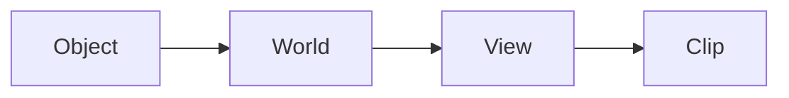

# Authoring Lessons

This page is for people adding or editing content. It documents the contract the
runtime enforces, the conventions the existing lessons follow, and the tests that
catch drift. The content is managed in Pages CMS (`.pages.yml`), but every page
is a plain Markdown file under `content/en/docs/`.

## Where content lives

| Kind | Directory | URL |
| --- | --- | --- |
| Docs | `content/en/docs/*.md` | `/docs/<slug>` |

The slug is the filename without `.md`. The relative path is the translation
key: `docs/shader-editor.md` and `pt-BR/docs/shader-editor.md` describe the same
page. English is the only authored locale for now; an untranslated page falls
back to English with a notice.

## Frontmatter

Every page starts with YAML frontmatter. Only `title` and `section` are required.

```yaml
---
title: First Shaders in the Sandbox
description: UVs, gradients, shapes and time in the 2D Sandbox.
section: lessons
order: 1
difficulty: beginner
prerequisites: gles-3-0-webgl2, math-for-shaders
editor: sandbox
example: uv
printable: false
draft: false
---
```

| Key | Type | Meaning |
| --- | --- | --- |
| `title` | string | Page title and tree label. |
| `description` | string | Summary for the header, search and future SEO. |
| `section` | enum | Section id; must match `SECTIONS` in `contentTrees.ts` and `.pages.yml`. |
| `order` | number | Position inside the section. Lower first. |
| `difficulty` | `beginner` / `intermediate` / `advanced` | Badge and learning-path grouping. Omit for reference pages. |
| `prerequisites` | comma-separated slugs | Linked from the learning path. |
| `editor` | `editor` / `sandbox` / `screen-space` | Renders the "Open in editor" callout. |
| `example` | string | Bundled example id the callout loads. Required when `editor` is set. |
| `printable` | boolean | Enables the print layout and the Print button. |
| `generated` | boolean | Set only by `npm run docs:abi`; do not edit by hand. |
| `draft` | boolean | Unpublished pages are hidden in production. English drafts are visible in `npm run dev`. |

Every key above is declared in `.pages.yml` for both locales. If you add a key,
add it to the two collections as well, otherwise the CMS cannot edit it.

### Section ids

Docs: `editors`, `guides`, `reference`, `api`, `basics`, `math`, `glsl`,
`lessons`, `lighting`, `post`, `debugging`, `webgl`.

The labels live in `src/core/content/contentTrees.ts`. A section that is not
listed there still renders, but at the end with its raw id; add it to both
places instead.

## The lesson template

Every lesson uses the same shape:

1. **Goal** — one paragraph, what the reader can do afterwards.
2. **Before you start** — the prerequisites, linked.
3. **Concept** — a few paragraphs, with a Mermaid diagram when it helps.
4. **Minimal annotated code** — one runnable block, not ten fragments.
5. **Open in editor** — provided by the frontmatter callout; mention the example
   id in prose if it helps.
6. **Expected result** — a screenshot under `public/images/content/lessons/`,
   with a sentence describing what changes when a parameter moves.
7. **Exercises** — two or three, each with a hint and a collapsible solution.
8. **Common mistakes** — the mistakes the diagnostics panel or the maths makes
   likely.
9. **Next** — the next lesson and one or two related references.

The previous/next pager at the bottom is generated from the tree order; do not
hard-code it.

## Code fences

The renderer adds a Copy button to every fenced code block. A complete runnable
snippet can add a Run button with an info-string modifier:

````markdown
```glsl title="UV as colour"
#version 300 es
...
```
````

| Modifier | Effect |
| --- | --- |
| `run=sandbox` | **Run this** opens `/sandbox?code=<encoded source>`. |
| `run=screen-space` | **Open in Screen Space** opens `/screen-space?code=<encoded source>`. |
| `example=<id>` | **Open in editor** opens the bundled example, without sending the snippet. |
| `effect=<id>` | **Open post effect** opens `/editor?effect=<id>` (or `/sandbox?effect=` with `run=sandbox`). |
| `title="…"` | Visible title in the code-block toolbar. |

Use `run=sandbox` only for a complete fragment that targets the sandbox ABI
(`vUv`, `uResolution`, `uTime`, `fragColor`). A partial snippet would fail to
compile after the user clicks Run; use `example=` or a plain fence instead.

The `example` id must exist in the matching registry:

- `run=sandbox` / `example=` on a sandbox page → `sandboxExamples`.
- `run=editor` / `example=` on a 3D page → `shaderExamples`.
- `run=screen-space` / `example=` on a screen-space page → `screenSpaceExamples`.
- `effect=` → `postEffectExamples`.

The link test (`src/core/content/lessonLinks.test.ts`) reads every content file,
parses the frontmatter and the fences, and fails on an unknown id. The same test
checks frontmatter `editor` + `example` pairs.

## Deep links

The canonical links are:

| Link | What it does |
| --- | --- |
| `/editor?example=phong` | Loads the `phong` material example. |
| `/editor?effect=vignette` | Loads the `vignette` post-effect example. |
| `/sandbox?example=gradient` | Loads the `gradient` sandbox example. |
| `/sandbox?code=<url-encoded>` | Loads an inline sandbox fragment. |
| `/screen-space?example=gbuffer-normal` | Loads a screen-space effect. |
| `/screen-space?code=<url-encoded>` | Loads an inline screen-space effect. |

`src/core/navigation/editorLinks.ts` builds and parses these; the views pass the
query into their composable before the preview initialises, so the first compile
is the requested document.

## Collapsible solutions

Use the `solution` container; it renders a native `<details>` element:

```markdown
::: solution Solution 1
The centre is dark because `length(vUv - 0.5)` is zero there.
:::
```

`note` and `warning` containers render as callouts:

```markdown
::: warning Keep it linear
Do not sRGB-encode inside an effect.
:::
```

The container body is ordinary Markdown, including fenced code. Do not use raw
HTML: `html: false` escapes it.

## Glossary terms

Wrap a term and its definition inline:

```markdown
The [[albedo|the diffuse base colour before lighting]] is multiplied by the
cosine term.
```

This renders as a hoverable `<abbr>`. The [Glossary](/docs/glossary) is a
normal page; keep its list in sync when you add a new term.

## Mermaid

````markdown

````

Diagrams hydrate lazily after the Markdown renders. Keep them small and do not
use external fonts.

## Images

Images live under `public/images/content/` and are referenced with a
root-relative URL:

```markdown

```

Lesson screenshots reuse the preview pipeline:

```bash
npm run docs:images       # regenerate every lesson screenshot
```

The 3D examples are captured from the real editor, the sandbox examples from the
sandbox preview, and the post/G-buffer views from the effect stacks. Do not
commit an image that is not generated by the preview; a screenshot of a mock-up
is not an expected result. If a capture is temporarily impossible, use a clearly
labelled placeholder and replace it once the capture works.

## ABI reference

`content/en/docs/abi-reference.md` is generated from the ABI declarations:

```bash
npm run docs:abi          # write the page
npm run docs:abi:check    # fail if it is out of date
```

`predev`, `prebuild` and `pretest` run the write step. The drift test compares
the committed page with `buildAbiReferenceMarkdown()`; editing the page by hand
will fail the test. Change the relevant `*Abi.ts` declaration instead.

## Test locally

```bash
npm test                  # content, link and ABI drift tests
npm run build             # vue-tsc + production bundle
npm run lint              # eslint
```

The content integration test loads the real `import.meta.glob` source, so a
missing file or malformed frontmatter fails there before the app does.
