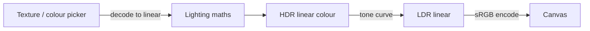

# Colour and Linear Space

## Goal

You should be able to tell whether the numbers in a shader are linear or sRGB,
avoid double-encoding, and explain why a specular highlight can be brighter than
`1.0` without being clipped.

## Two encodings, one colour

An 8-bit image stores values that a display expects. Those values are encoded
with the sRGB transfer function, which spends more bits on dark tones because
the eye is more sensitive there. A middle-grey pixel is around `0.5` in sRGB but
only about `0.21` in linear light.

Linear values are proportional to physical light. That matters because
operations such as addition, multiplication and weighted averages are only
physically meaningful in linear space. Blending two sRGB values gives a
different (and usually wrong) colour than blending the same colours in linear
space and encoding the result.



The conversion is approximately:

```glsl
vec3 toLinear(vec3 srgb)
{
    return pow(srgb, vec3(2.2));
}

vec3 toSrgb(vec3 linearColour)
{
    return pow(linearColour, vec3(1.0 / 2.2));
}
```

The real sRGB curve has a short linear segment near black, which the
approximation ignores. Use the engine's conversion when one exists; use this
pair only when you need to reason about the direction of the conversion.

## HDR is not a colour space

High dynamic range means values are allowed to exceed `1.0`. A lit white surface
might be `1.0`, a specular highlight on it might be `8.0`, and the sun disc might
be `50.0`. An LDR target clamps those to `1.0` and the highlight loses its shape.

The Screen Space editor renders the scene and every effect into floating-point
targets, so the values survive until the display pass. That is why the output
transform exists: it maps a potentially unbounded linear colour into the `[0, 1]`
range the canvas can show.

## Tone mapping

Tone mapping is a curve applied once, after the effect stack:

- **None** is a direct linear-to-sRGB encode. Values above `1.0` clip.
- **Reinhard** maps `x` to `x / (1 + x)`. It never clips, but it desaturates
  bright colours and is easy to outgrow.
- **ACES filmic** is a film-inspired curve with a shoulder and a toe. It is the
  default in the Screen Space editor because it keeps highlights readable.

Two rules follow:

1. **Do not tone map inside an effect** unless the output transform is set to
   **None**. Two curves make the image muddy and crush the highlights.
2. **Do not sRGB-encode inside an effect.** The display pass already does it.

Debug views are an exception only in the sense that they skip the effect stack;
they still go through the display pass, so they are encoded exactly once.

## Working with colour uniforms

The User data colour picker shows a hex value, which is an sRGB encoding. The
generated uniform receives a linear value (the engine converts it), so a shader
can multiply it directly by light. If you hard-code a colour in GLSL, treat the
numbers as linear:

```glsl
// A linear albedo, not a hex code.
vec3 albedo = vec3(0.72, 0.31, 0.22);
```

If you want a specific sRGB swatch, convert it once:

```glsl
vec3 srgb = vec3(0.83, 0.39, 0.28);
vec3 linearAlbedo = pow(srgb, vec3(2.2));
```

## Gamma in the sandbox

The 2D Sandbox displays the fragment output directly. It has no scene lighting
and no HDR target, so its default pipeline is LDR. If you copy a lighting
snippet into the sandbox and it looks too bright or too dark, compare the two
pipelines before changing the maths: the sandbox is not applying the same
output transform as the 3D editor.

## Exercises

1. Render a vertical ramp with `fragColor = vec4(vec3(vUv.y), 1.0)` in the
   sandbox. Then render `vec3(pow(vUv.y, 2.2))`. Which one looks like a smooth
   perceptual ramp?
2. Take the gradient example and multiply the final colour by `2.0`. In the
   sandbox the top of the ramp clips; in the Screen Space editor an ACES
   transform would roll it off. Explain the difference.
3. Set the Screen Space output transform to **None** and add
   `color = pow(color, vec3(1.0 / 2.2));` to an effect. What happens to the
   image, and why?

::: solution Solution 1
The first ramp is the sRGB encoding. The second one applies the decode curve a
second time, so it looks too dark in the midtones. If you want a linear ramp
displayed correctly, encode the final value once.
:::

::: solution Solution 2
The sandbox writes LDR. Multiplying by `2.0` clamps everything above `1.0` to
white, flattening the top of the ramp. ACES compresses instead of clipping, so
the top keeps some separation.
:::

::: solution Solution 3
The effect encodes to sRGB, and the display pass encodes again. The image becomes
washed out, with lifted blacks and compressed highlights. Remove one of the two
encodes.
:::

## Common mistakes

- Applying `pow(1.0 / 2.2)` in an effect while the display transform is active.
- Treating a hex colour as linear and multiplying it by light.
- Expecting an LDR target to preserve highlights above `1.0`.
- Using **None** with a very bright HDR scene and assuming the shader is broken;
  the highlights are clipping, not disappearing.

## Next

- [GLSL ES 3.00](/docs/gles-3-0-webgl2)
- [The Screen Space editor](/docs/screen-space-editor)
- [Post-processing lessons](/docs/post-processing)
