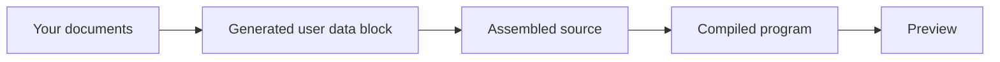

# Editors Overview

ShaderForge is a browser-based GLSL workbench. It has three editing screens: the
**3D Shader Editor**, the **2D Sandbox** and the **Screen Space GLSL Editor**.
They share the same code editor, compile pipeline and data panels, but they
answer different questions.

This page explains which screen to open and what all three have in common. Each
editor also has its own reference page.

## The three screens

| Screen | URL | What you write | Renderer | Pick it when |
| --- | --- | --- | --- | --- |
| 3D Shader Editor | `/editor` | A vertex and fragment pair for a surface | Babylon.js | You want a material on a model, with lighting and image-based reflections |
| 2D Sandbox | `/sandbox` | One fragment shader that fills the viewport | WebGL 2 | You want to experiment with pixels, patterns or raymarching without a scene |
| Screen Space GLSL Editor | `/screen-space` | A chain of post-effect fragments over a whole scene | Babylon.js | You want to post-process a scene and read its HDR colour and G-buffer |

The Screen Space editor is a separate scene pipeline, not the 3D editor with a
different tab selected. It loads a whole GLB scene, renders it with a
first-person camera, builds an MRT G-buffer and exposes attachments the surface
post-effect ABI does not have.

## Which screen should I use?

- **"I want to shade a model."** Open the [3D Shader Editor](/docs/3d-editor).
  You get a vertex stage, a fragment stage, a switchable mesh and an HDR
  environment.
- **"I want a fullscreen image with no setup."** Open the
  [2D Sandbox](/docs/2d-sandbox). One fragment document, one fullscreen
  triangle, three engine inputs.
- **"I want depth, normal, outline or SSAO effects over a scene."** Open the
  [Screen Space GLSL Editor](/docs/screen-space-editor). It exposes the scene
  colour, depth, normals, albedo, material and motion vectors.
- **"I am learning GLSL."** Start in the 2D Sandbox: there is no mesh, camera
  or lighting to manage. Move to the 3D editor when you want attributes,
  varyings and a surface, then to the Screen Space editor for G-buffer work. The
  [Learning Path](/docs/learning-path) orders the lessons.

## What they share

All three screens use the same left-to-right model:

- **Documents on the left.** Text tabs are backed by CodeMirror with GLSL
  syntax highlighting and compiler diagnostics. The 3D editor also has
  read-only **Attributes** and **Uniforms** reference documents and a structured
  **User data** table.
- **A live preview on the right.** The preview re-renders continuously; time is
  an input to your shader.
- **A Compile button.** Editing does not compile automatically. The button
  compiles the document family of the active tab.
- **User data.** A table of uniforms and textures that the app declares and
  binds for you. The same panel is used in all three editors, with a smaller set
  of kinds in the sandbox and post-only definitions in the screen-space editor.
- **Post effects.** An ordered chain of fullscreen fragment passes with an
  output transform at the end. The 3D editor and the sandbox share the surface
  post-effect ABI; the screen-space editor has its own G-buffer ABI.
- **A status bar and an error overlay.** They tell you whether the last compile
  succeeded and where it failed.
- **No save.** Nothing is persisted between page loads.

## Where they differ

| Dimension | 3D Shader Editor | 2D Sandbox | Screen Space |
| --- | --- | --- | --- |
| Editable stages | Vertex and fragment | Fragment only | Post-effect fragments only |
| Geometry | Switchable GLB mesh | Fixed fullscreen triangle | Whole GLB scene |
| Scene inputs | Camera, light, HDR environment, IBL | None | FPS camera, sun and HDRI intensities, full G-buffer |
| Extra inputs | Attributes, matrices, IBL samplers | `vUv`, `uResolution`, `uTime` | HDR scene colour, depth, normal, albedo, material, velocity |
| Examples | Twelve bundled material examples | Five sandbox examples | Seven G-buffer and effect examples |
| Copy source | Yes | No | Yes |
| Wireframe | Yes | No | No |
| Pause | Stops rendering; time keeps running | Freezes rendering and time | Freezes rendering, `time`, frame index and delta time |
| Post geometry | Real normals and depth | Neutral placeholders | Real view-space normals and world-unit depth |

The screen-space depth attachment is in world units; the surface post-effect
depth is normalised to `[0, 1]`. That difference is the reason the two ABIs are
separate.

## How an edit becomes an image

At compile time the app inserts the generated user-data declarations into your
source, compiles the result with the browser's WebGL 2 driver, and keeps the
resulting program. If a compile fails, the previous program stays on screen so
the preview does not go blank.

## Requirements

- A browser with **WebGL 2** enabled: current Chrome/Edge, current Firefox, or
  Safari 15+. There is no WebGL 1 fallback.
- Hardware acceleration enabled in the browser. A software renderer works but is
  slow.
- No installation, account or project file. Everything runs in the page.

## Next steps

- [Learning Path](/docs/learning-path)
- [3D Shader Editor](/docs/3d-editor)
- [2D Sandbox](/docs/2d-sandbox)
- [Screen Space GLSL Editor](/docs/screen-space-editor)
- [User data](/docs/user-data)
- [Post effects](/docs/post-effects)
- [ABI Reference](/docs/abi-reference)
- [Compiling and errors](/docs/compiling-and-errors)
- [Limits and troubleshooting](/docs/limits-and-troubleshooting)
- [The rendering pipeline](/docs/the-rendering-pipeline)
