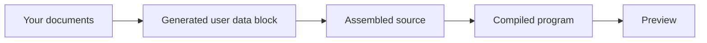

# Editors Overview

ShaderForge is a browser-based GLSL workbench. It has three editing screens
built on two renderers: the **3D Shader Editor**, the **2D Sandbox** and the
**Screen Space** editor. They share the same code editor, compile pipeline and
data panels, but they answer different questions.

This page explains which screen to open and what all three have in common. The
3D editor and the sandbox also have their own reference pages.

## The three screens

| Screen             | URL              | What you write                              | Renderer    | Pick it when                                                          |
| ------------------ | ---------------- | ------------------------------------------- | ----------- | --------------------------------------------------------------------- |
| 3D Shader Editor   | `/editor`        | A vertex and fragment pair for a surface    | Babylon.js  | You want a material on a model, with lighting and image-based reflections |
| 2D Sandbox         | `/sandbox`       | One fragment shader that fills the viewport | WebGL 2     | You want to experiment with pixels, patterns or raymarching without a scene |
| Screen Space       | `/screen-space`  | A chain of post-effect fragments            | Babylon.js  | You want to post-process a 3D scene and read its normals and depth    |

Screen Space is not a separate renderer. It opens the 3D Shader Editor on its
**Post effect** document instead of the fragment stage.

## Which screen should I use?

- **"I want to shade a model."** Open the [3D Shader Editor](/docs/3d-editor).
  You get a vertex stage, a fragment stage, a switchable mesh and an HDR
  environment.
- **"I want a fullscreen image with no setup."** Open the
  [2D Sandbox](/docs/2d-sandbox). One fragment document, one fullscreen
  triangle, three engine inputs.
- **"I want bloom, grading, outlines or depth effects over a scene."** Open the
  Screen Space editor. It starts on the post-effect document, where the scene's
  colour, normals and depth are available.
- **"I am learning GLSL."** Start in the 2D Sandbox: there is no mesh, camera
  or lighting to manage. Move to the 3D editor when you want attributes,
  varyings and a surface.

## What they share

All three screens use the same left-to-right model:

- **Documents on the left.** Text tabs are backed by CodeMirror with GLSL
  syntax highlighting and compiler diagnostics. The 3D editor also has
  read-only **Attributes** and **Uniforms** reference documents and a structured
  **User data** table.
- **A live preview on the right.** The preview re-renders continuously; time is
  an input to your shader.
- **A Compile button.** Editing does not compile automatically. The button
  compiles the document family of the active tab.
- **User data.** A table of uniforms and textures that the app declares and
  binds for you. The same panel is used in both editors, with a smaller set of
  kinds in the sandbox.
- **Post effects.** An ordered chain of fullscreen fragment passes with an
  output transform at the end. Both editors use the same stack and the same
  post-effect ABI.
- **A status bar and an error overlay.** They tell you whether the last compile
  succeeded and where it failed.
- **No save.** Nothing is persisted between page loads.

## Where they differ

| Dimension        | 3D Shader Editor                    | 2D Sandbox                        |
| ---------------- | ----------------------------------- | --------------------------------- |
| Editable stages  | Vertex and fragment                 | Fragment only                     |
| Geometry         | Switchable GLB mesh                 | Fixed fullscreen triangle         |
| Scene inputs     | Camera, light, HDR environment, IBL | None                              |
| Extra inputs     | Attributes, matrices, IBL samplers  | `vUv`, `uResolution`, `uTime`     |
| Examples         | Seven bundled examples              | None                              |
| Copy source      | Yes                                 | No                                |
| Wireframe        | Yes                                 | No                                |
| Pause            | Stops rendering; time keeps running | Freezes rendering and time        |
| Post geometry    | Real normals and depth              | Neutral placeholders              |

The Screen Space editor behaves like the 3D editor in every row except that it
opens on the post-effect document.

## How an edit becomes an image

At compile time the app inserts the generated user-data declarations into your
source, compiles the result with the browser's WebGL 2 driver, and keeps the
resulting program. If a compile fails, the previous program stays on screen so
the preview does not go blank.

## Requirements

- A browser with **WebGL 2** enabled. There is no WebGL 1 fallback.
- Hardware acceleration enabled in the browser. A software renderer works but is
  slow.
- No installation, account or project file. Everything runs in the page.

## Words used in these pages

| Term          | Meaning                                                                 |
| ------------- | ----------------------------------------------------------------------- |
| Stage         | One shader program part: vertex or fragment.                            |
| Vertex shader | Runs once per vertex; positions geometry and passes data onward.        |
| Fragment shader | Runs once per pixel (or sample); computes the output colour.          |
| Attribute     | Per-vertex input supplied by the mesh, such as position or UV.          |
| Varying       | A value passed from the vertex stage to the fragment stage.             |
| Uniform       | A value that is constant for a draw call, such as time or a matrix.     |
| Sampler       | A uniform that reads a texture.                                         |
| ABI           | The set of names and types the engine guarantees to bind.               |
| Pass          | One fullscreen draw in the post-effect chain.                           |
| Tonemap       | The curve that maps linear colour to displayable colour.                |
| IBL           | Image-based lighting: using an environment map for diffuse and specular light. |

## Next steps

- [3D Shader Editor](/docs/3d-editor)
- [2D Sandbox](/docs/2d-sandbox)
- [User data](/docs/user-data)
- [Post effects](/docs/post-effects)
- [Compiling and errors](/docs/compiling-and-errors)
- [Limits and troubleshooting](/docs/limits-and-troubleshooting)
- [The rendering pipeline](/knowledge/the-rendering-pipeline)
