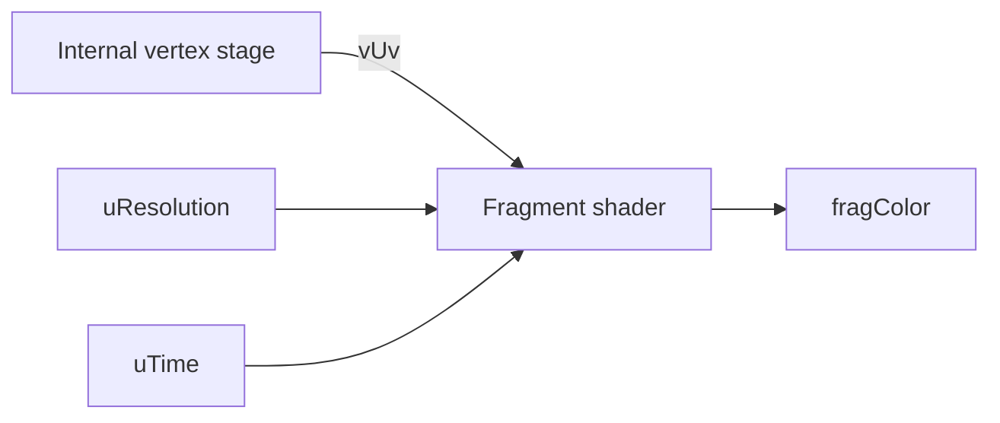

# First Shaders in the Sandbox

## Goal

Write and run a fragment shader that fills the screen. By the end you should be
comfortable with `vUv`, `uResolution`, `uTime`, `mix`, `smoothstep`, `step` and
`fract`, and you should have a mental model of a fragment shader as a function
from a pixel to a colour.

## Before you start

Read [GLSL ES 3.00](/docs/gles-3-0-webgl2) first. You need to recognise
`#version`, `precision`, `in`, `uniform` and the explicit fragment output.

## The fragment shader is a function of position

The sandbox draws one fullscreen triangle. For every pixel it covers, the
fragment shader runs `main`. The only per-pixel position you get is `vUv`, a
`vec2` that goes from `(0, 0)` at the bottom-left to `(1, 1)` at the top-right.



`vUv` is already normalised, so it is resolution independent. `uResolution` is
the drawing-buffer size in pixels, useful when you need the aspect ratio.
`uTime` is elapsed seconds and freezes when the preview is paused.

## UVs as colour

The smallest useful shader writes the UV straight to RGB:

```glsl run=sandbox title="UV as colour"
#version 300 es
precision highp float;

in vec2 vUv;
uniform vec2 uResolution;
uniform float uTime;

out vec4 fragColor;

void main(void)
{
    fragColor = vec4(vUv.x, vUv.y, 0.5, 1.0);
}
```

Red grows to the right, green grows upward, blue is constant. Once you can read
position from colour, you can debug almost anything.

## Gradients with mix

`mix(a, b, t)` interpolates between two values. `smoothstep(e0, e1, x)` produces
a smooth `0..1` ramp, which makes the transition softer than a linear `t`:

```glsl run=sandbox title="Gradient"
#version 300 es
precision highp float;

in vec2 vUv;
uniform vec2 uResolution;
uniform float uTime;

out vec4 fragColor;

void main(void)
{
    vec3 deepBlue = vec3(0.05, 0.08, 0.22);
    vec3 hotPink = vec3(0.95, 0.25, 0.55);

    float ramp = dot(vUv, normalize(vec2(1.0, 1.0)));
    vec3 color = mix(deepBlue, hotPink, smoothstep(0.1, 0.9, ramp));

    fragColor = vec4(color, 1.0);
}
```

## Shapes with step and distance

A shape is a test. `step(edge, x)` returns `1` when `x >= edge` and `0`
otherwise. A circle is "distance from the centre is less than the radius":

```glsl
vec2 p = (vUv - 0.5) * vec2(uResolution.x / uResolution.y, 1.0);
float distanceToCentre = length(p);
float inside = step(distanceToCentre, 0.3);
```

`step(edge, x)` is easy to read backwards. It is `x >= edge`, not `edge >= x`.
For a circle, write `1.0 - step(0.3, distanceToCentre)` if you prefer the
radius on the edge side.

For a soft edge, use `smoothstep(radius, radius - width, distance)`; the
reversed edges make the transition go from `0` outside to `1` inside.

## Time

`uTime` is in seconds. Multiply it by a speed and add it inside `sin`:

```glsl
float pulse = 0.5 + 0.5 * sin(uTime * 2.0);
```

`sin` returns `[-1, 1]`, so `0.5 + 0.5 * sin(...)` maps it to `[0, 1]`.
If you want a loop that repeats every second, use `fract(uTime)`.

## Tilings with fract

`fract(x)` is the fractional part. Multiply the UV first to choose the number of
cells, then take the fractional part to get a local coordinate that repeats:

```glsl
vec2 tiled = fract(vUv * 8.0);   // 8 cells across, local uv in [0, 1)
```

`floor(vUv * 8.0)` gives the integer cell index, which is how the pattern example
alternates colours.

## The editor is connected to these lessons

The **Open in editor** callout at the top of this page loads the `uv` example.
Use the **Run this** button on any complete snippet below to open the sandbox
with that source. The docs and the app share the same example ids, and a test
fails if a link points at an id that does not exist.

## Expected result


The image is the sandbox's first example. It is static except for the blue
channel, which pulses with `uTime`.

## Exercises

1. Swap the red and green channels in the first snippet. Which corner becomes
   yellow?
2. Make the gradient radial instead of diagonal: use `length(vUv - 0.5)` as the
   `smoothstep` input.
3. Draw a circle and animate its radius with `0.2 + 0.1 * sin(uTime)`.
4. Multiply the UV by `4.0` before `fract` and describe how many repeats you
   see.

::: solution Solution 1
`vec4(vUv.y, vUv.x, 0.5, 1.0)`. The top-left corner is `(0, 1)`, so green is the
largest there; the bottom-right is `(1, 0)`, so red wins.
:::

::: solution Solution 2
```glsl
float ramp = length(vUv - 0.5) * 2.0;
vec3 color = mix(hotPink, deepBlue, smoothstep(0.2, 1.0, ramp));
```
The centre is the dark end and the edges are pink.
:::

::: solution Solution 3
```glsl
vec2 p = (vUv - 0.5) * vec2(uResolution.x / uResolution.y, 1.0);
float radius = 0.2 + 0.1 * sin(uTime);
float circle = 1.0 - smoothstep(radius, radius + 0.01, length(p));
fragColor = vec4(vec3(circle), 1.0);
```
:::

::: solution Solution 4
Four repeats across and four down, because the tiled coordinate is
`fract(vUv * 4.0)`.
:::

## Common mistakes

- Treating `vUv` as pixels. It is normalised; use `uResolution` for pixels.
- Forgetting the aspect-ratio correction: a circle becomes an ellipse in a wide
  viewport without `p.x *= uResolution.x / uResolution.y`.
- Using `step(x, edge)` and getting the opposite shape.
- Animating with wall-clock milliseconds instead of `uTime` seconds.
- Declaring `uTime` in the User data tab: it is already provided by the ABI.

## Next

- [Patterns, noise and SDFs](/docs/patterns-noise-sdf)
- [Built-in functions](/docs/built-in-functions)
- [The 2D Sandbox reference](/docs/2d-sandbox)
