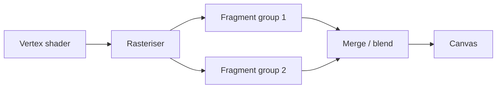

# Performance Basics

## Goal

Build a useful mental model of GPU execution, identify the usual bottlenecks,
and know which preview controls measure the cost instead of guessing.

## The execution model

A GPU runs a fragment shader for many pixels at once, in groups (often called
wavefronts or warps). The group executes in lockstep: every lane runs the same
instruction, with different data. That model explains most performance advice.



- **The fragment shader runs per covered pixel**, not per object. A fullscreen
  pass pays for every pixel of the drawing buffer.
- **Divergence is expensive.** If half a group takes an `if` branch and half does
  not, the group usually executes both paths and masks the result.
- **Memory latency is hidden by parallelism.** Texture fetches are not
  automatically slow, but a dependent chain of fetches stalls a whole group.

## Branching

Prefer arithmetic over branching when the branch is per-pixel and unpredictable:

```glsl
// Both sides are cheap, so this is usually the better form.
float inside = step(distance, radius);

// A per-pixel branch that diverges within a group.
if (distance < radius) {
    color = insideColor;
} else {
    color = outsideColor;
}
```

Branches are still useful when one side is expensive and the condition is
spatially coherent (a whole region of the screen takes the same path), or when
the branch is uniform for the whole draw. A loop bound that is constant and
small is preferable to a uniform-controlled loop; the compiler can unroll it.

## Texture fetches

- A fetch is fast when it hits the cache; neighbouring pixels usually read
  neighbouring texels, which is the good case.
- Each additional tap in a loop multiplies the bandwidth. A 12-tap SSAO is 12
  fetches per pixel; at 1600×1000 that is 19 million fetches per frame.
- Mipmapped sampling is cheaper and better filtered than `textureLod(..., 0)`
  in a minified region. Let the GPU choose.
- Avoid sampling a texture inside a loop with a UV that depends on the previous
  fetch; that serialises the group.

## Precision

`highp` is the default here and is what positions and normals need. `mediump`
can be faster on some mobile GPUs, but this app targets desktop WebGL 2, where
the difference is usually small. Do not trade correctness for a precision
change you cannot measure.

## Overdraw and fill rate

Overdraw is the same pixel shaded more than once: layered transparent surfaces,
large overlapping quads, or a fullscreen pass after a scene that already filled
the screen. Every fullscreen post effect is a new layer of overdraw.

The Screen Space editor is fill-bound: the G-buffer, the HDR colour target and
every effect pass scale with the pixel count. Two consequences:

- Adding an effect is not free even if it is a passthrough; it is another
  fullscreen draw.
- Reducing the drawing-buffer size is the largest single lever.

## What the editors measure

The Screen Space editor prints an overlay with:

- **FPS** — frames per second.
- **ms / budget** — smoothed frame time against the 16.7 ms target.
- **width×height (scale)** — the current drawing-buffer size and the adaptive
  render scale.
- **draws** — draw calls in the frame.

The editor lowers the render scale when the smoothed frame time misses the
budget and raises it slowly when there is headroom. That keeps interaction
responsive but makes raw frame-time comparisons at different scales misleading.
Read the scale before comparing two shaders.

The 3D editor has no stats overlay. Use the browser's performance tools or the
`?perf` profiler hook if you need timings.

## A practical checklist

1. **Is it the shader or the scene?** Pause the animation; if the frame is still
   slow, the cost is per-frame rendering, not `time`-driven work.
2. **How many passes?** Disable effects one by one from the stack.
3. **How many taps?** Count texture fetches per pixel, including loops.
4. **Is the shader overdrawing?** A fullscreen effect is one full-screen pass by
   definition; several of them add up.
5. **Is the scale changing?** Read the `%` in the stats overlay before drawing
   conclusions.
6. **Is the loop unrollable?** Use a literal bound and a small iteration count.

## Minimal example: the cost of a loop

```glsl run=sandbox title="Loop cost"
#version 300 es
precision highp float;

in vec2 vUv;
uniform vec2 uResolution;
uniform float uTime;

out vec4 fragColor;

void main(void)
{
    vec2 p = vUv - 0.5;
    float sum = 0.0;

    // Twelve evaluations of a cheap function; raise or lower the bound to feel
    // the cost on a large canvas.
    for (int i = 0; i < 12; i++)
    {
        float fi = float(i);
        sum += sin(p.x * (fi + 1.0) + uTime) * cos(p.y * (fi + 1.0));
    }

    fragColor = vec4(vec3(0.5 + 0.5 * sum / 12.0), 1.0);
}
```

## Exercises

1. Raise the loop bound to `64`. Does the sandbox stay smooth at a large canvas?
2. Replace the loop with a branch that skips half the pixels. Is it faster? Why
   might it not be?
3. In the Screen Space editor, disable all effects and read the stats. Re-enable
   them one at a time and compare the frame time.
4. Lower the render scale by shrinking the browser window. How does the frame
   time change?
5. Why is `textureLod(sampler, uv, 0.0)` in a minified region potentially slower
   than `texture(sampler, uv)`?

::: solution Solution 1
The exact answer depends on the GPU, but 64 sines/cosines per pixel is a large
increase. At a large canvas the frame time rises and the adaptive scale may drop.
:::

::: solution Solution 2
Divergent branches do not save the group's time when both paths are taken by
some lanes. A coherent branch (whole regions) can help; a per-pixel pattern often
does not.
:::

::: solution Solution 3
The passthrough is one fullscreen draw; each enabled effect adds another. The
difference is the cost of the extra passes, plus any texture taps.
:::

::: solution Solution 4
Fewer pixels means less fragment work and fewer texture fetches, so frame time
drops and the adaptive scale may rise. It is the same lever the policy uses.
:::

::: solution Solution 5
`textureLod(..., 0.0)` forces the highest-resolution mip even when the GPU would
choose a lower one. It fetches more texels and can thrash the cache, whereas
`texture` selects a suitable mip automatically.
:::

## Common mistakes

- Measuring FPS while the adaptive scale is changing.
- Adding a second fullscreen pass and expecting no cost.
- Using a uniform as a loop bound, preventing unrolling.
- Sampling a 4K texture with `textureLod(..., 0.0)` for a distant surface.
- Optimising a branch that is coherent or cheap.

## Next

- [Debugging shaders](/docs/debugging-shaders)
- [Limits and troubleshooting](/docs/limits-and-troubleshooting)
- [The Screen Space editor](/docs/screen-space-editor)
