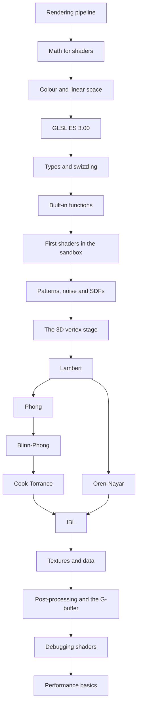

# Learning Path

This is the order the lessons are written for. Each lesson assumes the ones
before it; the frontmatter records the same links, so the tree and the pages
agree. You can jump to a topic, but the lighting series assumes the vertex-stage
lesson and the post-processing lesson assumes the lighting series.

## 1. Foundations

| Lesson | Difficulty | You will learn |
| --- | --- | --- |
| [The Rendering Pipeline](/docs/the-rendering-pipeline) | Beginner | How vertex data becomes pixels. |
| [Math for Shaders](/docs/math-for-shaders) | Beginner | Vectors, dot/cross, matrices, spaces. |
| [Colour and Linear Space](/docs/color-and-linear) | Beginner | sRGB vs linear, HDR, tone mapping. |

## 2. The language

| Lesson | Difficulty | You will learn |
| --- | --- | --- |
| [GLSL ES 3.00](/docs/gles-3-0-webgl2) | Beginner | Qualifiers, precision, control flow, functions. |
| [Types and Swizzling](/docs/data-types) | Beginner | Scalars, vectors, matrices, constructors, swizzles. |
| [Built-in Functions](/docs/built-in-functions) | Beginner | The functions you will use every day. |
| [Cheat Sheet](/docs/cheat-sheet) | Beginner | A printable reference for the syntax. |

## 3. The 2D sandbox

| Lesson | Difficulty | You will learn |
| --- | --- | --- |
| [First Shaders in the Sandbox](/docs/first-shaders) | Beginner | UVs, gradients, shapes, time, tiling. |
| [Patterns, Noise and SDFs](/docs/patterns-noise-sdf) | Beginner | Hash, value noise, fBm, signed distance fields. |

The sandbox is the fastest place to iterate. Every snippet marked **Run this**
opens it with the exact source.

## 4. The 3D vertex stage

| Lesson | Difficulty | You will learn |
| --- | --- | --- |
| [The 3D Vertex Stage](/docs/vertex-stage-3d) | Intermediate | MVP, normalMatrix, varyings, displacement. |

## 5. Lighting

| Lesson | Difficulty | You will learn |
| --- | --- | --- |
| [Lambert](/docs/lighting-lambert) | Beginner | Cosine-law diffuse. |
| [Phong](/docs/lighting-phong) | Beginner | Reflection-vector specular. |
| [Blinn-Phong](/docs/lighting-blinn-phong) | Intermediate | Half-vector specular. |
| [Oren-Nayar](/docs/lighting-oren-nayar) | Intermediate | Rough diffuse. |
| [Cook-Torrance](/docs/lighting-cook-torrance) | Advanced | GGX, Smith, Fresnel. |
| [Image-Based Lighting](/docs/lighting-ibl) | Advanced | Irradiance, prefiltering, BRDF LUT. |

The lighting lessons map one-to-one to bundled examples. The **Open in editor**
callout at the top of each lesson loads the matching example.

## 6. Textures and data

| Lesson | Difficulty | You will learn |
| --- | --- | --- |
| [Textures and Data](/docs/textures-and-data) | Intermediate | sampler2D, wrapping, normal maps, cube maps, User data. |

## 7. Screen-space and post-processing

| Lesson | Difficulty | You will learn |
| --- | --- | --- |
| [Post-processing and the G-buffer](/docs/post-processing) | Intermediate | The stack, vignette, blur, outlines, fog, SSAO. |
| [Screen Space GLSL Editor](/docs/screen-space-editor) | Advanced | The whole-scene editor and its HDR pipeline. |
| [ABI Reference](/docs/abi-reference) | Reference | Every name the renderer binds. |

## 8. Debugging and performance

| Lesson | Difficulty | You will learn |
| --- | --- | --- |
| [Debugging Shaders](/docs/debugging-shaders) | Intermediate | Colour-as-printf, isolating terms, the error catalogue. |
| [Performance Basics](/docs/how-the-gpu-executes-shaders) | Intermediate | Branching, fetches, overdraw, adaptive resolution. |

## Which editor should I use?

- **2D Sandbox** — a single fragment, no geometry, no lighting. Best for
  gradients, patterns, noise, SDFs and pure screen-space maths.
- **3D Shader Editor** — a single mesh with a vertex and fragment pair. Best for
  lighting models, normal maps, displacement and environment reflections.
- **Screen Space Editor** — a whole HDR scene with a full G-buffer. Best for
  depth/normal effects, outlines, SSAO, motion vectors and anything that needs
  the original scene colour.

The same GLSL works everywhere the ABI matches, but the data does not. A
screen-space effect that reads `depthTexture` as world units will misbehave in
the surface post-effect tab, where depth is normalised.

## Related

- [Glossary](/docs/glossary)
- [Editors Overview](/docs/editors-overview)
- [Limits and troubleshooting](/docs/limits-and-troubleshooting)
