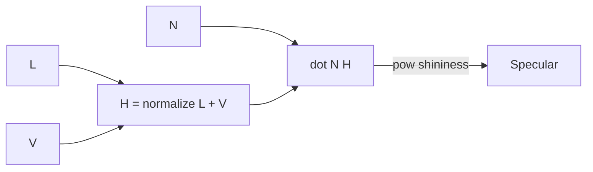

# Lighting: Blinn-Phong

## Goal

Swap Phong's reflection vector for the half vector, explain why the highlight
stays stable at grazing angles, and compare the two lobes.

## The half vector

Blinn's change is small: instead of reflecting the light and comparing it with
the eye, compare the *half vector* between light and eye with the normal:

```glsl
vec3 H = normalize(L + V);
float specular = pow(max(dot(N, H), 0.0), shininess);
```

`H` is the direction a microfacet would need in order to reflect `L` into `V`.
It never leaves the hemisphere around `N` when both `L` and `V` are above the
surface, so the highlight does not vanish at the silhouette the way Phong's
reflection vector can.



## The shader

```glsl run=editor example=blinn-phong title="Blinn-Phong"
#version 300 es
precision highp float;

in vec3 vWorldPosition;
in vec3 vWorldNormal;

uniform vec3 cameraPos;
uniform vec3 lightDir;

layout(location = 0) out vec4 fragColor;

void main(void)
{
    vec3 N = normalize(vWorldNormal);
    vec3 L = normalize(lightDir);
    vec3 V = normalize(cameraPos - vWorldPosition);

    float NdotL = max(dot(N, L), 0.0);
    vec3 H = normalize(L + V);
    float specular = pow(max(dot(N, H), 0.0), shininess);

    vec3 diffuse = albedo * NdotL;
    vec3 highlight = specularColor * specular * NdotL;

    fragColor = vec4(diffuse + highlight, 1.0);
}
```

To match Phong's visual width, use a somewhat larger `shininess`; the two
exponents are not equivalent. The example keeps `48` so the comparison is
direct.

## Expected result


Move the camera around the object: the Blinn-Phong highlight stays on the
surface up to the silhouette, while the Phong highlight can disappear earlier.

## Exercises

1. Set `shininess` to `128` in both the Phong and Blinn-Phong examples. Which
   highlight is tighter?
2. Remove the `NdotL` factor. Does Blinn-Phong stay plausible at the silhouette?
3. Rename `H` to `R` and compare the output with the Phong example. What did
   you change?
4. Normalise `L + V` manually with `length` and compare cost/readability.

::: solution Solution 1
Blinn-Phong's lobe is generally broader for the same exponent; to match Phong's
width you need a larger exponent, but the exact conversion is view-dependent.
:::

::: solution Solution 2
It stays more plausible than Phong because `H` stays in the hemisphere, but the
highlight can still appear on surfaces facing away from the light. The
`NdotL` mask is still the correct fix.
:::

::: solution Solution 3
You replaced the half-vector comparison with a reflection comparison, which is
back to Phong. The `pow` term now uses `dot(R, V)`.
:::

::: solution Solution 4
`vec3 H = (L + V) / length(L + V);` is equivalent and slightly more explicit.
`normalize` is clearer and maps to one instruction on most GPUs.
:::

## Common mistakes

- Forgetting to normalise `L + V`.
- Using the half vector for diffuse lighting.
- Assuming the same exponent gives the same highlight as Phong.
- Negative `L + V` vectors near the horizon; the clamp handles the pow, but the
  lighting is undefined if the eye is below the surface.

## Next

- [Lighting: Oren-Nayar](/docs/lighting-oren-nayar)
- [Lighting: Cook-Torrance](/docs/lighting-cook-torrance)
