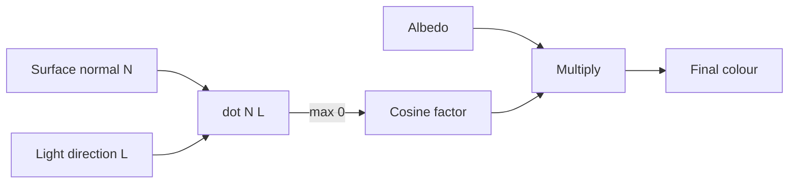

# Lighting: Lambert

## Goal

Implement Lambertian diffuse lighting and explain why `dot(N, L)` is the whole
model for a matte surface.

## The cosine law

A matte surface scatters light equally in every direction, but it receives less
energy when the light hits it at a grazing angle. The ratio is the cosine of the
angle between the surface normal `N` and the direction to the light `L`. For
unit vectors, that cosine is `dot(N, L)`.



`max(..., 0.0)` clamps the back-facing side. Without it, the dark side would get
a negative value and could cancel ambient light.

## The shader

```glsl run=editor example=lambert title="Lambert"
#version 300 es
precision highp float;

in vec3 vWorldNormal;
uniform vec3 lightDir;

layout(location = 0) out vec4 fragColor;

void main(void)
{
    vec3 N = normalize(vWorldNormal);
    vec3 L = normalize(lightDir);

    float NdotL = max(dot(N, L), 0.0);
    vec3 finalColor = albedo * NdotL;

    fragColor = vec4(finalColor, 1.0);
}
```

`albedo` is a User data colour; the example seeds it as a warm terracotta. The
light direction is a world-space direction supplied by the preview, not a
position.

## Expected result


The terminator is smooth and the unlit side is completely black. That hard
black is physically what the model says without an ambient term; the other
models add either ambient or more energy.

## Exercises

1. Add `0.1` to `NdotL` before multiplying by albedo. Why is this no longer
   Lambert, and what does it approximate?
2. Flip the light direction (`-lightDir`). What happens to the terminator?
3. Replace `NdotL` with `smoothstep(0.0, 1.0, NdotL)`. How does the surface
   change?
4. Multiply by a second `dot(N, L)` (i.e. `NdotL * NdotL`). What material does
   that resemble?

::: solution Solution 1
Adding a constant is an ambient term: it lifts the unlit side uniformly. It is
not Lambert because the model now emits light from surfaces facing away from the
source.
:::

::: solution Solution 2
The terminator moves to the other side: what used to face the light is now dark.
:::

::: solution Solution 3
`smoothstep` reshapes the falloff, making the transition softer near the
terminator and flattening the bright side. It is a stylised curve, not a
physical one.
:::

::: solution Solution 4
Squaring the cosine concentrates the response around the light direction, which
resembles a very broad, rough specular lobe rather than diffuse paper.
:::

## Common mistakes

- Forgetting to normalise `N` or `L`.
- Using a light position instead of a light direction.
- Multiplying by `NdotL` twice by accident.
- Expecting ambient light; there is none unless you add it.
- Lighting in object space while the light direction is world space.

## Next

- [Lighting: Phong](/docs/lighting-phong)
- [Lighting: Blinn-Phong](/docs/lighting-blinn-phong)
