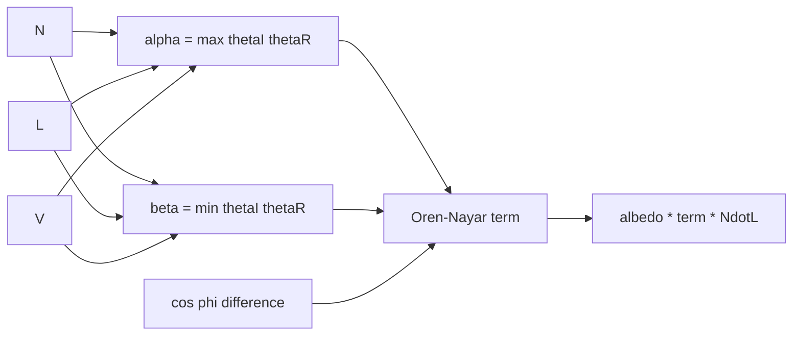

# Lighting: Oren-Nayar

## Goal

Implement the Oren-Nayar rough-diffuse model, explain the `sigma` parameter, and
know when it is worth the extra maths over Lambert.

## Why Lambert is not enough for rough surfaces

Lambert assumes a perfectly matte surface whose brightness depends only on
`dot(N, L)`. Real rough materials (chalk, clay, felt) have V-shaped
microfacets, so one side of a groove can shadow the other and the surface
retro-reflects more when the light and eye are close together. The result is a
view-dependent diffuse term that flattens less at grazing angles.

Oren-Nayar adds two pieces to Lambert:

- A `sigma` parameter for the facet slope, where `0` degenerates to Lambert.
- An azimuth term between the projections of `L` and `V` onto the tangent
  plane, which produces the retro-reflection.



## The shader

```glsl run=editor example=oren-nayar title="Oren-Nayar"
#version 300 es
precision highp float;

in vec3 vWorldPosition;
in vec3 vWorldNormal;

uniform vec3 cameraPos;
uniform vec3 lightDir;

layout(location = 0) out vec4 fragColor;

void main(void)
{
    vec3 N = normalize(vWorldNormal);
    vec3 L = normalize(lightDir);
    vec3 V = normalize(cameraPos - vWorldPosition);

    float NdotL = max(dot(N, L), 0.0);
    float NdotV = max(dot(N, V), 0.0);

    float sigma2 = sigma * sigma;
    float A = 1.0 - 0.5 * sigma2 / (sigma2 + 0.33);
    float B = 0.45 * sigma2 / (sigma2 + 0.09);

    vec3 tangentL = L - N * NdotL;
    vec3 tangentV = V - N * NdotV;
    float cosPhiDiff = 0.0;
    if (dot(tangentL, tangentL) > 1e-8 && dot(tangentV, tangentV) > 1e-8) {
        cosPhiDiff = max(dot(normalize(tangentL), normalize(tangentV)), 0.0);
    }

    float thetaI = acos(clamp(NdotL, 0.0, 1.0));
    float thetaR = acos(clamp(NdotV, 0.0, 1.0));
    float alpha = max(thetaI, thetaR);
    float beta = min(min(thetaI, thetaR), 1.4);

    float orenNayar = A + B * cosPhiDiff * sin(alpha) * tan(beta);
    vec3 finalColor = albedo * orenNayar * NdotL;

    fragColor = vec4(finalColor, 1.0);
}
```

The `tan(beta)` clamp matters: `tan` explodes as the smaller angle approaches
`PI / 2`, and the term is multiplied by a vanishing `NdotL`, so clamping only
removes the spike.

## Expected result


Set `sigma` to `0.0` and the image becomes Lambert. Raise it toward `1.0` and
the terminator softens while the surface brightens when the light is behind the
camera.

## Exercises

1. Set `sigma` to `0.0` and compare the render with the Lambert example.
2. Remove the `tan(beta)` clamp. Where does the image break?
3. Drop the `cosPhiDiff` term (set it to `1.0`). What is lost?
4. Replace `A` and `B` with constants `1.0` and `0.0`. Which model do you get?
5. Which term makes the surface brighter when the light and eye are aligned?

::: solution Solution 1
With `sigma = 0`, `A = 1`, `B = 0`, and the result is exactly `albedo * NdotL`,
i.e. Lambert.
:::

::: solution Solution 2
Near grazing angles, `tan(beta)` approaches infinity and produces fireflies or
NaN. The clamp removes the spike while keeping the term's effect where it is
defined.
:::

::: solution Solution 3
The azimuth-dependent retro-reflection disappears; the surface loses the
view-dependent brightening and behaves like an isotropic rough diffuse.
:::

::: solution Solution 4
`A = 1, B = 0` reduces to Lambert again; Oren-Nayar is a correction on top of
the cosine law.
:::

::: solution Solution 5
The `B * cosPhiDiff * sin(alpha) * tan(beta)` term. It is largest when the light
and view directions are on the same side of the normal.
:::

## Common mistakes

- Forgetting `max(dot(N, V), 0.0)`; `acos` of a negative value is undefined.
- Computing the azimuth without guarding against degenerate tangent vectors.
- Using `sigma` in degrees; it is a slope parameter, not an angle.
- Expecting a specular highlight; Oren-Nayar is diffuse only.
- Forgetting that the light is unit radiance and the final multiply by `NdotL`
  is what makes it a reflection model.

## Next

- [Lighting: Cook-Torrance](/docs/lighting-cook-torrance)
- [Lighting: IBL](/docs/lighting-ibl)
