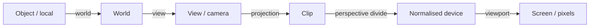

# Math for Shaders

## Goal

By the end of this page you should be able to read a vertex shader that
multiplies a position by three matrices, explain what each matrix does, use a
dot product to answer "how much does this surface face the light?", and use a
cross product to build a tangent frame. You do not need calculus for the lessons
that follow.

## Vectors

A `vec3` is three numbers. In shaders it usually means one of two things:

- **A position** — a point in some space, such as `(0.2, 1.4, -3.0)`.
- **A direction** — an arrow, such as a surface normal or the direction to the
  light. Directions are usually normalised first.

Normalising divides a vector by its length so the result has length `1`:

```glsl
vec3 toLight = normalize(lightPosition - worldPosition);
```

The same three numbers can be either, and mixing the two is one of the most
common sources of confusing results. A normal must never be translated: it has
no position. A position must be transformed by the model matrix; a normal must
use the normal matrix.

## Dot product

`dot(a, b)` is `|a| * |b| * cos(angle)`. For two unit vectors it is simply
`cos(angle)`:

- `1` means the vectors point the same way.
- `0` means they are perpendicular.
- `-1` means they point in opposite directions.

That is why diffuse lighting is one dot product:

```glsl
float NdotL = max(dot(normal, lightDirection), 0.0);
```

`max(..., 0.0)` clamps the back side to darkness. Without it, the unlit side
would receive a negative contribution and darken incorrectly.

The dot product is also useful outside lighting: `dot(uv, normalize(vec2(1.0, 1.0)))`
projects a UV coordinate onto a diagonal ramp, which is how the gradient example
works.

## Cross product

`cross(a, b)` returns a vector perpendicular to both inputs. Its length is the
area of the parallelogram they span. In shaders it is most often used to build
an orthonormal frame:

```glsl
vec3 tangent = normalize(vWorldTangent - normal * dot(normal, vWorldTangent));
vec3 bitangent = cross(normal, tangent);
```

The subtraction removes the part of the tangent that points along the normal
(Gram–Schmidt), and the cross product produces the third axis. Without that
correction, a tangent imported from a mesh may not be exactly perpendicular to
the interpolated normal, and the normal-mapped surface will look skewed.

## Matrices

A `mat4` is a 4×4 grid. In GLSL it multiplies a `vec4` on the left:

```glsl
vec4 clipPosition = projection * view * world * vec4(position, 1.0);
```

Matrix multiplication is not commutative: `A * B` is not `B * A`. The order above
means "model first, then view, then projection", because the rightmost matrix is
applied first to the vector.

### The coordinate spaces



| Space | What the numbers mean | Typical matrix |
| --- | --- | --- |
| Object / local | Relative to the mesh's own origin | — |
| World | Shared scene coordinates | `world` |
| View / camera | Relative to the camera, useful for lighting and depth | `view` |
| Clip | Homogeneous coordinates just before the GPU divides by `w` | `projection * view * world` |
| NDC | `x`/`y` in `[-1, 1]`, `z` in `[-1, 1]` (WebGL) | clip / `w` |
| Screen | Pixels, after the viewport transform | `gl_FragCoord`, textures |

The vertex shader writes clip space to `gl_Position`. Everything after that is
fixed-function. A fragment shader normally receives interpolated world-space or
view-space values, not clip-space ones.

### The normal matrix

Normals are directions, not positions, and a non-uniform scale changes the
direction a surface faces. The normal matrix is the inverse-transpose of the
upper-left 3×3 of the world matrix:

```glsl
vWorldNormal = normalize(normalMatrix * normal); // mat3, not mat4
```

The preview binds it for you. Reusing `mat3(world)` instead is correct only for
uniform scale and no shear.

## Colour

A colour is three (or four) numbers, but it can be stored in two different
encodings:

- **sRGB** — perceptual encoding used by images and by the final canvas. Values
  are not proportional to light.
- **Linear** — values proportional to light. Adding two linear colours is
  physically meaningful; adding two sRGB values is not.

The renderer works in linear space and encodes to sRGB once in the display
pass. That is why a texture sampled with `texture()` is linearised by Babylon
where needed, and why a color uniform is converted before it reaches the shader.

Your main rule: **do maths in linear space, encode once at the end.** The
[Colour and linear space](/docs/color-and-linear) page covers the details,
including HDR and tone mapping.

## Minimal example: a dot-product gradient

The sandbox fragment below turns the dot product into a diagonal shading ramp.
It is the same operation as `NdotL`, just with a UV coordinate instead of a
normal.

```glsl run=sandbox title="Dot-product gradient"
#version 300 es
precision highp float;

in vec2 vUv;
uniform vec2 uResolution;
uniform float uTime;

out vec4 fragColor;

void main(void)
{
    vec2 direction = normalize(vec2(1.0, 1.0));
    float ramp = dot(vUv, direction);      // 0 at the bottom-left, ~1.41 at the top-right
    float shade = smoothstep(0.15, 1.0, ramp);

    vec3 color = mix(vec3(0.05, 0.08, 0.2), vec3(0.95, 0.5, 0.2), shade);
    fragColor = vec4(color, 1.0);
}
```

## Exercises

1. Change `direction` to `normalize(vec2(1.0, -1.0))`. Predict which corner is
   brightest before you run it.
2. Replace `smoothstep` with `step(0.7, ramp)`. What changes, and why does the
   edge become hard?
3. Use `cross(vec3(ramp, 0.0, 0.0), vec3(0.0, ramp, 0.0))` and display the
   result. What is the length of the output at `ramp = 1`?

::: solution Solution 1
The top-left corner becomes the bright end: the dot product is largest where
both components of the direction are positive in the same way.
:::

::: solution Solution 2
`step` returns `0` or `1` immediately at the threshold; `smoothstep` interpolates
over an interval. The hard edge is the point of a step, and it shows aliasing.
:::

::: solution Solution 3
The cross product of those two vectors has length `ramp²`, so the output grows
quadratically. At `ramp = 1` it is `1`.
:::

## Common mistakes

- **Using a position where a direction is expected.** A normal is not a point;
  do not translate it by `world`.
- **Forgetting to normalise.** `dot` is only a cosine when both vectors have
  length `1`.
- **Multiplying matrices in the wrong order.** Read the chain right to left.
- **Doing sRGB maths in a colour picker.** The UI colour is converted for you;
  do not apply gamma twice.

## Next

- [Colour and linear space](/docs/color-and-linear)
- [GLSL ES 3.00](/docs/gles-3-0-webgl2)
- [First shaders in the sandbox](/docs/first-shaders)
