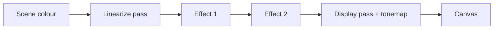

# Post effects

A post effect is a fullscreen fragment pass that runs after the scene has been
rendered. Effects are stacked: each one receives the previous pass's output, and
a final display pass applies the output transform. The 3D Shader Editor and the
2D Sandbox share this surface stack, the ABI and the editor. The
[Screen Space GLSL Editor](/docs/screen-space-editor) has a separate stack with
a richer scene G-buffer.

## The stack

Open the **Post effect** document to edit the selected effect. The panel above
the editor contains the stack:

| Control             | What it does                                                       |
| ------------------- | ------------------------------------------------------------------ |
| Effect name         | Selects that effect for editing.                                   |
| Checkbox            | Enables or disables the effect. Disabled effects are skipped.      |
| **↑** / **↓**       | Moves the effect earlier or later in the chain.                    |
| **×**               | Removes the effect.                                                 |
| **Add effect**      | Appends a new pass-through effect.                                 |
| **Load example**    | Replaces the active effect with a bundled example (vignette, blur, outline, depth fog, SSAO). |
| **Output transform**| Chooses the tonemap applied by the display pass.                   |

There is always at least one effect: removing the last one creates a new effect
with the default pass-through fragment. The first effect is named **Pass
through**; added effects are named **Effect 2**, **Effect 3**, and so on.

List order is execution order. The first effect reads the scene; each later
effect reads the output of the one above it.

## The pipeline



- The scene is rendered to a colour target.
- An internal **linearize** pass converts that colour to linear working space.
- Every enabled effect runs in order, ping-ponging between two targets.
- The **display** pass applies the output transform and encodes to sRGB.
- In the 3D editor, a normal/depth prepass also runs so effects can read the
  scene's view-space normals and linear depth.

Your effect receives linear colour. Do not apply an sRGB encode yourself; the
display pass does it once, at the end.

## The post-effect ABI

### Inputs

| Name                 | Type      | Meaning                                                                 |
| -------------------- | --------- | ----------------------------------------------------------------------- |
| `textureSampler`     | `sampler2D` | Output of the previous pass. The first effect receives the scene.     |
| `gbufferTexture`     | `sampler2D` | `rgb`: view-space normal encoded as `n * 0.5 + 0.5`; `a`: `1` on geometry, `0` on background. |
| `depthTexture`       | `sampler2D` | `r`: linear view depth normalised to the clip range. `0` is the near plane, `1` is the far plane and the background. World units are `cameraNear + r * (cameraFar - cameraNear)`. |
| `resolution`         | `vec2`    | Current render-target size in pixels.                                   |
| `texelSize`          | `vec2`    | `1.0 / resolution`, useful for screen-space taps.                       |
| `time`               | `float`   | Seconds.                                                                |
| `cameraNear`         | `float`   | Near clip plane, in world units.                                        |
| `cameraFar`          | `float`   | Far clip plane, in world units.                                         |
| `cameraPosition`     | `vec3`    | Camera position in world space.                                         |
| `projection`         | `mat4`    | Camera projection matrix.                                               |
| `inverseProjection`  | `mat4`    | Inverse projection, for depth reconstruction.                           |
| `view`               | `mat4`    | World-to-view matrix.                                                   |
| `inverseView`        | `mat4`    | View-to-world matrix.                                                   |

### Varying and output

```glsl
in vec2 vUV;
layout(location = 0) out vec4 fragColor;
```

`vUV` is the normalised screen coordinate, `(0, 0)` bottom-left to `(1, 1)`
top-right. Write linear colour to `fragColor`; keep alpha at `1.0`.

As with every engine input, declare the names you use. An effect that does not
mention `depthTexture` does not need to declare it.

## Tonemap

The **Output transform** runs after the last effect:

| Option                  | Behaviour                                                        |
| ----------------------- | ---------------------------------------------------------------- |
| **None (linear to sRGB)** | No curve; linear colour is clamped and encoded to sRGB.        |
| **Reinhard**            | `color / (1 + color)` per channel.                               |
| **ACES filmic**         | ACES approximation with a filmic shoulder.                       |

Changing the transform does not recompile the chain: the display pass reads the
mode as a uniform. It changes the look of the final image after every effect,
because the effects work in linear space before the transform.

## 3D editor vs 2D Sandbox

Both editors use the same stack and the same shader ABI, but the sandbox has no
geometry to derive normals or depth from. It supplies neutral placeholders:

| Input                          | 3D editor                  | 2D Sandbox                    |
| ------------------------------ | -------------------------- | ----------------------------- |
| `textureSampler`               | Previous pass              | Previous pass                 |
| `gbufferTexture`               | Real view-space normals    | 1×1 neutral normal            |
| `depthTexture`                 | Real normalised view depth | 1×1 neutral depth             |
| `cameraNear` / `cameraFar`     | Real clip planes           | `0` / `1`                     |
| `projection` and friends       | Real camera matrices       | Identity                      |
| `resolution`, `texelSize`, `time` | Real                    | Real                          |

Consequence: effects that read `gbufferTexture`, `depthTexture` or the camera
matrices have nothing meaningful to read in the sandbox and look like no-ops.
Effects that only use `textureSampler`, `resolution`, `texelSize`, `time` and
your own uniforms behave the same in both editors.

## User data in post effects

A User data definition must target **Post** to appear in every post-effect pass.
In the sandbox, **All** also reaches post effects. In the 3D editor, **All**
means vertex and fragment only; it does **not** reach post effects. See
[User data](/docs/user-data).

## Compiling the chain

- Adding, removing, moving, enabling or disabling an effect recompiles the whole
  chain.
- Selecting an effect or changing the output transform does not recompile.
- The chain is compiled atomically: if any pass fails, the previous chain keeps
  rendering. The error panel names the failing effect and its stage.
- Editing an effect's fragment does not compile automatically; press
  **Compile** while the Post effect document is active.

## Screen-space effects are different

The Screen Space editor's effects run over a whole scene and expose the original
HDR scene colour plus depth, normal, albedo, material and velocity attachments.
The surface ABI above has only `textureSampler`, `gbufferTexture` and a
normalised `depthTexture`. A screen-space effect that reads `depthTexture` as
world units will be wrong in the surface tab, and a surface effect that expects
normalised depth will be wrong here.

Use the Screen Space editor for depth/normal outlines, SSAO, motion vectors and
anything that needs the untouched scene colour. The complete name list for both
contracts is in the generated [ABI Reference](/docs/abi-reference).

## A grayscale and vignette effect

This fragment works in both editors and uses only inputs that are meaningful in
the sandbox:

```glsl run=sandbox title="Grayscale + vignette"
#version 300 es
precision highp float;

in vec2 vUV;

uniform sampler2D textureSampler;

layout(location = 0) out vec4 fragColor;

void main(void)
{
    vec3 color = texture(textureSampler, vUV).rgb;

    float luma = dot(color, vec3(0.2126, 0.7152, 0.0722));

    vec2 p = vUV * 2.0 - 1.0;
    float vignette = 1.0 - 0.35 * dot(p, p);

    fragColor = vec4(vec3(luma) * vignette, 1.0);
}
```

For a blur, sample `textureSampler` at offsets scaled by `texelSize`, not by a
fixed number of UV units, so the effect keeps the same radius at every pane
size.

## Pitfalls

- **The chain is in linear space.** Encoding to sRGB inside an effect
  double-encodes the image when the display pass runs.
- **Alpha should stay at `1.0`.** The canvas is opaque; unusual alpha makes
  later passes and the display pass unpredictable.
- **Order matters.** A blur before a threshold is not the same effect as a
  threshold before a blur.
- **Disabled effects are removed from the compiled chain**, so their uniforms
  and textures are not bound while they are off.
- **Depth and normals are view-space.** Do not treat `gbufferTexture.rgb` as a
  world-space normal.
- **The sandbox has no geometry.** A depth-based outline will not work there.

## Related

- [3D Shader Editor](/docs/3d-editor)
- [2D Sandbox](/docs/2d-sandbox)
- [User data](/docs/user-data)
- [Compiling and errors](/docs/compiling-and-errors)
