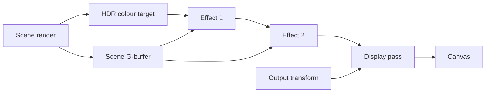
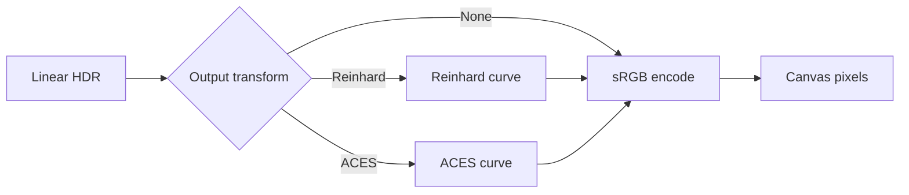

# Screen Space GLSL Editor

The Screen Space GLSL Editor is the scene-wide workbench. Instead of shading a
single mesh, you write the fragment stage of one or more fullscreen passes that
run after a complete PBR scene has been rendered. That makes it the right editor
for effects that need the whole image or the scene's geometry data: outlines,
SSAO, depth fog, bloom-style blur chains, G-buffer visualisers and anything that
reprojects between frames.

The 3D Shader Editor's **Post effect** tab also spans the screen, but it only
sees one mesh and an LDR colour image. This editor sees the original HDR scene,
a separate G-buffer, and the view/projection history that temporal effects need.

## What is on screen

| Region | What it does |
| --- | --- |
| **Post effect** tab | The effect stack and the editor for the selected effect's fragment. |
| **User data** tab | Declares uniforms and textures for the `post` stage. The generated block is injected into every effect pass. |
| **G-Buffer** tab | Switches the viewport to a raw attachment and lists the exact attachment contract. |
| **Scene** and **Environment** menus | Load a whole GLB scene and an HDRI. Both are fixed catalogues. |
| **Compile** | Compiles the whole stack atomically. A failure keeps the previous chain on screen. |
| **Pause** | Stops the render loop. `time`, `frameIndex` and `deltaTime` stop advancing while paused. |
| **Lighting overlay** | Sun and HDRI intensity sliders. They change the render, not your effect source. |
| **Stats overlay** | FPS, frame time versus the 16.7 ms budget, drawing-buffer size, draw calls and the adaptive render scale. |

## The pipeline



The scene renders once. The opaque colour goes to an HDR target, and the
requested attachments go to the G-buffer in one MRT pass. Each effect pass reads
the previous pass in `textureSampler` (the first effect reads the HDR scene),
and it may also read `sceneColorTexture` for the untouched original. The display
pass applies the output transform and then the sRGB encode exactly once.

The attachments are requested only when a compiled effect actually reads them,
plus whatever the active debug view needs. A passthrough effect therefore costs
a plain colour target, not a full G-buffer.

## The G-buffer attachments

Every attachment is a `sampler2D` and arrives in linear space. The encodings are
part of the contract; decode them before doing maths.

| Sampler | Encoding | Decode |
| --- | --- | --- |
| `textureSampler` | Output of the previous pass. For the first effect, the HDR scene colour. | already linear |
| `sceneColorTexture` | The original HDR scene colour, independent of the stack. | already linear |
| `depthTexture` | Linear view-space depth in world units in `r`. Background is the far plane. | `worldZ = depth` |
| `normalTexture` | View-space normal `n * 0.5 + 0.5` in `rgb`; `a` is the geometry mask. | `n = normalize(rgb * 2.0 - 1.0)` |
| `albedoTexture` | `sqrt`-encoded linear base colour in `rgb`; `a` is the geometry mask. | `albedo = rgb * rgb` |
| `materialTexture` | PBR reflectivity: `rgb` = specular F0, `a` = glossiness (`1 - roughness`). | `roughness = 1 - a`; metallic from F0 vs albedo |
| `velocityTexture` | Linear UV-space motion vectors in `rg`; values may be negative. | motion in UV units |

The geometry mask is what separates "the background" from "a surface whose
normal happens to point away". Always multiply a visual debug view by
`normalTexture.a` if you do not want the background to light up.

### Decoding normals

```glsl run=screen-space
#version 300 es
precision highp float;

in vec2 vUV;

uniform sampler2D normalTexture;
uniform sampler2D depthTexture;
uniform vec2 resolution;

layout(location = 0) out vec4 fragColor;

void main(void)
{
    vec4 sampleValue = texture(normalTexture, vUV);
    vec3 normal = normalize(sampleValue.rgb * 2.0 - 1.0);

    // Show the world/view-space normal as colour and mask the background.
    fragColor = vec4((normal * 0.5 + 0.5) * sampleValue.a, 1.0);
}
```

### Reconstructing metallic and roughness

Babylon stores the PBR specular workflow, not metallic/roughness. The default
effect and the G-buffer panel ship the two helpers you need:

```glsl
float gbufferRoughness(vec2 uv)
{
    return clamp(1.0 - texture(materialTexture, uv).a, 0.0, 1.0);
}

float gbufferMetallic(vec2 uv)
{
    vec3 f0 = texture(materialTexture, uv).rgb;
    vec3 albedo = texture(albedoTexture, uv).rgb;
    albedo *= albedo;

    float dielectric = 0.04;
    float maxF0 = max(max(f0.r, f0.g), f0.b);
    float maxAlbedo = max(max(albedo.r, albedo.g), albedo.b);
    return clamp((maxF0 - dielectric) / max(maxAlbedo - dielectric, 1e-3), 0.0, 1.0);
}
```

These are not engine variables; they are ordinary functions in the default
effect source. Copy them into your own effect if you need them after replacing
the starter document.

## The effect stack

The stack is ordered. Each enabled effect is one fullscreen fragment pass, and
each pass receives the previous pass's output. Use the checkboxes to bypass an
effect without deleting it, the arrows to reorder, and the output-transform menu
to choose how the display pass maps HDR linear colour to the screen.

- **None (linear to sRGB)** — no tone curve; useful for data visualisations.
- **Reinhard** — simple filmic curve, good for a quick sanity check.
- **ACES filmic** — the sane default for a lit scene.

Disabled effects are not compiled and their uniforms are not bound. A chain is
installed only when every pass compiles; a failure keeps the previous chain.

## The debug views

The **G-Buffer** tab and the viewport overlay switch the display pass to a raw
attachment. Debug views bypass the effect stack output, so you can inspect what
your shader can read before you write it.

| View | What it shows |
| --- | --- |
| Final image | The stack output after the output transform. |
| Scene colour | The untouched HDR opaque colour. |
| Depth | Linear view-space depth, gamma-shaped for readability. |
| Normal | View-space normal as RGB, masked by geometry. |
| Albedo | Linear base colour, masked by geometry. |
| Roughness / metallic | Roughness in red, metallic in green, mean F0 in blue. |
| Motion vectors | The velocity buffer, amplified so the direction is visible. |
| Transparent overlay | The separate transparent target, when the pipeline enables it. |

The **Transparent overlay** entry is hidden while transparent surfaces render in
the main pass; that is the current default.

## User data in the screen-space editor

The User data table is post-only here: every definition is injected into every
effect pass and bound every frame. Cube samplers are not offered; use the scene
G-buffer and the built-in cubemaps if you need environment data.

```glsl
// Declared in User data as a post float named `radius`.
uniform float radius;

void main(void)
{
    float d = texture(depthTexture, vUV).r;
    fragColor = vec4(vec3(step(d, radius)), 1.0);
}
```

Value edits bind live without recompiling. Adding, renaming or retargeting a row
rebuilds the shader.

## Lighting and the camera

The **Lighting** overlay has two sliders:

- **Sun** — direct directional intensity, `0` to `5`.
- **HDRI** — environment intensity, `0` to `3`.

They are useful for checking whether an effect reads scene lighting or only the
G-buffer. They do not affect the values your effect samples from the G-buffer
beyond the scene render itself.

The viewport is a first-person camera:

- Click the viewport to capture the pointer.
- `W A S D` move, `Q`/`E` move down/up.
- `Shift` boosts the movement speed.
- `Esc` releases the pointer.

`Pause` stops the render loop. Use it while reading a frame or comparing two
debug views; the stats overlay freezes too.

## HDR, linear space and the output transform

All scene rendering and every effect pass are linear. The HDRI, the sun and the
PBR material can produce values far above `1.0`; that is the point of HDR. The
display pass is the only place where an output transform and the sRGB encode
happen.



Consequences for your code:

- Do not apply `pow(color, vec3(2.2))` or an ACES curve inside an effect unless
  you also set the output transform to **None**; otherwise the image is
  transformed twice.
- Keep intermediate values linear. A bright specular highlight can be `10.0` or
  more; writing it to an LDR target would clamp it before the display pass sees
  it.
- Debug views intentionally bypass the effect stack but still go through the
  display pass, so they are encoded the same way as the final image.

## Adaptive resolution

The preview is fill-bound: every effect pass and the G-buffer scale with the
pixel count. When the smoothed frame time exceeds the 60 fps budget, the renderer
lowers the internal resolution (to as low as 50%) and lets the browser upscale
the canvas. It recovers slowly, only with real headroom. The `%` in the stats
overlay is the current scale factor.

This is why a shader that is fast at 100% can stay smooth while you add passes:
you are trading detail for interactivity, not changing the shader. It also means
frame-time comparisons at different scales are not apples-to-apples.

## Limits

- One effect stack, one scene catalogue (currently Bistro) and one HDRI
  catalogue. There is no upload or custom asset path.
- Effects are fragment-only. The fullscreen vertex stage is internal.
- The stack is linear; there is no branch or conditional pass graph.
- The editor has no save, export or share beyond **Copy source**.
- Nothing persists across reloads: the stack, user data, scene and camera all
  reset.
- The transparent overlay target is disabled by default; its debug view is
  hidden while that is true.

## Related

- [ABI Reference](/docs/abi-reference) — every uniform and sampler, generated
  from the declarations.
- [Post effects](/docs/post-effects) — the smaller surface post-effect ABI.
- [Post-processing lessons](/docs/post-processing)
- [Debugging shaders](/docs/debugging-shaders)
- [Limits and troubleshooting](/docs/limits-and-troubleshooting)
