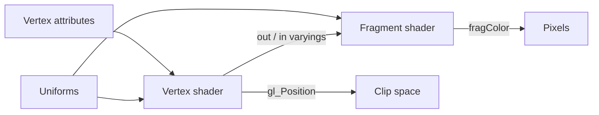

# GLSL ES 3.00

## Goal

Understand the structure of a modern WebGL 2 shader: the `#version` line, the
`in`/`out` interface between stages, the `uniform` inputs the engine owns,
precision declarations, control flow, user functions and the fragment output.

## One language, two stages

A WebGL 2 program links two shader stages. The vertex stage runs once per vertex
and writes `gl_Position`; the fragment stage runs once per covered pixel and
writes one or more colour outputs.



The interface between the stages is explicit:

```glsl
// vertex
out vec3 vWorldNormal;

// fragment
in vec3 vWorldNormal;
```

The names and types must match exactly. A mismatch is a link error, not a
compile error, and the error panel reports it as **Shaders do not match**.

## The header

Every shader starts with the version directive on the very first line:

```glsl
#version 300 es
```

Fragment shaders then declare a default float precision:

```glsl
precision highp float;
```

A `#version` that is not on the first line is a syntax error. Comments before it
are not allowed either.

## Qualifiers

| Qualifier | Where it appears | Meaning |
| --- | --- | --- |
| `in` | vertex | vertex attribute, supplied by the mesh |
| `in` | fragment | interpolated value from the vertex stage |
| `out` | vertex | value interpolated to the fragment stage |
| `out` | fragment | colour output; declare with a location |
| `uniform` | both | value constant for the whole draw call |
| `const` | both | compile-time constant |
| `inout` | function parameter | read and write the caller's value |
| `flat` | `in`/`out` | no interpolation; the provoking vertex wins |
| `smooth` | `in`/`out` | perspective-correct interpolation (default) |

A fragment output in GLSL ES 3.00 is declared explicitly:

```glsl
layout(location = 0) out vec4 fragColor;
```

There is no `gl_FragColor` in ES 3.00. The diagnostics panel recognises that
mistake and tells you the replacement.

## Uniforms are not constants

A `uniform` is constant for one draw call but changes between frames. The engine
sets it before the draw. You cannot assign to a uniform in the shader. If a
value changes per vertex, use an attribute or compute it; if it changes per
pixel, compute it in the fragment shader.

The complete list for each editor is generated in the
[ABI Reference](/docs/abi-reference).

## Attributes

Attributes are vertex inputs. The 3D preview provides `position`, `normal`,
`tangent`, `uv`, `uv2` and `color`; the sandbox provides none because its vertex
stage is internal. Declare an attribute with `in`:

```glsl
in vec3 position;
in vec3 normal;
in vec2 uv;
```

An attribute the mesh does not provide reads as a default value, not an error.
If a shader looks flat or a UV is always zero, check the attribute name first.

## Precision

Precision qualifiers control the minimum range and precision of a type:

- `lowp` — at least 8 bits of mantissa; cheap, visibly banded.
- `mediump` — at least 10 bits; a common mobile default.
- `highp` — at least 16 bits; the desktop default and the right choice for
  positions.

You can write `precision highp float;` once at the top, or annotate individual
declarations (`uniform highp mat4 view;`). This project uses `highp` everywhere
and expects it in user shaders.

## Control flow

GLSL ES 3.00 has `if`/`else`, `for`, `while` and `do`/`while`. Two practical
differences from JavaScript:

- A `for` loop with a constant bound is the only form the compiler can fully
  unroll; a bound from a uniform may prevent unrolling.
- `discard` exits the fragment shader without writing a colour. It disables
  early depth testing for that draw, so use it sparingly.

```glsl
for (int i = 0; i < 8; i++) {
    sum += texture(textureSampler, uv + vec2(float(i)) * texelSize).r;
}
```

## Functions

Functions are declared before use, with a return type and typed parameters:

```glsl
float luminance(vec3 color)
{
    return dot(color, vec3(0.2126, 0.7152, 0.0722));
}

vec3 tonemapReinhard(vec3 color)
{
    return color / (1.0 + color);
}
```

Overloads are allowed when the parameter types differ. `in` is the default
parameter qualifier; `out` writes a result, and `inout` reads and writes:

```glsl
void splitUv(vec2 uv, out vec2 cell, out vec2 local)
{
    cell = floor(uv);
    local = fract(uv);
}
```

Recursion is not supported. A function cannot be declared inside another
function.

## Built-ins

The fragment shader receives `gl_FragCoord` (window-space position) and
`gl_FrontFacing` (front/back facing). The vertex shader writes `gl_Position`
and may read `gl_VertexID` and `gl_InstanceID`. The sandbox uses `gl_VertexID`
to generate its fullscreen triangle without a vertex buffer.

The most-used built-in functions are covered in
[Built-in functions](/knowledge/built-in-functions) and the
[cheat sheet](/docs/cheat-sheet).

## From GLSL ES 1.00

The 3D editor still understands ES 1.00 diagnostics, so old snippets produce
useful advice. The renderer compiles ES 3.00, which means these substitutions:

| ES 1.00 | ES 3.00 |
| --- | --- |
| `attribute vec3 position;` | `in vec3 position;` (vertex) |
| `varying vec3 vNormal;` | `out vec3 vNormal;` (vertex), `in vec3 vNormal;` (fragment) |
| `gl_FragColor = ...;` | `layout(location = 0) out vec4 fragColor;` then `fragColor = ...;` |
| `texture2D(s, uv)` | `texture(s, uv)` |
| `textureCube(s, dir)` | `texture(s, dir)` |
| `#version 100` | `#version 300 es` |

The [debugging page](/knowledge/debugging-shaders) lists the exact error
messages the diagnostics panel translates.

## Minimal complete shader

```glsl run=sandbox title="GLSL ES 3.00 skeleton"
#version 300 es
precision highp float;

in vec2 vUv;
uniform vec2 uResolution;
uniform float uTime;

out vec4 fragColor;

float ring(vec2 uv, float frequency)
{
    vec2 p = uv - 0.5;
    return smoothstep(0.02, 0.0, abs(fract(length(p) * frequency - uTime) - 0.5));
}

void main(void)
{
    float value = ring(vUv, 8.0);
    fragColor = vec4(vec3(value), 1.0);
}
```

## Exercises

1. Move `#version 300 es` below a comment and compile. Read the error panel; it
   should name the first-line rule.
2. Change the fragment output to `gl_FragColor = vec4(1.0);`. What does the
   diagnostics panel say?
3. Write a function `vec3 tint(vec3 color, float amount)` and call it from
   `main`.
4. Declare a `uniform float uScale;` and use it in the ring frequency. Does the
   sandbox bind it? Why not?

::: solution Solution 1
The compiler reports that `#version` must be first. The rule exists because the
driver chooses the language version before parsing anything else.
:::

::: solution Solution 2
`gl_FragColor` is not available in GLSL ES 3.00. Declare an output with
`layout(location = 0) out vec4 fragColor;` and assign to it.
:::

::: solution Solution 3
```glsl
vec3 tint(vec3 color, float amount)
{
    return mix(color, vec3(1.0), amount);
}
```
Then call `tint(vec3(value), 0.25)` inside `main`.
:::

::: solution Solution 4
The sandbox does not bind `uScale`; it only provides `uResolution` and `uTime`.
Declare the value in the User data tab so it is generated and bound.
:::

## Common mistakes

- `#version` not on the first line.
- Using `gl_FragColor` in a `#version 300 es` shader.
- Mixing `attribute`/`varying` with `in`/`out`.
- Mismatched varying names or types between stages.
- Floating-point literals written as integers.
- A `uniform` declared but never written by the engine (it reads as zero).

## Next

- [Built-in functions](/knowledge/built-in-functions)
- [First shaders in the sandbox](/knowledge/first-shaders)
- [Debugging shaders](/knowledge/debugging-shaders)
