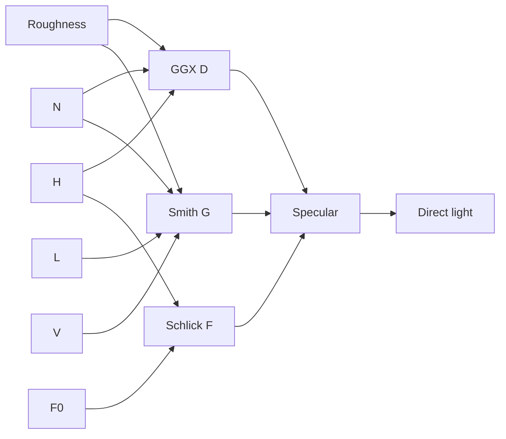

# Lighting: Cook-Torrance

## Goal

Read and implement the Cook-Torrance microfacet BRDF: the GGX normal
distribution `D`, the Smith masking-shadowing term `G`, and the Schlick Fresnel
term `F`. Understand why the specular term is divided by
`4 * NdotL * NdotV` and how metals tint their reflection.

## The microfacet model

A real surface is a collection of tiny mirrors. The BRDF asks three questions:

- **D — distribution:** how many microfacets are oriented exactly along the
  half vector `H`?
- **G — geometry:** how much light survives masking and self-shadowing between
  facets?
- **F — Fresnel:** how much light reflects rather than refracts at each facet?

The specular contribution is `D * G * F / (4 * NdotL * NdotV)`. The denominator
normalises the half-vector mapping and keeps the result energy-conserving.



## The shader

```glsl run=editor example=cook-torrance title="Cook-Torrance"
#version 300 es
precision highp float;

in vec3 vWorldPosition;
in vec3 vWorldNormal;

uniform vec3 cameraPos;
uniform vec3 lightDir;

layout(location = 0) out vec4 fragColor;

const float PI = 3.14159265359;
const float DIELECTRIC_F0 = 0.04;
const float LIGHT_RADIANCE = 3.0;

vec3 acesFilm(vec3 x)
{
    float a = 2.51;
    float b = 0.03;
    float c = 2.43;
    float d = 0.59;
    float e = 0.14;
    return clamp((x * (a * x + b)) / (x * (c * x + d) + e), 0.0, 1.0);
}

float distributionGGX(float NdotH, float perceptualRoughness)
{
    float alpha = perceptualRoughness * perceptualRoughness;
    float alpha2 = alpha * alpha;
    float denominator = NdotH * NdotH * (alpha2 - 1.0) + 1.0;
    return alpha2 / max(PI * denominator * denominator, 1e-4);
}

float geometrySchlickGGX(float NdotX, float k)
{
    return NdotX / (NdotX * (1.0 - k) + k);
}

float geometrySmith(float NdotV, float NdotL, float perceptualRoughness)
{
    float k = (perceptualRoughness + 1.0) * (perceptualRoughness + 1.0) / 8.0;
    return geometrySchlickGGX(NdotV, k) * geometrySchlickGGX(NdotL, k);
}

vec3 fresnelSchlick(float VdotH, vec3 F0)
{
    float factor = pow(max(1.0 - VdotH, 0.0), 5.0);
    return F0 + (vec3(1.0) - F0) * factor;
}

void main(void)
{
    vec3 N = normalize(vWorldNormal);
    vec3 L = normalize(lightDir);
    vec3 V = normalize(cameraPos - vWorldPosition);
    vec3 H = normalize(L + V);

    float NdotL = max(dot(N, L), 0.0);
    float NdotV = max(dot(N, V), 1e-3);
    float NdotH = max(dot(N, H), 0.0);
    float VdotH = max(dot(V, H), 0.0);

    vec3 F0 = mix(vec3(DIELECTRIC_F0), baseColor, metallic);

    vec3 F = fresnelSchlick(VdotH, F0);
    float D = distributionGGX(NdotH, roughness);
    float G = geometrySmith(NdotV, NdotL, roughness);

    vec3 specular = D * G * F / (4.0 * NdotL * NdotV + 1e-3);

    vec3 kD = (vec3(1.0) - F) * (1.0 - metallic);
    vec3 diffuse = kD * baseColor / PI;

    vec3 finalColor = (diffuse + specular) * LIGHT_RADIANCE * NdotL;
    fragColor = vec4(acesFilm(finalColor), 1.0);
}
```

`LIGHT_RADIANCE` is deliberately above `1.0` so the highlight reaches the ACES
shoulder. Without a tone curve, the highlight would clip and lose its shape.

## Expected result


Set `roughness` to `0.05` for a near-mirror and to `0.9` for a broad, dim
reflection. Set `metallic` to `1` to remove the diffuse term and tint `F0` with
the base colour.

## Exercises

1. Set `roughness` to `0.05` and then `0.95`. How does the highlight change in
   size and intensity?
2. Set `metallic` to `1.0`. Why does the diffuse term disappear?
3. Replace `geometrySmith` with `1.0`. What happens at grazing angles?
4. Replace the GGX `D` with a constant. Which model does the result resemble?
5. Remove `acesFilm` and clamp to `1.0` instead. What happens to the highlight?
6. Why is `NdotV` clamped to `1e-3` rather than `0.0`?

::: solution Solution 1
Low roughness concentrates the reflection into a small, bright highlight; high
roughness spreads it out and lowers its peak, which is the visual meaning of
roughness.
:::

::: solution Solution 2
`kD = (1 - F) * (1 - metallic)` becomes zero, leaving only specular. A metal has
no diffuse albedo in this model; its base colour tints `F0` instead.
:::

::: solution Solution 3
The specular term no longer attenuates at grazing angles, so the rim becomes
too bright and the model loses energy conservation. The silhouette can glow.
:::

::: solution Solution 4
A constant `D` gives a Blinn-Phong-like lobe. GGX is the microfacet distribution
that produces the characteristic rough highlight with a long tail.
:::

::: solution Solution 5
Values above `1.0` clamp to white, so the highlight becomes a flat disc. The
tone curve compresses the peak and preserves the shape.
:::

::: solution Solution 6
The denominator contains `NdotV`; clamping to zero would divide by zero (or
produce an infinitely bright grazing term). A small epsilon keeps the result
finite while the `G` term drives the contribution toward zero.
:::

## Common mistakes

- Forgetting the `4 * NdotL * NdotV` denominator, which makes the highlight
  explode.
- Using roughness directly as `alpha` without squaring it for GGX.
- Forgetting `kD = 1 - F` and adding diffuse plus specular without energy
  conservation.
- Applying ACES inside the shader when the editor's display pass already applies
  an output transform. The examples are self-contained; a screen-space effect
  should not repeat the curve.
- Using `NdotL` or `NdotV` without clamping before division.

## Next

- [Lighting: IBL](/knowledge/lighting-ibl)
- [Post-processing lessons](/knowledge/post-processing)
