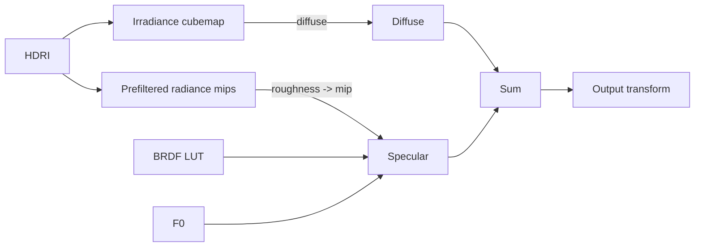

# Lighting: Image-Based Lighting

## Goal

Understand the split-sum approximation and use the three cubemap resources the
preview binds: `irradianceMap`, `prefilteredEnvironmentMap` and `brdfLUT`.
Implement both the metalness/roughness and the specular/glossiness workflows.

## Why a cubemap is not enough

A naive IBL shader samples the environment along the reflection vector:

```glsl
vec3 colour = texture(environmentMap, reflect(-V, N)).rgb;
```

That gives a mirror. A rough surface integrates the environment over a wide
lobe, and doing that per pixel is too expensive. Split-sum precomputes the
integral in two parts:

1. **Prefiltered radiance** — the environment convolved with a GGX lobe at
   several roughness levels, stored in mip levels of a cubemap.
2. **BRDF LUT** — a 2D table of the BRDF response as a function of `NdotV` and
   roughness, independent of the environment.

The final specular is `prefiltered(R, roughness) * (F0 * lut.r + lut.g)`.



The diffuse irradiance is a cosine-convolved cubemap. Sampling it with `N` is
already the integral over the hemisphere, so no extra cosine factor is needed.

## The metalness / roughness workflow

```glsl run=editor example=ibl-metalness-roughness title="IBL metalness / roughness"
#version 300 es
precision highp float;

in vec3 vWorldPosition;
in vec3 vWorldNormal;

uniform vec3 cameraPos;
uniform samplerCube irradianceMap;
uniform samplerCube prefilteredEnvironmentMap;
uniform sampler2D brdfLUT;

layout(location = 0) out vec4 fragColor;

const float ENV_MAX_LOD = 9.0;
const float DIELECTRIC_F0 = 0.04;

vec3 acesFilm(vec3 x)
{
    float a = 2.51;
    float b = 0.03;
    float c = 2.43;
    float d = 0.59;
    float e = 0.14;
    return clamp((x * (a * x + b)) / (x * (c * x + d) + e), 0.0, 1.0);
}

void main(void)
{
    vec3 N = normalize(vWorldNormal);
    vec3 V = normalize(cameraPos - vWorldPosition);
    vec3 R = reflect(-V, N);

    float NdotV = max(dot(N, V), 1e-3);

    vec3 F0 = mix(vec3(DIELECTRIC_F0), baseColor, metallic);
    vec3 kD = vec3(1.0) - F0;

    vec3 irradiance = texture(irradianceMap, N).rgb;
    vec3 radiance = textureLod(
        prefilteredEnvironmentMap,
        R,
        roughness * ENV_MAX_LOD
    ).rgb;

    vec2 brdf = texture(brdfLUT, vec2(NdotV, roughness)).rg;
    vec3 specular = radiance * mix(vec3(brdf.r), vec3(brdf.g), F0);

    vec3 diffuse = kD * baseColor * irradiance;

    fragColor = vec4(acesFilm(diffuse + specular), 1.0);
}
```

## Metalness/roughness versus specular/glossiness

Both workflows describe the same surface:

| Concept | Metalness / roughness | Specular / glossiness |
| --- | --- | --- |
| Base colour | `baseColor` | `diffuseColor` |
| Reflectance | `F0 = mix(0.04, baseColor, metallic)` | `specularColor` directly |
| Roughness | `roughness` | `1 - glossiness` |
| Diffuse weight | `1 - F0` | `1 - specularColor` |
| Metal detection | `metallic` | specular colour is high and diffuse is near black |

The specular/glossiness example uses the second column. Do not mix the two:
choosing `specularColor` as `F0` and also multiplying by `metallic` would apply
the metal rule twice.

## Expected result


Drag the `roughness` slider from `0.05` to `0.9`: the reflection widens and the
prefiltered mip level rises. Change the environment in the viewer menu and the
reflection changes with it.

## Exercises

1. Set `metallic` to `0.0` and `baseColor` to a bright colour. Why does the
   reflection dim?
2. Set `roughness` to `0.0`. Which mip level is sampled, and what does the
   surface look like?
3. Set `roughness` to `1.0`. What happens at `ENV_MAX_LOD`?
4. In the specular/glossiness example, set `glossiness` to `1.0`. How does it
   compare with `roughness = 0.0` in the other example?
5. Reverse `brdf.r` and `brdf.g` in the mix. What happens to the reflection
   intensity?

::: solution Solution 1
`F0` is the dielectric `0.04`, so only 4% of the environment is reflected at
normal incidence; the rest is diffuse. A metal would use the base colour as
`F0`, which is much brighter.
:::

::: solution Solution 2
`roughness * 9 = 0`, so the base mip is sampled: a sharp mirror reflection.
:::

::: solution Solution 3
The roughest mip (`9`) is sampled. The reflection is a broad, low-frequency
average of the environment.
:::

::: solution Solution 4
`glossiness = 1` means `roughness = 0`; the two workflows should agree when the
parameters are converted correctly.
:::

::: solution Solution 5
The split-sum LUT's two channels have different meanings; swapping them gives a
wrong Fresnel response, usually a brighter or darker rim and an incorrect
grazing falloff.
:::

## Common mistakes

- Sampling the environment with `N` for specular; the reflection needs `R`.
- Using `roughness * 9` when the cubemap has fewer mips.
- Forgetting to decode the BRDF LUT (`r` and `g` are already linear).
- Mixing metalness and specular/glossiness workflows.
- Applying the output transform twice; the editor's display pass owns it.
- Assuming `environmentMap` and `prefilteredEnvironmentMap` are the same texture.

## Next

- [Post-processing lessons](/knowledge/post-processing)
- [The Screen Space editor](/docs/screen-space-editor)
