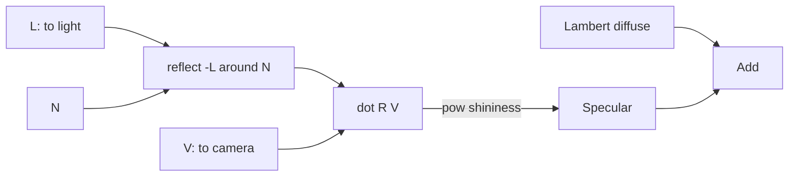

# Lighting: Phong

## Goal

Extend Lambert with a specular highlight, explain the reflection vector, and
understand what the shininess exponent controls.

## The reflection vector

A shiny surface reflects the incoming light around its normal. Phong compares
that reflected direction `R` with the direction to the eye `V`:

```glsl
vec3 R = reflect(-L, N);
float specular = pow(max(dot(R, V), 0.0), shininess);
```

`reflect` expects the incident vector pointing *towards* the surface, so pass
`-L` when `L` points from the surface to the light. The `pow` exponent controls
the lobe width: larger values concentrate the highlight into a smaller, sharper
spot.



## The shader

```glsl run=editor example=phong title="Phong"
#version 300 es
precision highp float;

in vec3 vWorldPosition;
in vec3 vWorldNormal;

uniform vec3 cameraPos;
uniform vec3 lightDir;

layout(location = 0) out vec4 fragColor;

void main(void)
{
    vec3 N = normalize(vWorldNormal);
    vec3 L = normalize(lightDir);
    vec3 V = normalize(cameraPos - vWorldPosition);

    float NdotL = max(dot(N, L), 0.0);
    vec3 R = reflect(-L, N);
    float specular = pow(max(dot(R, V), 0.0), shininess);

    vec3 diffuse = albedo * NdotL;
    vec3 highlight = specularColor * specular * NdotL;

    fragColor = vec4(diffuse + highlight, 1.0);
}
```

Multiplying the highlight by `NdotL` keeps it from appearing on surfaces that
face away from the light.

## Expected result


The default `shininess` is `48`. Raise it to `128` and the highlight tightens;
lower it to `4` and it spreads across the surface.

## Exercises

1. Set `shininess` to `1`. What does the highlight look like, and why?
2. Remove the `NdotL` factor from the highlight. Which side of the object starts
   to glow?
3. Change the reflection to `reflect(L, N)`. Does the highlight move to the
   other side?
4. Add a second specular lobe with a much lower `shininess` and half the
   intensity. What material does that suggest?

::: solution Solution 1
The lobe becomes extremely wide and dim, almost indistinguishable from diffuse;
`pow` with an exponent of `1` is just the cosine again.
:::

::: solution Solution 2
The highlight appears on surfaces facing away from the light, because the
`NdotL` mask is gone. That is a common bug when porting Phong code.
:::

::: solution Solution 3
Yes. `reflect(L, N)` mirrors the direction away from the light, so the
highlight ends up on the opposite side.
:::

::: solution Solution 4
Two lobes of different width resemble a coated surface: a sharp clear-coat
highlight over a broader base specular.
:::

## Common mistakes

- Passing `L` instead of `-L` to `reflect`.
- Forgetting `max(..., 0.0)` before `pow`, which produces NaN for negative bases.
- Multiplying the highlight by `NdotL` twice.
- Using a light position as `lightDir`.
- Expecting energy conservation; Phong adds energy and can look too bright.

## Next

- [Lighting: Blinn-Phong](/knowledge/lighting-blinn-phong)
- [Lighting: Cook-Torrance](/knowledge/lighting-cook-torrance)
