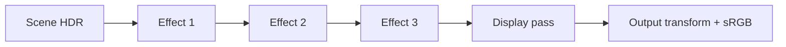

# Post-processing and the G-buffer

## Goal

Understand the two post-effect ABIs, build an ordered chain, decode the
attachments, and implement the classic effects: vignette, blur, edge detection,
depth fog and SSAO. Know when to use the 3D editor's Post tab and when to use the
Screen Space editor.

## Two stacks, two contracts

| Editor | ABI | Samplers | Best for |
| --- | --- | --- | --- |
| 3D Shader Editor, Post effect tab | Surface post-effect ABI | `textureSampler`, `gbufferTexture`, `depthTexture` | Effects over the single preview mesh |
| 2D Sandbox, Post effect tab | Same surface ABI | same, with neutral geometry | Screen-space maths that does not need scene data |
| Screen Space editor | Screen-space G-buffer ABI | Previous pass, original scene, depth, normal, albedo, material, velocity | Whole-scene effects and G-buffer work |

The surface ABI's `depthTexture` is *normalised* linear depth: `0` at the near
plane, `1` at the far plane and the background. The screen-space ABI's
`depthTexture` is linear view-space depth in **world units**. Confusing the two
is the most common porting bug between the editors.

## The chain



Each effect reads the previous pass in `textureSampler`. The first effect reads
the scene. In the Screen Space editor, `sceneColorTexture` is always the
untouched original, which is what effects such as SSR or a bloom combine need.

Effects are fragment-only. The fullscreen vertex stage is internal, so a post
effect is exactly one fragment source with `vUV` and `fragColor`.

## Output transform

The display pass owns the tone curve and the sRGB encode. Choose the transform
in the effect stack:

- **None** for data visualisations or effects that already tone map.
- **Reinhard** for a gentle filmic roll-off.
- **ACES** for lit scene work.

Do not apply `pow(color, vec3(1.0 / 2.2))` inside an effect if the transform is
active. See [Colour and linear space](/knowledge/color-and-linear) for the full
explanation.

## Vignette

A vignette darkens the frame edges. It only needs the previous pass and the
resolution:

```glsl run=editor effect=vignette title="Vignette"
#version 300 es
precision highp float;

in vec2 vUV;
uniform sampler2D textureSampler;
uniform vec2 resolution;

layout(location = 0) out vec4 fragColor;

void main(void)
{
    vec3 color = texture(textureSampler, vUV).rgb;

    vec2 p = (vUV - 0.5) * 2.0;
    p.x *= resolution.x / resolution.y;
    float distanceFromCentre = length(p);

    float vignette = smoothstep(0.55, 1.25, distanceFromCentre);
    color *= mix(1.0, 0.22, vignette);

    fragColor = vec4(color, 1.0);
}
```


## Blur

A separable Gaussian is two passes: horizontal, then vertical. This is the
horizontal half; the weights are symmetric around the centre.

```glsl run=editor effect=blur title="Nine-tap blur (horizontal)"
#version 300 es
precision highp float;

in vec2 vUV;
uniform sampler2D textureSampler;
uniform vec2 texelSize;

layout(location = 0) out vec4 fragColor;

void main(void)
{
    const float weights[5] = float[](0.227027, 0.194594, 0.121621, 0.054054, 0.016216);
    vec3 color = texture(textureSampler, vUV).rgb * weights[0];

    for (int tap = 1; tap < 5; tap++)
    {
        vec2 offset = vec2(float(tap) * texelSize.x, 0.0);
        color += texture(textureSampler, vUV + offset).rgb * weights[tap];
        color += texture(textureSampler, vUV - offset).rgb * weights[tap];
    }

    fragColor = vec4(color, 1.0);
}
```

For a real blur chain, add a vertical copy with `texelSize.y`. Two nine-tap
passes are much cheaper than one large 2D kernel.


## Edge detection and outlines

An outline compares a pixel's depth and normal with its neighbours. A large
difference means an edge. The screen-space version can use the real depth buffer
and the view-space normals:

```glsl
float depthEdge =
    abs(depthAt(vUV - vec2(texelSize.x, 0.0)) - depthAt(vUV + vec2(texelSize.x, 0.0))) +
    abs(depthAt(vUV - vec2(0.0, texelSize.y)) - depthAt(vUV + vec2(0.0, texelSize.y)));

vec3 normalCenter = normalAt(vUV);
float normalEdge = 1.0 - clamp(dot(normalCenter, averageNeighbourNormal), 0.0, 1.0);

float edge = smoothstep(0.03, 0.12, depthEdge) + smoothstep(0.25, 0.6, normalEdge);
```

The screen-space ABI has a complete outline and an SSAO example in the effect
menu. The surface ABI version is similar but uses the normalised depth, so the
depth thresholds are smaller.


## Depth fog

Fog is a distance blend. Convert the depth to world units first:

```glsl
float normalisedDepth = texture(depthTexture, vUV).r;
float worldDepth = cameraNear + normalisedDepth * (cameraFar - cameraNear);

float density = 0.035;
float fog = 1.0 - exp(-worldDepth * worldDepth * density * density);

vec3 color = mix(scene, fogColor, clamp(fog, 0.0, 1.0));
```

In the Screen Space editor, `depthTexture.r` is already in world units, so the
`cameraNear`/`cameraFar` remap is not needed. That difference is exactly why the
surface and screen-space versions are separate documents.


## SSAO

Ambient occlusion darkens creases. Screen-space AO samples the depth buffer in a
disc around each pixel and counts how many neighbours are closer to the camera
than the tangent plane:

```glsl
vec3 position = viewPosition(vUV);
vec3 normal = decodeNormal(vUV);

float occlusion = 0.0;
for (int i = 0; i < 12; i++)
{
    vec2 offset = discOffset(i) * radius * texelSize * 256.0;
    vec3 neighbour = viewPosition(vUV + offset);
    vec3 delta = neighbour - position;

    float inRadius = step(length(delta), radius);
    float inFront = step(bias, dot(-delta, normal) / max(length(delta), 1e-4));
    occlusion += inRadius * inFront;
}

occlusion = 1.0 - occlusion / 12.0;
fragColor = vec4(scene * mix(0.45, 1.0, occlusion), 1.0);
```

The screen-space example reconstructs view-space positions from the inverse
projection and the real depth. The surface version has no reliable view-space
reconstruction, so it uses the normalised depth differences directly and is
correspondingly approximate.


## Expected result


The first thing to do in a new screen-space effect is switch to the **G-Buffer**
tab and confirm the attachment you intend to sample. If the view is black, the
pipeline is not requesting that attachment, or you are looking at the
background.

## Exercises

1. Add a `radius` uniform to the vignette and animate it with `time`. What
   changes?
2. Make the blur vertical by changing `texelSize.x` to `texelSize.y`.
3. Raise the outline's depth threshold until the internal creases disappear.
   Which threshold controls the silhouette?
4. In the screen-space depth fog, remove the `cameraNear` remap (if you copied
   the surface version). What changes, and why?
5. Reverse the SSAO mix (`mix(1.0, 0.45, occlusion)`). What does the image look
   like?
6. Why does SSAO need the normal buffer, not just depth?

::: solution Solution 1
The vignette's inner and outer edges expand and contract; the darkened region
becomes a pulsing frame. Use `time` (seconds) and a speed factor.
:::

::: solution Solution 2
The same loop now blurs along the vertical axis. Applying both versions in
sequence approximates a 2D Gaussian.
:::

::: solution Solution 3
The `smoothstep(0.03, 0.12, depthEdge)` low threshold controls which small
differences count; raising it removes creases but can also remove thin
silhouettes. The normal term is what keeps the silhouette.
:::

::: solution Solution 4
The values are already in world units in the screen-space buffer, so treating
them as normalised and remapping compresses or expands the fog range. The fog
either starts too close or never appears.
:::

::: solution Solution 5
Occluded areas become bright and open areas become dark: the creases glow. It
is the inverse of ambient occlusion, useful only as a debug view.
:::

::: solution Solution 6
Depth alone cannot tell whether a neighbour that is closer belongs to the same
surface (a slope) or a different one (a crease). The normal provides the tangent
plane that makes the test meaningful.
:::

## Common mistakes

- Treating screen-space depth as normalised; it is world units.
- Sampling `normalTexture` without decoding `* 2.0 - 1.0`.
- Forgetting the geometry mask, so the background contributes to the effect.
- Tone mapping inside an effect while the display transform is active.
- Using the same thresholds for surface and screen-space depth.
- Forgetting that the sandbox's neutral geometry makes depth/normal effects
  no-ops.

## Next

- [Debugging shaders](/knowledge/debugging-shaders)
- [Performance basics](/knowledge/how-the-gpu-executes-shaders)
- [The Screen Space editor reference](/docs/screen-space-editor)
