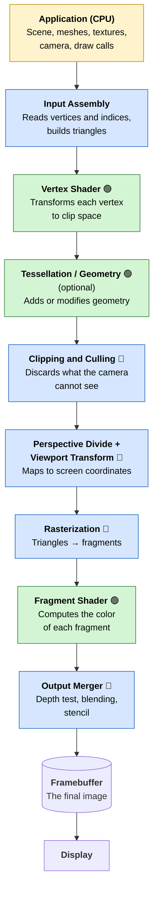
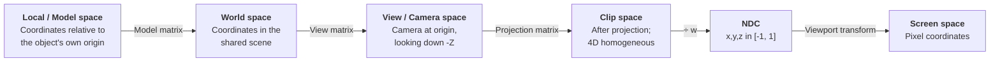
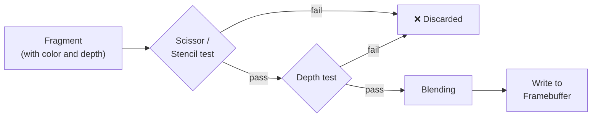
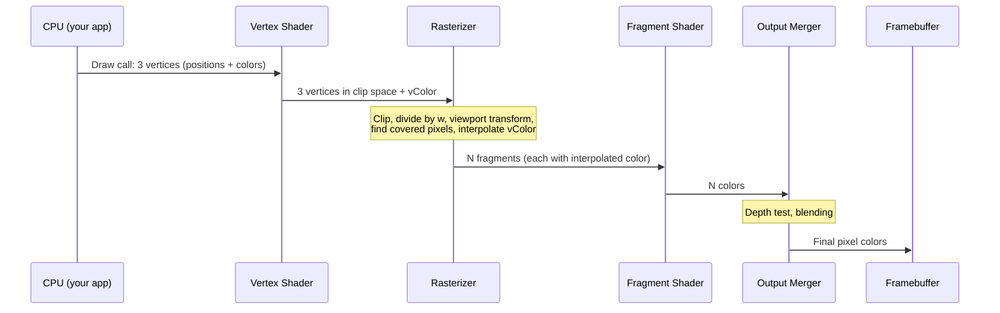

# The Rendering Pipeline: From 3D Data to Pixels on Your Screen

> **Audience:** first-year students in computer graphics.
> **Prerequisites:** basic programming, a vague memory of vectors and matrices. Nothing else.
> **Reading time:** about 25 minutes.

---

## Table of Contents

1. [What is a rendering pipeline?](#1-what-is-a-rendering-pipeline)
2. [The big picture](#2-the-big-picture)
3. [Stage 0: The application (CPU side)](#3-stage-0-the-application-cpu-side)
4. [Stage 1: Geometry processing](#4-stage-1-geometry-processing)
5. [Coordinate spaces: the journey of a vertex](#5-coordinate-spaces-the-journey-of-a-vertex)
6. [Stage 2: Rasterization](#6-stage-2-rasterization)
7. [Stage 3: Fragment (pixel) processing](#7-stage-3-fragment-pixel-processing)
8. [Stage 4: Output merging](#8-stage-4-output-merging)
9. [Programmable vs. fixed-function stages](#9-programmable-vs-fixed-function-stages)
10. [Why a pipeline? Parallelism on the GPU](#10-why-a-pipeline-parallelism-on-the-gpu)
11. [A minimal example: shaders](#11-a-minimal-example-shaders)
12. [Beyond the basics: forward, deferred and ray tracing](#12-beyond-the-basics-forward-deferred-and-ray-tracing)
13. [Common beginner mistakes](#13-common-beginner-mistakes)
14. [Glossary](#14-glossary)
15. [Exercises](#15-exercises)
16. [Further reading](#16-further-reading)

---

## 1. What is a rendering pipeline?

A computer screen is just a grid of colored dots called **pixels**. A 3D game or application, on the other hand, describes a world made of **numbers**: positions of points in space, triangles connecting them, materials, lights and a camera.

**Rendering** is the process of turning that 3D description into a 2D image. The **rendering pipeline** (also called the *graphics pipeline*) is the sequence of steps that data goes through to make that conversion happen, tens or hundreds of times per second.

### The factory analogy

Think of a car factory with an assembly line:

- Station 1 welds the chassis.
- Station 2 paints it.
- Station 3 installs the interior.
- Station 4 does the final inspection.

Each station does **one specific job**, receives the output of the previous station, and passes its result to the next. While car #1 is being painted, car #2 is already being welded. Everything works **in parallel**, and that is the secret of throughput.

The rendering pipeline works exactly like that, except that the "cars" are **vertices**, **triangles** and **pixels**.

```text
  Raw material                                                      Finished product
 (3D triangles)  ───►  [Station 1] ──► [Station 2] ──► [Station 3] ───►  (an image)
```

> **Key idea:** a rendering pipeline is a *sequence of stages*. Each stage takes data in, transforms it, and hands it to the next stage.

---

## 2. The big picture

Here is the whole pipeline at a glance. Don't worry about the unfamiliar words yet; we will visit every box.



**Legend:** 🟡 CPU-side · 🟢 programmable by you (shaders) · 🔵 fixed-function (configurable, but not programmable)

We can group the stages into three big phases:

| Phase | Works on... | Main question it answers |
|---|---|---|
| **Geometry processing** | Vertices and triangles | *Where on the screen does each triangle end up?* |
| **Rasterization** | Triangles → fragments | *Which pixels does each triangle cover?* |
| **Pixel processing** | Fragments | *What color should each pixel be?* |

---

## 3. Stage 0: The application (CPU side)

Before the GPU does anything, **your program** (running on the CPU) prepares the work:

1. **Loads the data**: meshes (vertex positions, normals, UV coordinates), textures, shaders.
2. **Updates the scene**: moves the player, plays animations, runs physics.
3. **Decides what to draw**: for example, skipping objects that are obviously behind the camera (*frustum culling* at object level).
4. **Sends commands to the GPU**: these are called **draw calls**.

A draw call is basically the sentence: *"Draw this mesh, with this shader, these textures, and these settings."*

```text
   CPU (your code)                         GPU
 ┌────────────────────┐   draw calls   ┌───────────────────┐
 │ Game logic         │ ─────────────► │ Rendering pipeline│
 │ Scene management   │   (via API:    │ (thousands of     │
 │ Culling            │  OpenGL,       │  cores working in │
 │ Resource upload    │  Vulkan,       │  parallel)        │
 └────────────────────┘  DirectX,      └───────────────────┘
                         Metal, WebGPU)
```

> **Why it matters:** too many draw calls can make the CPU the bottleneck: the GPU sits idle waiting for instructions. This is one of the first performance problems you will meet.

### What does a mesh look like?

A mesh is typically stored as two arrays:

```text
Vertex buffer (one entry per vertex):
  index   position (x,y,z)      normal (nx,ny,nz)    uv (u,v)
    0     (-1.0, -1.0, 0.0)     (0,0,1)              (0,0)
    1     ( 1.0, -1.0, 0.0)     (0,0,1)              (1,0)
    2     ( 1.0,  1.0, 0.0)     (0,0,1)              (1,1)
    3     (-1.0,  1.0, 0.0)     (0,0,1)              (0,1)

Index buffer (groups of 3 = one triangle):
    0, 1, 2,    0, 2, 3        ← two triangles form a square (quad)
```

```text
   3 ●───────────● 2
     │ ╲         │
     │   ╲  T2   │         T1 = (0, 1, 2)
     │     ╲     │         T2 = (0, 2, 3)
     │  T1   ╲   │
     │         ╲ │
   0 ●───────────● 1
```

> **Why triangles?** A triangle is the simplest polygon: its three points are always **planar** (they lie in one flat plane), it is always **convex**, and it is easy to rasterize. GPUs are built to eat triangles.

---

## 4. Stage 1: Geometry processing

This phase answers: **"Where does every vertex end up on the screen?"**

### 4.1 Input Assembly

The GPU reads the vertex and index buffers and assembles **primitives** (usually triangles, but also lines or points).

### 4.2 The Vertex Shader (programmable)

The **vertex shader** is a small program that runs **once per vertex**. Its primary mission is to output the vertex position in **clip space**. It does that by multiplying the position by matrices:

```text
clipPosition = Projection × View × Model × localPosition
               └───────── "MVP matrix" ─────────┘
```

It can also do other things: animate vertices (waving grass, skeletal animation), pass data (colors, UVs, normals) to the next stages, and so on.

### 4.3 Tessellation and Geometry shaders (optional)

Optional stages that can **create or modify geometry on the GPU**: for example, subdividing a coarse mesh into a smoother one. Beginners can safely ignore them at first.

### 4.4 Clipping and Culling (fixed-function)

Not everything the CPU sends will be visible. The GPU automatically:

- **Clips** triangles against the camera's view volume (the *frustum*). Triangles partially outside get cut, and new vertices are created at the boundary.
- **Culls back faces**: triangles that face away from the camera (the inside of a closed object) are usually discarded, since you can't see them anyway.

```text
        Top view of the camera frustum

                     far plane
                  ┌───────────────┐
                 ╱                 ╲
                ╱    ▲ visible      ╲
               ╱    ▲▲▲             ╲
              ╱                      ╲        ● ← outside: discarded
             ╱       ▲▲               ╲
            ╱   ▲                      ╲
           └──────────────────────────────┘ near plane
                     ╲          ╱
                      ╲        ╱
                       ╲      ╱
                        ╲    ╱
                         ◉ camera
```

### 4.5 Perspective Divide and Viewport Transform

Two last conversions turn clip-space coordinates into pixel coordinates:

1. **Perspective divide**: divide `x, y, z` by `w`. This is what makes **distant objects look smaller**. The result is called **NDC** (*Normalized Device Coordinates*), where visible points lie inside a cube from -1 to +1 (in OpenGL; Direct3D and Vulkan use 0 to 1 for depth).
2. **Viewport transform**: scale and shift the NDC square to the actual window, e.g. 1920×1080 pixels.

```text
   NDC (resolution independent)          Screen (pixels)

      y                                   (0,0) ───────────► x
      ▲  (+1,+1)                           │
 (-1,+1)┌─────────┐                        │   1920 × 1080
      │ │    ●    │      viewport          │   ┌──────────────┐
 ─────┼─┼────┼────┼──►x   ───────►         │   │      ●       │
      │ │         │      transform         ▼   │              │
 (-1,-1)└─────────┘ (+1,-1)                y   └──────────────┘
```

---

## 5. Coordinate spaces: the journey of a vertex

This is the single most important concept to master as a beginner. A vertex is **not** described in one coordinate system throughout the pipeline. It travels through several **spaces**, each one useful for a different purpose.



| Space | What changes? | Analogy |
|---|---|---|
| **Local** | The artist modeled a chair with its origin at the center of its seat. | A blueprint of a chair. |
| **World** | Where the chair sits in the room (position, rotation, scale). | Placing the chair in the room. |
| **View** | Everything is re-expressed relative to the camera. | Describing the room from the camera's eyes. |
| **Clip** | Perspective is applied (a 3D box becomes a *frustum*). | How a lens bends the view. |
| **NDC** | Divide by `w`; everything visible fits in a standard cube. | A standardized "photo frame". |
| **Screen** | Scale to the window's pixel resolution. | Printing the photo at a given size. |

### Why matrices?

Moving, rotating and scaling can all be written as **4×4 matrices**. Multiplying matrices combines several transforms into one. That's why vertices carry **4 components** `(x, y, z, w)` (so-called *homogeneous coordinates*): it lets us express *translation* and *perspective* as matrix multiplications too.

```text
              ┌ m00 m01 m02 m03 ┐   ┌ x ┐
 clipPos  =   │ m10 m11 m12 m13 │ × │ y │
              │ m20 m21 m22 m23 │   │ z │
              └ m30 m31 m32 m33 ┘   └ 1 ┘
```

> **Tip:** the order matters! `Projection × View × Model × v` applies Model **first** (it's the rightmost), then View, then Projection, when using column vectors (the OpenGL convention).

---

## 6. Stage 2: Rasterization

After geometry processing, we have triangles described by three **screen-space** points. But a screen is made of pixels. **Rasterization** is the process that answers:

> *"Which pixels does this triangle cover?"*

It's performed by a **fixed-function** hardware unit (the *rasterizer*).

### 6.1 How it works (conceptually)

For each triangle, the rasterizer tests the **center** of each pixel in the triangle's bounding box. If the center is inside the triangle, that pixel becomes a **fragment**: a candidate pixel to be colored.

Below, a triangle with vertices **A**, **B** and **C** is placed over a pixel grid. `#` marks the pixels whose centers are covered:

```text
        0 1 2 3 4 5 6 7 8 9 10 11
     0  . A . . . . . . . . .  .
     1  . # # # . . . . . . .  .
     2  . # # # # # # . . . .  .
     3  . # # # # # # # # B .  .
     4  . # # # # # # # . . .  .
     5  . . # # # # . . . . .  .
     6  . . # # . . . . . . .  .
     7  . . C . . . . . . . .  .

     (illustrative: real hardware uses exact edge functions)
```

Notice the **staircase** (jagged) edges. That is **aliasing**, a natural consequence of sampling a continuous shape with a discrete grid. Techniques such as **MSAA** (multisample anti-aliasing) or **TAA** exist to soften it.

### 6.2 How does it know a pixel is inside?

The classic method uses **edge functions**. For each of the triangle's three edges we compute on which side of the edge the pixel center is. If it's on the "inside" side of all three edges, the pixel is covered.

```text
          C
         ╱ ╲
        ╱   ╲        P is inside if it's on the
       ╱  P  ╲       left side of AB, BC and CA
      ╱   ●   ╲      (for counter-clockwise triangles)
     A─────────B
```

### 6.3 Interpolation: the magic bonus

The vertex shader output (color, UV, normal...) exists only **at the three vertices**. For every fragment, the rasterizer computes **barycentric coordinates** `(α, β, γ)` (three weights that sum to 1) and **interpolates** those values:

```text
 value(P) = α · value(A) + β · value(B) + γ · value(C)
```

```text
                 C (blue)
                 ╱╲
                ╱  ╲
               ╱    ╲        A pixel near A is mostly red,
              ╱  ●   ╲       near B mostly green,
             ╱  P     ╲      near C mostly blue,
            ╱          ╲     and in the middle: a smooth mix.
   A (red) ●────────────● B (green)
```

This is why a triangle with 3 colored vertices shows a smooth gradient. It's also how **texture coordinates**, **normals** and everything else get smoothly spread across a surface.

> **Important:** the rasterizer emits **fragments**, not pixels. A *fragment* is a *potential* pixel; it may still be discarded (e.g. by the depth test), or several fragments may compete for the same pixel.

---

## 7. Stage 3: Fragment (pixel) processing

### The Fragment Shader (programmable)

The **fragment shader** (called **pixel shader** in DirectX) runs **once per fragment**. Its job is to answer: **"What color is this fragment?"**

This is where most of the *visual look* of your scene is decided:

- **Texture sampling**: reading a color from an image using the interpolated UV coordinates.
- **Lighting**: combining the surface normal, light direction, and material to get diffuse and specular shading.
- **Effects**: normal mapping, shadows, fog, reflections, and so on.

A very simple lighting calculation (Lambert diffuse):

```text
 brightness = max(0, dot(normal, directionToLight))
 finalColor = textureColor × lightColor × brightness
```

```text
         light direction
              ╲  │ normal
               ╲ │
                ╲│  θ
     ─────────────●─────────── surface
     
     brightness = cos(θ)   →  1 when facing the light, 0 at 90° or more
```

The fragment shader can also **discard** the fragment (useful for transparent cut-outs such as leaves) and output **several colors** at once (for deferred rendering, see section 12).

> **Performance note:** fragment shaders run for *every covered pixel*, so on a 4K display there are over 8 million of them per frame, per layer of geometry! Expensive fragment shaders are a classic cause of low frame rates.

---

## 8. Stage 4: Output merging

The fragment shader gives us a color, but we aren't done: that fragment must be **merged** into the final image. This stage is fixed-function (but configurable), and does several tests in order:



### 8.1 Depth test (Z-buffer)

How do we make sure that a near wall hides the mountain behind it, regardless of the **order** in which they are drawn? With a **depth buffer** (Z-buffer): an image-sized array that stores, for every pixel, the **depth of the closest fragment seen so far**.

```text
 For each incoming fragment at pixel (x, y):
     if fragment.depth < depthBuffer[x][y]:     ← is it closer?
         depthBuffer[x][y] = fragment.depth      ← remember the new depth
         colorBuffer[x][y] = fragment.color      ← and write its color
     else:
         discard the fragment                    ← it's hidden
```

A worked example for **one pixel** while three triangles are drawn in arbitrary order:

```text
 Triangle drawn   Fragment depth   Depth buffer before   Result            Depth buffer after
 ──────────────   ──────────────   ───────────────────   ────────────────  ──────────────────
 1. Red           0.60             1.00 (cleared)        0.60 < 1.00 ✔     0.60   color = red
 2. Blue          0.80             0.60                  0.80 < 0.60 ✘     0.60   color = red
 3. Green         0.30             0.60                  0.30 < 0.60 ✔     0.30   color = green
```

Final pixel color: **green** (the closest), no matter the drawing order.

```text
     camera ◉ ──────►  green (0.30)   red (0.60)   blue (0.80)
                          ▓▓▓            ▒▒▒            ░░░
                         nearest                       farthest
```

### 8.2 Blending (transparency)

For translucent objects (glass, water, particles), the new color is **mixed** with what's already in the framebuffer:

```text
 result = source.rgb × source.alpha  +  destination.rgb × (1 − source.alpha)
```

> **Gotcha:** blending depends on **order**. Transparent objects are usually drawn *after* the opaque ones, sorted from far to near.

### 8.3 Stencil test

The **stencil buffer** is a small per-pixel integer mask. You can use it to restrict drawing to some region: portals, mirrors, outlines, shadow volumes, etc.

### 8.4 The framebuffer and double buffering

Finally, the color is written into the **framebuffer**. To avoid showing a half-drawn image (flickering or *tearing*), GPUs use **double buffering**:

```text
   ┌────────────┐                 ┌────────────┐
   │ Front      │ ──► Monitor     │ Back       │ ◄── GPU draws here
   │ buffer     │                 │ buffer     │
   └────────────┘                 └────────────┘
          ▲                              │
          └────── swap when finished ────┘
```

While the monitor displays the front buffer, the GPU draws the next frame in the back buffer. When it's done, they swap.

---

## 9. Programmable vs. fixed-function stages

Early GPUs (1990s) had a **fixed-function pipeline**: you could only toggle options (lighting on/off, fog on/off). Modern GPUs have **programmable stages** driven by small programs called **shaders**.

| Stage | Type | Who controls it? |
|---|---|---|
| Input assembly | Fixed | Configured by API state |
| **Vertex shader** | **Programmable** | **You** (shader code) |
| Tessellation / Geometry | Programmable (optional) | You |
| Clipping, culling | Fixed | Configured (e.g. cull mode) |
| Perspective divide, viewport | Fixed | Configured (viewport size) |
| Rasterization | Fixed | Configured (fill mode, MSAA) |
| **Fragment shader** | **Programmable** | **You** |
| Depth/stencil/blend | Fixed (configurable) | Configured (operations, functions) |

A rule of thumb for beginners: **you write the vertex shader and the fragment shader; the hardware does the rest.**

---

## 10. Why a pipeline? Parallelism on the GPU

There are two kinds of parallelism at play:

1. **Pipeline (task) parallelism**: just like the factory, different stages work on different data *at the same time*.
2. **Data parallelism**: each stage processes *thousands of items at once* (vertices or fragments are independent of each other).

```text
 Time ─────────────────────────────────────────────────►

 Stage:      Vertex      Raster      Fragment     Merge
 Batch 1:    ██████
 Batch 2:                ██████
 Batch 1:                            ██████
 ...         (different batches are in different stages simultaneously)

 Inside the fragment stage, thousands of cores run the same shader on different pixels:

 core 0: pixel (0,0) ─┐
 core 1: pixel (1,0)  │  same program,
 core 2: pixel (2,0)  ├─ different data  ("SIMT / SIMD")
 ...                  │
 core N: pixel (x,y) ─┘
```

This is why GPUs have **thousands of simple cores**, whereas a CPU has a few very complex ones. The pipeline is designed so that every vertex and every pixel can be processed **independently**: no one needs to wait for anyone else.

> **Consequence for shader programming:** a shader invocation can't (easily) look at its neighbors' results. Think of each invocation as an isolated worker with their own private notebook.

---

## 11. A minimal example: shaders

Here is the classic "colored triangle" in **GLSL** (OpenGL's shading language). Read it as a story of what we learned.

### Vertex shader (runs once per vertex)

```glsl
#version 330 core

layout(location = 0) in vec3 aPosition;   // from the vertex buffer
layout(location = 1) in vec3 aColor;      // from the vertex buffer

uniform mat4 uModel;        // same for all vertices of this draw call
uniform mat4 uView;
uniform mat4 uProjection;

out vec3 vColor;            // passed to the rasterizer → interpolated

void main()
{
    vColor = aColor;
    // Local → World → View → Clip
    gl_Position = uProjection * uView * uModel * vec4(aPosition, 1.0);
}
```

### Fragment shader (runs once per fragment)

```glsl
#version 330 core

in vec3 vColor;             // interpolated by the rasterizer
out vec4 FragColor;         // goes to the output merger

void main()
{
    FragColor = vec4(vColor, 1.0);   // RGB + alpha
}
```

### What happens when you issue `glDrawArrays(GL_TRIANGLES, 0, 3)`?



Three vertices (red, green, blue) go in, and a triangle with a smooth rainbow gradient comes out. **The vertex shader ran 3 times. The fragment shader ran perhaps thousands of times.**

---

## 12. Beyond the basics: forward, deferred and ray tracing

Once the basic pipeline is clear, you will meet these important variations:

### Forward rendering
What we described: each object goes through the whole pipeline and gets lit in the fragment shader. Simple and fast with few lights, but costly with *many* lights.

### Deferred rendering
The pipeline is split in two passes:


Lighting is computed **once per visible pixel** instead of once per fragment (even hidden ones). Great for hundreds of lights, but harder with transparency and anti-aliasing.

### Ray tracing
A different approach: instead of "for each triangle, find the pixels" (*object-order*), it asks "for each pixel, shoot a ray and find the triangle it hits" (*image-order*).

```text
     Rasterization                        Ray tracing
  "triangles → pixels"                  "pixels → triangles"

   for each triangle:                    for each pixel:
       for each pixel it covers:             for each object:
           shade it                              does the ray hit it?
```

Modern GPUs have dedicated hardware for ray tracing, and many engines use **hybrid rendering**: rasterize the main image and use ray tracing for reflections, shadows or global illumination.

### Compute shaders
Modern pipelines also include **compute shaders**: general-purpose programs on the GPU used for particle systems, post-processing, culling, and more, running outside of the graphics pipeline proper.

---

## 13. Common beginner mistakes

| Symptom | Likely cause |
|---|---|
| **Nothing appears on screen** | The object is outside the frustum, behind the camera, or has a wrong MVP matrix; the shader failed to compile; the triangle winding is reversed and it was culled. |
| **The object looks "inside out"** | Winding order is wrong (clockwise vs. counter-clockwise) so front faces are being culled. |
| **Far objects overlap near ones** | Depth testing is disabled, or the depth buffer wasn't cleared at the start of the frame. |
| **Flickering surfaces ("z-fighting")** | Two surfaces at nearly the same depth; or the near plane is too close and the far plane too far (poor depth precision). |
| **Objects appear squashed** | Aspect ratio in the projection matrix doesn't match the window. |
| **Transform does the opposite of what you expect** | Matrix multiplication order is wrong (matrices are *not* commutative). |
| **Low FPS** | Too many draw calls (CPU bound), or heavy fragment shaders / overdraw (GPU bound). |

---

## 14. Glossary

| Term | Meaning |
|---|---|
| **Vertex** | A point in space with attributes (position, normal, UV, color...). |
| **Primitive** | The basic shape the GPU draws: point, line or triangle. |
| **Mesh** | A collection of vertices and indices forming an object. |
| **Shader** | A small program that runs on the GPU. |
| **Draw call** | A CPU command asking the GPU to draw something. |
| **Frustum** | The truncated pyramid representing the camera's visible volume. |
| **Clip space** | Coordinate space after projection, before dividing by `w`. |
| **NDC** | Normalized Device Coordinates: the visible area is a standard cube. |
| **Rasterization** | Converting triangles into the fragments (pixels) they cover. |
| **Fragment** | A candidate pixel generated by the rasterizer. |
| **Barycentric coordinates** | Three weights describing a point's position inside a triangle. |
| **Z-buffer / Depth buffer** | Per-pixel record of the closest depth, used to resolve visibility. |
| **Framebuffer** | The memory holding the final image (color, depth, stencil). |
| **Aliasing** | Jagged edges caused by sampling at a finite resolution. |
| **Overdraw** | Shading the same pixel multiple times because of overlapping geometry. |
| **API** | Programming interface to the GPU: OpenGL, Vulkan, DirectX, Metal, WebGPU. |

---

## 15. Exercises

1. **Draw it yourself.** Without looking at this article, sketch the pipeline from memory (at least 6 boxes). Mark which ones are programmable.
2. **Spaces.** A cube is modeled with its center at `(0,0,0)`. You translate it to `(5,0,0)` in the scene. In which space are the coordinates `(0.5, 0.5, 0.5)` and `(5.5, 0.5, 0.5)` respectively?
3. **Counting.** A triangle covers 1,000 pixels on screen. How many times does the vertex shader run? How many times (at least) does the fragment shader run?
4. **Depth buffer.** Three fragments with depths `0.7`, `0.2`, `0.5` arrive in this order for the same pixel. Write the depth buffer value after each fragment (initial value `1.0`). Which color wins?
5. **Interpolation.** A triangle has vertex colors red `(1,0,0)`, green `(0,1,0)` and blue `(0,0,1)`. What's the color at the exact center of the triangle (barycentric weights `1/3, 1/3, 1/3`)?
6. **Hands on.** Using any API (WebGL, OpenGL, WebGPU), render a single triangle with a color per vertex. Then change the vertex shader so the triangle rotates over time.

<details>
<summary>Answers (click to expand)</summary>

2. Local space → `(0.5, 0.5, 0.5)`; world space → `(5.5, 0.5, 0.5)`.
3. The vertex shader runs 3 times (once per vertex). The fragment shader runs about 1,000 times (one per covered pixel, more if other geometry overlaps).
4. After the first: `0.7`; after the second: `0.2`; the third (`0.5`) fails the test, so the buffer stays at `0.2`. The color of the **second** fragment wins.
5. `(1/3, 1/3, 1/3)`, a medium gray.

</details>

---

## 16. Further reading

- **LearnOpenGL**: a very friendly, step-by-step tutorial series (learnopengl.com).
- **Scratchapixel**: explains the math behind rasterization and ray tracing from scratch.
- **Real-Time Rendering** (Akenine-Möller, Haines, Hoffman): the reference book of the field.
- **Fundamentals of Computer Graphics** (Marschner & Shirley): excellent for first courses.
- **A trip through the Graphics Pipeline** (Fabian "ryg" Giesen): a deep look at how real GPUs implement the stages.
- **Khronos / Microsoft / Apple docs**: official specs for Vulkan/OpenGL, Direct3D and Metal.

---

## Summary

```text
  ┌──────────────────────────────────────────────────────────────────┐
  │ 1. The CPU sends vertices, triangles and draw calls to the GPU.  │
  │ 2. The VERTEX SHADER moves each vertex to clip space (MVP).      │
  │ 3. Clipping, culling, ÷w and viewport put triangles on screen.   │
  │ 4. RASTERIZATION finds which pixels each triangle covers and     │
  │    interpolates the vertex data across it.                       │
  │ 5. The FRAGMENT SHADER computes each fragment's color.           │
  │ 6. The OUTPUT MERGER (depth, stencil, blending) decides what     │
  │    gets written to the framebuffer.                              │
  │ 7. The framebuffer is shown on the display. Repeat 60+ times     │
  │    per second.                                                   │
  └──────────────────────────────────────────────────────────────────┘
```

> **If you remember just one sentence:** *the rendering pipeline is an assembly line that turns triangles described by numbers into colored pixels, and its power comes from doing this for millions of independent vertices and pixels in parallel.*

Happy rendering! 🎨