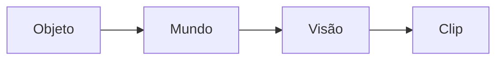

# Lições sobre autoria

Esta página é para quem adiciona ou edita conteúdo. Ela documenta o contrato
que o runtime impõe, as convenções que as lições existentes seguem e os testes
que detectam divergências. O conteúdo é gerenciado no Pages CMS (`.pages.yml`),
mas cada página é um arquivo Markdown simples em `content/en/docs/`.

## Onde o conteúdo fica

| Tipo | Diretório | URL |
| --- | --- | --- |
| Docs | `content/en/docs/*.md` | `/docs/<slug>` |

O slug é o nome do arquivo sem `.md`. O caminho relativo é a chave de tradução:
`docs/shader-editor.md` e `pt-BR/docs/shader-editor.md` descrevem a mesma
página. Por enquanto, o inglês é o único locale em que se escreve conteúdo; uma
página não traduzida usa o fallback para o inglês, com um aviso.

## Frontmatter

Toda página começa com frontmatter YAML. Apenas `title` e `section` são
obrigatórios.

```yaml
---
title: Primeiros shaders no sandbox
description: UVs, gradientes, formas e tempo no Sandbox GLSL 2D.
section: lessons
order: 1
difficulty: beginner
prerequisites: gles-3-0-webgl2, math-for-shaders
editor: sandbox
example: uv
printable: false
draft: false
---
```

| Chave | Tipo | Significado |
| --- | --- | --- |
| `title` | string | Título da página e rótulo na árvore. |
| `description` | string | Resumo para o cabeçalho, a busca e SEO futuro. |
| `section` | enum | Id de seção; precisa corresponder a `SECTIONS` em `contentTrees.ts` e em `.pages.yml`. |
| `order` | number | Posição dentro da seção. Menor primeiro. |
| `difficulty` | `beginner` / `intermediate` / `advanced` | Badge e agrupamento na trilha de aprendizagem. Omita em páginas de referência. |
| `prerequisites` | slugs separados por vírgula | Vinculados na trilha de aprendizagem. |
| `editor` | `editor` / `sandbox` / `screen-space` | Renderiza o callout "Open in editor". |
| `example` | string | Id do exemplo empacotado que o callout carrega. Obrigatório quando `editor` está definido. |
| `printable` | boolean | Habilita o layout de impressão e o botão Print. |
| `generated` | boolean | Definido apenas por `npm run docs:abi`; não edite à mão. |
| `draft` | boolean | Páginas não publicadas ficam ocultas em produção. Rascunhos em inglês ficam visíveis em `npm run dev`. |

Todas as chaves acima estão declaradas em `.pages.yml` para os dois locales. Se
adicionar uma chave, adicione-a também às duas coleções; caso contrário, o CMS
não consegue editá-la.

### Ids de seção

Docs: `editors`, `guides`, `reference`, `api`, `basics`, `math`, `glsl`,
`lessons`, `lighting`, `post`, `debugging`, `webgl`.

Os rótulos ficam em `src/core/content/contentTrees.ts`. Uma seção que não está
listada ali ainda renderiza, mas no final, com o id bruto; adicione-a aos dois
lugares em vez disso.

## O modelo de lição

Toda lição usa a mesma estrutura:

1. **Objetivo** — um parágrafo, o que o leitor consegue fazer depois.
2. **Antes de começar** — os pré-requisitos, com links.
3. **Conceito** — alguns parágrafos, com um diagrama Mermaid quando ajuda.
4. **Código mínimo anotado** — um bloco executável, não dez fragmentos.
5. **Open in editor** — fornecido pelo callout do frontmatter; mencione o id do
   exemplo na prosa se ajudar.
6. **Resultado esperado** — uma captura de tela em
   `public/images/content/lessons/`, com uma frase descrevendo o que muda quando
   um parâmetro se move.
7. **Exercícios** — dois ou três, cada um com uma dica e uma solução recolhível.
8. **Erros comuns** — os erros que o painel de diagnósticos ou a matemática
   tornam prováveis.
9. **Próximos passos** — a próxima lição e uma ou duas referências relacionadas.

O paginador de anterior/próximo no final é gerado a partir da ordem da árvore;
não o escreva à mão.

## Blocos de código

O renderizador adiciona um botão Copy a todo bloco de código. Um trecho executável
completo pode adicionar um botão **Run this** com um modificador na info string:

````markdown
```glsl title="UV como cor"
#version 300 es
...
```
````

| Modificador | Efeito |
| --- | --- |
| `run=sandbox` | **Run this** abre `/sandbox?code=<encoded source>`. |
| `run=screen-space` | **Open in Screen Space** abre `/screen-space?code=<encoded source>`. |
| `example=<id>` | **Open in editor** abre o exemplo empacotado, sem enviar o trecho. |
| `effect=<id>` | **Open post effect** abre `/editor?effect=<id>` (ou `/sandbox?effect=` com `run=sandbox`). |
| `title="…"` | Título visível na barra de ferramentas do bloco de código. |

Use `run=sandbox` apenas para um fragmento completo que se destina à ABI do
sandbox (`vUv`, `uResolution`, `uTime`, `fragColor`). Um trecho parcial falharia
na compilação depois que o usuário clicar em **Run this**; use `example=` ou um
bloco simples em vez disso.

O id `example` precisa existir no registro correspondente:

- `run=sandbox` / `example=` em uma página do sandbox → `sandboxExamples`.
- `run=editor` / `example=` em uma página 3D → `shaderExamples`.
- `run=screen-space` / `example=` em uma página do Editor GLSL de Tela →
  `screenSpaceExamples`.
- `effect=` → `postEffectExamples`.

O teste de links (`src/core/content/lessonLinks.test.ts`) lê todos os arquivos
de conteúdo, faz o parsing do frontmatter e dos blocos de código, e falha ao
encontrar um id desconhecido. O mesmo teste verifica os pares `editor` +
`example` do frontmatter.

## Deep links

Os links canônicos são:

| Link | O que faz |
| --- | --- |
| `/editor?example=phong` | Carrega o exemplo de material `phong`. |
| `/editor?effect=vignette` | Carrega o exemplo de pós-processamento `vignette`. |
| `/sandbox?example=gradient` | Carrega o exemplo de sandbox `gradient`. |
| `/sandbox?code=<url-encoded>` | Carrega um fragmento de sandbox inline. |
| `/screen-space?example=gbuffer-normal` | Carrega um efeito de tela. |
| `/screen-space?code=<url-encoded>` | Carrega um efeito de tela inline. |

`src/core/navigation/editorLinks.ts` monta e faz o parsing desses links; as
views passam a query para o composable delas antes de a prévia inicializar,
então a primeira compilação já é o documento solicitado.

## Soluções recolhíveis

Use o container `solution`; ele renderiza um elemento `<details>` nativo:

```markdown
::: solution Solução 1
O centro é escuro porque `length(vUv - 0.5)` é zero ali.
:::
```

Os containers `note` e `warning` renderizam como callouts:

```markdown
::: warning Mantenha em espaço linear
Não faça codificação sRGB dentro de um efeito.
:::
```

O corpo do container é Markdown comum, incluindo blocos de código. Não use HTML
bruto: `html: false` escapa esse HTML.

## Termos do glossário

Envolva um termo e sua definição inline:

```markdown
O [[albedo|a cor base difusa antes da iluminação]] é multiplicado pelo
termo do cosseno.
```

Isso renderiza como um `<abbr>` com dica ao passar o mouse. O
[Glossário](/docs/glossary) é uma página normal; mantenha a lista dele em
sincronia quando adicionar um termo novo.

## Mermaid

````markdown

````

Os diagramas são hidratados sob demanda depois que o Markdown renderiza.
Mantenha-os pequenos e não use fontes externas.

## Imagens

As imagens ficam em `public/images/content/` e são referenciadas com uma URL
relativa à raiz:

```markdown

```

As capturas de tela das lições reutilizam o pipeline de prévia:

```bash
npm run docs:images       # regenera todas as capturas de tela das lições
```

Os exemplos 3D são capturados do editor real, os exemplos do sandbox vêm da
prévia do sandbox, e as views de post/G-buffer vêm das pilhas de efeitos. Não
faça commit de uma imagem que não tenha sido gerada pela prévia; uma captura de
tela de um mock-up não é um resultado esperado. Se uma captura for
temporariamente impossível, use um placeholder claramente rotulado e
substitua-o quando a captura funcionar.

## Referência da ABI

`content/en/docs/abi-reference.md` é gerado a partir das declarações da ABI:

```bash
npm run docs:abi          # escreve a página
npm run docs:abi:check    # falha se estiver desatualizado
```

`predev`, `prebuild` e `pretest` executam a etapa de escrita. O teste de
divergências compara a página commitada com `buildAbiReferenceMarkdown()`;
editar a página à mão faz o teste falhar. Em vez disso, altere a declaração
`*Abi.ts` correspondente.

## Testar localmente

```bash
npm test                  # testes de conteúdo, links e divergências da ABI
npm run build             # vue-tsc + bundle de produção
npm run lint              # eslint
```

O teste de integração de conteúdo carrega a fonte real de `import.meta.glob`,
então um arquivo ausente ou um frontmatter malformado falha ali antes de o app
falhar.
