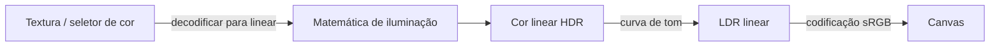

# Cor e espaço linear

## Objetivo

Você deve ser capaz de dizer se os números em um shader são lineares ou sRGB,
evitar a codificação dupla e explicar por que um brilho especular pode ser mais
claro que `1.0` sem ser cortado.

## Duas codificações, uma cor

Uma imagem de 8 bits armazena valores que uma tela espera. Esses valores são
codificados com a função de transferência sRGB, que gasta mais bits nos tons
escuros porque o olho é mais sensível ali. Um pixel de cinza médio fica em
torno de `0.5` em sRGB, mas só cerca de `0.21` em luz linear.

Valores lineares são proporcionais à luz física. Isso importa porque operações
como adição, multiplicação e médias ponderadas só têm significado físico no
espaço linear. Fazer blending de dois valores sRGB dá uma cor diferente (e
normalmente errada) da que se obtém ao fazer blending das mesmas cores no
espaço linear e codificar o resultado.



A conversão é aproximadamente:

```glsl
vec3 toLinear(vec3 srgb)
{
    return pow(srgb, vec3(2.2));
}

vec3 toSrgb(vec3 linearColour)
{
    return pow(linearColour, vec3(1.0 / 2.2));
}
```

A curva sRGB real tem um pequeno trecho linear perto do preto, que a
aproximação ignora. Use a conversão da engine quando ela existir; use este par
só quando precisar raciocinar sobre a direção da conversão.

## HDR não é um espaço de cor

Faixa dinâmica alta significa que os valores podem passar de `1.0`. Uma
superfície branca iluminada pode ser `1.0`, um brilho especular sobre ela pode
ser `8.0` e o disco do sol pode ser `50.0`. Um render target LDR limita esses
valores a `1.0`, e o brilho especular perde a forma.

O Editor GLSL de Tela renderiza a cena e cada efeito em render targets de
ponto flutuante, então os valores sobrevivem até o passe de exibição. É por
isso que a transformação de saída existe: ela mapeia uma cor linear
potencialmente ilimitada para a faixa `[0, 1]` que o canvas consegue mostrar.

## Tone mapping

Tone mapping é uma curva aplicada uma vez só, depois da pilha de efeitos:

- **Nenhuma** é uma codificação direta de linear para sRGB. Valores acima de
  `1.0` são cortados.
- **Reinhard** mapeia `x` para `x / (1 + x)`. Nunca corta, mas dessatura as
  cores claras e é facilmente excedido pelos brilhos.
- **ACES filmic** é uma curva inspirada em película, com um ombro e um pé. É o
  padrão no Editor GLSL de Tela porque mantém os brilhos legíveis.

Duas regras vêm daí:

1. **Não aplique tone mapping dentro de um efeito** a menos que a transformação
   de saída esteja em **Nenhuma**. Duas curvas deixam a imagem turva e esmagam
   os brilhos.
2. **Não faça codificação sRGB dentro de um efeito.** O passe de exibição já
   faz isso.

As visualizações de depuração são uma exceção só no sentido de que pulam a
pilha de efeitos; elas ainda passam pelo passe de exibição, então são
codificadas exatamente uma vez.

## Trabalhando com uniforms de cor

O seletor de cor de Dados do usuário mostra um valor hexadecimal, que é uma
codificação sRGB. O uniform gerado recebe um valor linear (a engine converte),
então um shader pode multiplicá-lo diretamente pela luz. Se você fixar uma cor
no GLSL, trate os números como lineares:

```glsl
// Um albedo linear, não um código hexadecimal.
vec3 albedo = vec3(0.72, 0.31, 0.22);
```

Se quiser uma amostra sRGB específica, converta uma vez:

```glsl
vec3 srgb = vec3(0.83, 0.39, 0.28);
vec3 linearAlbedo = pow(srgb, vec3(2.2));
```

## Gamma no sandbox

O Sandbox GLSL 2D exibe a saída do fragmento diretamente. Ele não tem
iluminação de cena nem render target HDR, então seu pipeline padrão é LDR. Se
você copiar um trecho de iluminação para o sandbox e ele parecer claro ou
escuro demais, compare os dois pipelines antes de mexer na matemática: o
sandbox não aplica a mesma transformação de saída que o Editor GLSL 3D.

## Exercícios

1. Renderize um gradiente vertical com
   `fragColor = vec4(vec3(vUv.y), 1.0)` no sandbox. Depois renderize
   `vec3(pow(vUv.y, 2.2))`. Qual dos dois parece um gradiente perceptivo suave?
2. Pegue o exemplo de gradiente e multiplique a cor final por `2.0`. No sandbox
   o topo do gradiente é cortado; no Editor GLSL de Tela uma transformação ACES
   faria roll-off nele. Explique a diferença.
3. Defina a transformação de saída do Editor GLSL de Tela como **Nenhuma** e
   adicione `color = pow(color, vec3(1.0 / 2.2));` a um efeito. O que acontece
   com a imagem, e por quê?

::: solution Solução 1
O primeiro gradiente é a codificação sRGB. O segundo aplica a curva de
decodificação uma segunda vez, então parece escuro demais nos meios-tons. Se
quiser um gradiente linear exibido corretamente, codifique o valor final uma
vez.
:::

::: solution Solução 2
O sandbox escreve em LDR. Multiplicar por `2.0` limita tudo o que está acima de
`1.0` ao branco, achatando o topo do gradiente. A ACES comprime em vez de
cortar, então o topo mantém alguma separação.
:::

::: solution Solução 3
O efeito codifica para sRGB, e o passe de exibição codifica de novo. A imagem
fica lavada, com pretos elevados e brilhos comprimidos. Remova uma das duas
codificações.
:::

## Erros comuns

- Aplicar `pow(1.0 / 2.2)` em um efeito enquanto a transformação de exibição
  está ativa.
- Tratar uma cor hexadecimal como linear e multiplicá-la pela luz.
- Esperar que um render target LDR preserve brilhos acima de `1.0`.
- Usar **Nenhuma** com uma cena HDR muito clara e presumir que o shader quebrou;
  os brilhos estão sofrendo clipping, não desaparecendo.

## Próximos passos

- [GLSL ES 3.00](/docs/gles-3-0-webgl2)
- [Editor GLSL de Tela](/docs/screen-space-editor)
- [Lições de pós-processamento](/docs/post-processing)
