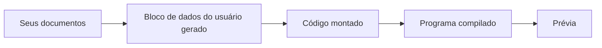

# Visão geral dos editores

O ShaderForge é uma bancada de trabalho GLSL que roda no navegador. Ele tem
três telas de edição: o **Editor GLSL 3D**, o **Sandbox GLSL 2D** e o
**Editor GLSL de Tela**. Eles compartilham o mesmo editor de código, o mesmo
pipeline de compilação e os mesmos painéis de dados, mas respondem a perguntas
diferentes.

Esta página explica qual tela abrir e o que as três têm em comum. Cada editor
também tem sua própria página de referência.

## As três telas

| Tela | URL | O que você escreve | Renderizador | Quando escolher |
| --- | --- | --- | --- | --- |
| Editor GLSL 3D | `/editor` | Um par de shaders de vértices e fragmentos para uma superfície | Babylon.js | Você quer um material em um modelo, com iluminação e reflexos com base em imagem |
| Sandbox GLSL 2D | `/sandbox` | Um shader de fragmentos que preenche a viewport | WebGL 2 | Você quer experimentar pixels, padrões ou raymarching sem uma cena |
| Editor GLSL de Tela | `/screen-space` | Uma cadeia de fragmentos de pós-efeito sobre uma cena inteira | Babylon.js | Você quer pós-processar uma cena e ler sua cor HDR e seu G-buffer |

O Editor GLSL de Tela é um pipeline de cena separado, não o editor 3D com outra
aba selecionada. Ele carrega uma cena GLB inteira, renderiza com uma câmera em
primeira pessoa, monta um G-buffer MRT e expõe attachments que a ABI de
pós-efeito de superfície não tem.

## Qual tela devo usar?

- **"Quero sombrear um modelo."** Abra o [Editor GLSL 3D](/docs/3d-editor).
  Você tem um estágio de vértice, um estágio de fragmento, uma malha alternável
  e um ambiente HDR.
- **"Quero uma imagem de tela cheia sem configuração."** Abra o
  [Sandbox GLSL 2D](/docs/2d-sandbox). Um documento de fragmento, um triângulo
  de tela cheia, três entradas da engine.
- **"Quero efeitos de profundidade, normal, contorno ou SSAO sobre uma cena."**
  Abra o [Editor GLSL de Tela](/docs/screen-space-editor). Ele expõe a cor da
  cena, profundidade, normais, albedo, material e vetores de movimento.
- **"Estou aprendendo GLSL."** Comece no Sandbox GLSL 2D: não há malha, câmera
  nem iluminação para gerenciar. Passe para o editor 3D quando quiser
  atributos, varyings e uma superfície, e depois para o Editor GLSL de Tela em
  trabalhos com G-buffer. A [Trilha de aprendizagem](/docs/learning-path) ordena
  as lições.

## O que eles têm em comum

As três telas usam o mesmo modelo da esquerda para a direita:

- **Documentos à esquerda.** As abas de texto são implementadas sobre o
  CodeMirror, com realce de sintaxe GLSL e diagnósticos do compilador. O editor
  3D também tem documentos de referência somente leitura **Atributos** e
  **Uniformes** e uma tabela **Dados do usuário** estruturada.
- **Uma prévia ao vivo à direita.** A prévia é renderizada continuamente; o
  tempo é uma entrada do seu shader.
- **Um botão Compilar.** Editar não compila automaticamente. O botão compila a
  família de documentos da aba ativa.
- **Dados do usuário.** Uma tabela de uniforms e texturas que o app declara e
  vincula para você. O mesmo painel é usado nos três editores, com um conjunto
  menor de tipos no sandbox e definições somente de pós-processamento no Editor
  GLSL de Tela.
- **Efeitos de pós-processamento.** Uma cadeia ordenada de passes de fragmento
  em tela cheia, com uma transformação de saída no final. O editor 3D e o
  sandbox compartilham a ABI de pós-efeito de superfície; o Editor GLSL de
  Tela tem sua própria ABI de G-buffer.
- **Uma barra de status e uma sobreposição de erros.** Elas informam se a última
  compilação teve sucesso e onde ela falhou.
- **Sem salvamento.** Nada é persistido entre carregamentos da página.

## Onde eles diferem

| Dimensão | Editor GLSL 3D | Sandbox GLSL 2D | Editor GLSL de Tela |
| --- | --- | --- | --- |
| Estágios editáveis | Vértices e fragmentos | Somente fragmento | Somente fragmentos de pós-efeito |
| Geometria | Malha GLB alternável | Triângulo de tela cheia fixo | Cena GLB inteira |
| Entradas de cena | Câmera, luz, ambiente HDR, IBL | Nenhuma | Câmera FPS, intensidades do sol e do HDRI, G-buffer completo |
| Entradas extras | Atributos, matrizes, samplers IBL | `vUv`, `uResolution`, `uTime` | Cor HDR da cena, profundidade, normal, albedo, material, velocidade |
| Exemplos | Doze exemplos de material incluídos | Cinco exemplos do sandbox | Sete exemplos de G-buffer e de efeito |
| Copiar código do shader | Sim | Não | Sim |
| Wireframe | Sim | Não | Não |
| Pausar | Para a renderização; o tempo continua correndo | Congela a renderização e o tempo | Congela a renderização, `time`, o índice do quadro e o delta time |
| Geometria de pós-efeito | Normais e profundidade reais | Placeholders neutros | Normais reais no espaço de visão e profundidade em unidades de mundo |

O attachment de profundidade do editor de tela está em unidades de mundo; a
profundidade do pós-efeito de superfície é normalizada para `[0, 1]`. Essa
diferença é o motivo de as duas ABIs serem separadas.

## Como uma edição vira imagem

No momento da compilação, o app insere as declarações de dados do usuário
geradas no seu código, compila o resultado com o driver WebGL 2 do navegador e
mantém o programa resultante. Se uma compilação falhar, o programa anterior
continua na tela para que a prévia não fique em branco.

## Requisitos

- Um navegador com **WebGL 2** ativado: Chrome/Edge atual, Firefox atual ou
  Safari 15+. Não há fallback para WebGL 1.
- Aceleração de hardware ativada no navegador. Um renderizador por software
  funciona, mas é lento.
- Sem instalação, conta ou arquivo de projeto. Tudo roda na página.

## Próximos passos

- [Trilha de aprendizagem](/docs/learning-path)
- [Editor GLSL 3D](/docs/3d-editor)
- [Sandbox GLSL 2D](/docs/2d-sandbox)
- [Editor GLSL de Tela](/docs/screen-space-editor)
- [Dados do usuário](/docs/user-data)
- [Efeitos de pós-processamento](/docs/post-effects)
- [Referência da ABI](/docs/abi-reference)
- [Compilação e erros](/docs/compiling-and-errors)
- [Limites e solução de problemas](/docs/limits-and-troubleshooting)
- [O pipeline de renderização](/docs/the-rendering-pipeline)
