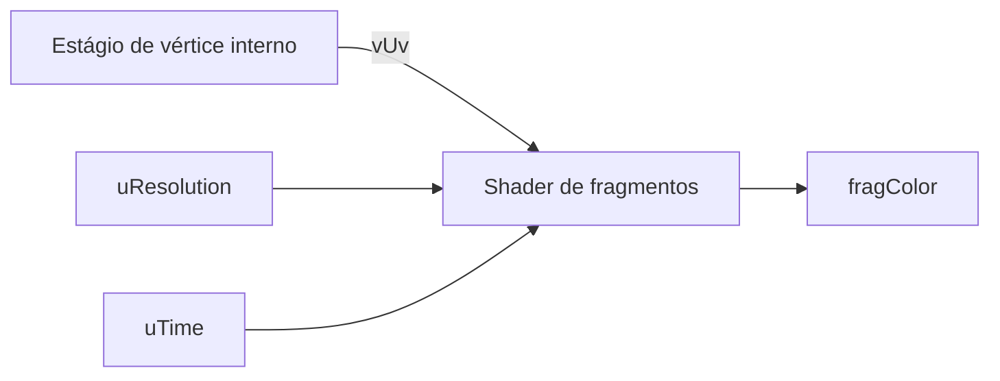

# Primeiros shaders no sandbox

## Objetivo

Escreva e execute um shader de fragmentos que preenche a tela. Ao final, você
deve estar à vontade com `vUv`, `uResolution`, `uTime`, `mix`, `smoothstep`,
`step` e `fract`, e deve ter um modelo mental de um shader de fragmentos como
uma função de um pixel para uma cor.

## Antes de começar

Leia [GLSL ES 3.00](/docs/gles-3-0-webgl2) primeiro. Você precisa
reconhecer `#version`, `precision`, `in`, `uniform` e a saída explícita do
shader de fragmentos.

## O shader de fragmentos é uma função da posição

O sandbox desenha um único triângulo de tela cheia. Para cada pixel que ele
cobre, o shader de fragmentos executa `main`. A única posição por pixel que você
recebe é `vUv`, um `vec2` que vai de `(0, 0)` no canto inferior esquerdo a
`(1, 1)` no canto superior direito.



`vUv` já está normalizado, então é independente da resolução. `uResolution` é o
tamanho do buffer de desenho em pixels, útil quando você precisa da proporção
(aspect ratio). `uTime` é o tempo decorrido em segundos e congela quando a
prévia está pausada.

## UVs como cor

O shader útil mais simples grava o UV direto no RGB:

```glsl run=sandbox title="UV como cor"
#version 300 es
precision highp float;

in vec2 vUv;
uniform vec2 uResolution;
uniform float uTime;

out vec4 fragColor;

void main(void)
{
    fragColor = vec4(vUv.x, vUv.y, 0.5, 1.0);
}
```

Vermelho cresce para a direita, verde cresce para cima, azul é constante.
Quando você consegue ler posição a partir da cor, consegue depurar quase
qualquer coisa.

## Gradientes com mix

`mix(a, b, t)` interpola entre dois valores. `smoothstep(e0, e1, x)` produz uma
rampa suave de `0..1`, o que deixa a transição mais suave do que um `t` linear:

```glsl run=sandbox title="Gradiente"
#version 300 es
precision highp float;

in vec2 vUv;
uniform vec2 uResolution;
uniform float uTime;

out vec4 fragColor;

void main(void)
{
    vec3 deepBlue = vec3(0.05, 0.08, 0.22);
    vec3 hotPink = vec3(0.95, 0.25, 0.55);

    float ramp = dot(vUv, normalize(vec2(1.0, 1.0)));
    vec3 color = mix(deepBlue, hotPink, smoothstep(0.1, 0.9, ramp));

    fragColor = vec4(color, 1.0);
}
```

## Formas com step e distância

Uma forma é um teste. `step(edge, x)` retorna `1` quando `x >= edge` e `0` caso
contrário. Um círculo é "a distância do centro é menor que o raio":

```glsl
vec2 p = (vUv - 0.5) * vec2(uResolution.x / uResolution.y, 1.0);
float distanceToCentre = length(p);
float inside = step(distanceToCentre, 0.3);
```

`step(edge, x)` é fácil de ler ao contrário. É `x >= edge`, não `edge >= x`.
Para um círculo, escreva `1.0 - step(0.3, distanceToCentre)` se você preferir o
raio do lado da borda.

Para uma borda suave, use `smoothstep(radius, radius - width, distance)`; as
bordas invertidas fazem a transição ir de `0` fora para `1` dentro.

## Tempo

`uTime` está em segundos. Multiplique por uma velocidade e some dentro de `sin`:

```glsl
float pulse = 0.5 + 0.5 * sin(uTime * 2.0);
```

`sin` retorna `[-1, 1]`, então `0.5 + 0.5 * sin(...)` mapeia para `[0, 1]`. Se
você quer um laço que se repita a cada segundo, use `fract(uTime)`.

## Tiling com fract

`fract(x)` é a parte fracionária. Multiplique o UV primeiro para escolher o
número de células, depois pegue a parte fracionária para obter uma coordenada
local que se repete:

```glsl
vec2 tiled = fract(vUv * 8.0);   // 8 células na horizontal, uv local em [0, 1)
```

`floor(vUv * 8.0)` dá o índice inteiro da célula, que é como o exemplo pattern
alterna cores.

## O editor está conectado a estas lições

O aviso **Open in editor** no topo desta página carrega o exemplo `uv`. Use o
botão **Run this** em qualquer trecho completo abaixo para abrir o sandbox com
esse código-fonte. A documentação e o app compartilham os mesmos ids de exemplo,
e um teste falha se um link apontar para um id que não existe.

## Resultado esperado


A imagem é o primeiro exemplo do sandbox. É estática, exceto pelo canal azul,
que pulsa com `uTime`.

## Exercícios

1. Troque os canais vermelho e verde no primeiro trecho. Qual canto fica
   amarelo?
2. Faça o gradiente radial em vez de diagonal: use `length(vUv - 0.5)` como
   entrada do `smoothstep`.
3. Desenhe um círculo e anime seu raio com `0.2 + 0.1 * sin(uTime)`.
4. Multiplique o UV por `4.0` antes do `fract` e descreva quantas repetições
   você vê.

::: solution Solução 1
`vec4(vUv.y, vUv.x, 0.5, 1.0)`. O canto superior esquerdo é `(0, 1)`, então o
verde é maior ali; o inferior direito é `(1, 0)`, então o vermelho vence.
:::

::: solution Solução 2
```glsl
float ramp = length(vUv - 0.5) * 2.0;
vec3 color = mix(hotPink, deepBlue, smoothstep(0.2, 1.0, ramp));
```
O centro é a extremidade escura e as bordas são rosa.
:::

::: solution Solução 3
```glsl
vec2 p = (vUv - 0.5) * vec2(uResolution.x / uResolution.y, 1.0);
float radius = 0.2 + 0.1 * sin(uTime);
float circle = 1.0 - smoothstep(radius, radius + 0.01, length(p));
fragColor = vec4(vec3(circle), 1.0);
```
:::

::: solution Solução 4
Quatro repetições na horizontal e quatro na vertical, porque a coordenada de
tiling é `fract(vUv * 4.0)`.
:::

## Erros comuns

- Tratar `vUv` como pixels. Ele é normalizado; use `uResolution` para pixels.
- Esquecer a correção de proporção: um círculo vira uma elipse em uma viewport
  larga sem `p.x *= uResolution.x / uResolution.y`.
- Usar `step(x, edge)` e obter a forma oposta.
- Animar com milissegundos de tempo real em vez dos segundos de `uTime`.
- Declarar `uTime` na aba Dados do usuário: ele já é fornecido pela ABI.

## Próximos passos

- [Padrões, ruído e SDFs](/docs/patterns-noise-sdf)
- [Funções integradas](/docs/built-in-functions)
- [Sandbox GLSL 2D](/docs/2d-sandbox)
