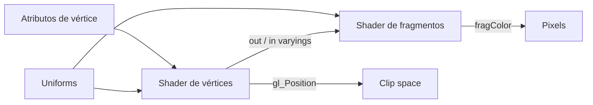

# GLSL ES 3.00

## Objetivo

Entenda a estrutura de um shader moderno de WebGL 2: a linha `#version`, a
interface `in`/`out` entre os estágios, as entradas `uniform` que a engine
controla, as declarações de precisão, o fluxo de controle, as funções do
usuário e a saída do fragmento.

## Uma linguagem, dois estágios

Um programa de WebGL 2 vincula dois estágios de shader. O estágio de vértice
executa uma vez por vértice e escreve `gl_Position`; o estágio de fragmento
executa uma vez por pixel coberto e escreve uma ou mais saídas de cor.



A interface entre os estágios é explícita:

```glsl
// vertex
out vec3 vWorldNormal;

// fragment
in vec3 vWorldNormal;
```

Os nomes e os tipos devem coincidir exatamente. Uma divergência é um erro de
vinculação, não de compilação, e o painel de erros a reporta como
**Shaders do not match**.

## O cabeçalho

Todo shader começa com a diretiva de versão na primeira linha:

```glsl
#version 300 es
```

Shaders de fragmentos então declaram uma precisão padrão de float:

```glsl
precision highp float;
```

Uma `#version` que não está na primeira linha é um erro de sintaxe. Comentários
antes dela também não são permitidos.

## Qualificadores

| Qualificador | Onde aparece | Significado |
| --- | --- | --- |
| `in` | vértice | atributo de vértice, fornecido pela malha |
| `in` | fragmento | valor interpolado vindo do estágio de vértice |
| `out` | vértice | valor interpolado para o estágio de fragmento |
| `out` | fragmento | saída de cor; declare com um location |
| `uniform` | ambos | valor constante para todo o draw call |
| `const` | ambos | constante de tempo de compilação |
| `inout` | parâmetro de função | lê e escreve o valor de quem chama |
| `flat` | `in`/`out` | sem interpolação; o vértice provocador vence |
| `smooth` | `in`/`out` | interpolação com correção de perspectiva (padrão) |

Uma saída de fragmento no GLSL ES 3.00 é declarada explicitamente:

```glsl
layout(location = 0) out vec4 fragColor;
```

Não existe `gl_FragColor` no ES 3.00. O painel de diagnósticos reconhece esse
erro e informa o substituto.

## Uniforms não são constantes

Um `uniform` é constante durante um draw call, mas muda entre quadros. A engine
o define antes do draw call. Você não pode atribuir a um uniform dentro do
shader. Se um valor muda por vértice, use um atributo ou calcule-o; se muda por
pixel, calcule-o no shader de fragmentos.

A lista completa de cada editor é gerada na
[Referência da ABI](/docs/abi-reference).

## Atributos

Atributos são entradas de vértice. A prévia 3D fornece `position`, `normal`,
`tangent`, `uv`, `uv2` e `color`; o sandbox não fornece nenhum, porque seu
estágio de vértice é interno. Declare um atributo com `in`:

```glsl
in vec3 position;
in vec3 normal;
in vec2 uv;
```

Um atributo que a malha não fornece é lido como um valor padrão, não como erro.
Se um shader parece achatado ou uma UV é sempre zero, verifique o nome do
atributo primeiro.

## Precisão

Os qualificadores de precisão controlam a faixa e a precisão mínimas de um tipo:

- `lowp` — pelo menos 8 bits de mantissa; barato, com banding visível.
- `mediump` — pelo menos 10 bits; um padrão comum em mobile.
- `highp` — pelo menos 16 bits; o padrão em desktop e a escolha certa para
  posições.

Você pode escrever `precision highp float;` uma vez no topo, ou anotar
declarações individuais (`uniform highp mat4 view;`). Este projeto usa `highp`
em todo lugar e espera isso nos shaders do usuário.

## Fluxo de controle

O GLSL ES 3.00 tem `if`/`else`, `for`, `while` e `do`/`while`. Duas diferenças
práticas em relação ao JavaScript:

- Um laço `for` com limite constante é a única forma que o compilador consegue
  desenrolar por completo; um limite vindo de um uniform pode impedir o
  desenrolamento.
- `discard` encerra o shader de fragmentos sem escrever uma cor. Ele desativa o
  teste de profundidade antecipado nesse draw call, então use com parcimônia.

```glsl
for (int i = 0; i < 8; i++) {
    sum += texture(textureSampler, uv + vec2(float(i)) * texelSize).r;
}
```

## Funções

Funções são declaradas antes do uso, com um tipo de retorno e
parâmetros tipados:

```glsl
float luminance(vec3 color)
{
    return dot(color, vec3(0.2126, 0.7152, 0.0722));
}

vec3 tonemapReinhard(vec3 color)
{
    return color / (1.0 + color);
}
```

Sobrecargas são permitidas quando os tipos dos parâmetros diferem. `in` é o
qualificador de parâmetro padrão; `out` escreve um resultado, e `inout` lê e
escreve:

```glsl
void splitUv(vec2 uv, out vec2 cell, out vec2 local)
{
    cell = floor(uv);
    local = fract(uv);
}
```

Não há suporte a recursão. Uma função não pode ser declarada dentro de outra
função.

## Integrados

O shader de fragmentos recebe `gl_FragCoord` (posição no espaço de janela) e
`gl_FrontFacing` (frente/verso). O shader de vértices escreve `gl_Position` e
pode ler `gl_VertexID` e `gl_InstanceID`. O sandbox usa `gl_VertexID` para gerar
seu triângulo de tela cheia sem um buffer de vértices.

As funções integradas mais usadas estão em
[Funções integradas](/docs/built-in-functions) e na
[Referência rápida de GLSL](/docs/cheat-sheet).

## Vindo do GLSL ES 1.00

O Editor GLSL 3D ainda entende diagnósticos de ES 1.00, então trechos antigos
geram sugestões úteis. O renderizador compila ES 3.00, o que implica estas
substituições:

| ES 1.00 | ES 3.00 |
| --- | --- |
| `attribute vec3 position;` | `in vec3 position;` (vértice) |
| `varying vec3 vNormal;` | `out vec3 vNormal;` (vértice), `in vec3 vNormal;` (fragmento) |
| `gl_FragColor = ...;` | `layout(location = 0) out vec4 fragColor;` depois `fragColor = ...;` |
| `texture2D(s, uv)` | `texture(s, uv)` |
| `textureCube(s, dir)` | `texture(s, dir)` |
| `#version 100` | `#version 300 es` |

A [página de depuração](/docs/debugging-shaders) lista as mensagens de erro
exatas que o painel de diagnósticos traduz.

## Shader completo mínimo

```glsl run=sandbox title="Esqueleto do GLSL ES 3.00"
#version 300 es
precision highp float;

in vec2 vUv;
uniform vec2 uResolution;
uniform float uTime;

out vec4 fragColor;

float ring(vec2 uv, float frequency)
{
    vec2 p = uv - 0.5;
    return smoothstep(0.02, 0.0, abs(fract(length(p) * frequency - uTime) - 0.5));
}

void main(void)
{
    float value = ring(vUv, 8.0);
    fragColor = vec4(vec3(value), 1.0);
}
```

## Exercícios

1. Mova `#version 300 es` para depois de um comentário e compile. Leia o painel
   de erros; ele deve citar a regra da primeira linha.
2. Mude a saída do fragmento para `gl_FragColor = vec4(1.0);`. O que o painel
   de diagnósticos diz?
3. Escreva uma função `vec3 tint(vec3 color, float amount)` e chame-a dentro
   de `main`.
4. Declare um `uniform float uScale;` e use-o na frequência do anel. O sandbox
   o vincula? Por que não?

::: solution Solução 1
O compilador reporta que `#version` deve vir primeiro. A regra existe porque o
driver escolhe a versão da linguagem antes de analisar qualquer outra coisa.
:::

::: solution Solução 2
`gl_FragColor` não está disponível no GLSL ES 3.00. Declare uma saída com
`layout(location = 0) out vec4 fragColor;` e atribua a ela.
:::

::: solution Solução 3
```glsl
vec3 tint(vec3 color, float amount)
{
    return mix(color, vec3(1.0), amount);
}
```
Depois chame `tint(vec3(value), 0.25)` dentro de `main`.
:::

::: solution Solução 4
O sandbox não vincula `uScale`; ele fornece apenas `uResolution` e `uTime`.
Declare o valor na aba Dados do usuário para que ele seja gerado e vinculado.
:::

## Erros comuns

- `#version` não está na primeira linha.
- Uso de `gl_FragColor` em um shader `#version 300 es`.
- Misturar `attribute`/`varying` com `in`/`out`.
- Nomes ou tipos de varying incompatíveis entre os estágios.
- Literais de ponto flutuante escritos como inteiros.
- Um `uniform` declarado mas nunca escrito pela engine (é lido como zero).

## Próximos passos

- [Funções integradas](/docs/built-in-functions)
- [Primeiros shaders no sandbox](/docs/first-shaders)
- [Depuração de shaders](/docs/debugging-shaders)
