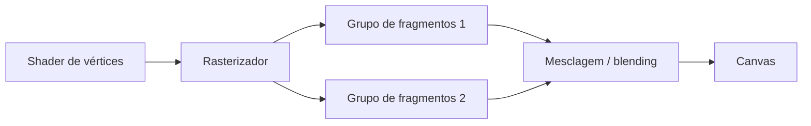

# Fundamentos de desempenho

## Objetivo

Construa um modelo mental útil da execução da GPU, identifique os gargalos
habituais e saiba quais controles da prévia medem o custo em vez de chutar.

## O modelo de execução

Uma GPU executa um shader de fragmentos para muitos pixels de uma vez, em
grupos (muitas vezes chamados de wavefronts ou warps). O grupo executa em
lockstep: cada lane executa a mesma instrução, com dados diferentes. Esse
modelo explica a maior parte dos conselhos sobre desempenho.



- **O shader de fragmentos roda por pixel coberto**, não por objeto. Um passe
  de tela cheia paga por cada pixel do buffer de desenho.
- **A divergência é cara.** Se metade de um grupo segue um desvio `if` e a
  outra metade não, o grupo em geral executa os dois caminhos e mascara o
  resultado.
- **A latência de memória é escondida pelo paralelismo.** Leituras de textura
  não são lentas automaticamente, mas uma cadeia dependente de leituras trava
  um grupo inteiro.

## Desvios condicionais (branching)

Prefira aritmética a desvios condicionais quando o desvio é por pixel e
imprevisível:

```glsl
// Os dois lados são baratos, então esta costuma ser a forma melhor.
float inside = step(distance, radius);

// Um desvio por pixel que diverge dentro de um grupo.
if (distance < radius) {
    color = insideColor;
} else {
    color = outsideColor;
}
```

Desvios ainda são úteis quando um lado é caro e a condição é espacialmente
coerente (uma região inteira da tela segue o mesmo caminho), ou quando o
desvio é uniforme para todo o draw call. Um limite de loop constante e pequeno é
preferível a um loop controlado por uniform; o compilador consegue
desenrolá-lo.

## Leituras de textura

- Uma leitura é rápida quando acerta o cache; pixels vizinhos em geral leem
  texels vizinhos, que é o caso bom.
- Cada tap adicional em um loop multiplica a largura de banda. Um SSAO com 12
  taps faz 12 leituras por pixel; em 1600×1000 isso dá 19 milhões de leituras
  por quadro.
- Amostragem com mipmap é mais barata e tem filtragem melhor que
  `textureLod(..., 0)` em uma região minificada. Deixe a GPU escolher.
- Evite amostrar uma textura dentro de um loop com um UV que depende da
  leitura anterior; isso serializa o grupo.

## Precisão

`highp` é o padrão aqui e é o que posições e normais exigem. `mediump` pode ser
mais rápido em algumas GPUs móveis, mas este app é voltado para WebGL 2 no
desktop, onde a diferença costuma ser pequena. Não abra mão da exatidão em
troca de uma mudança de precisão que você não consegue medir.

## Overdraw e taxa de preenchimento

Overdraw é o mesmo pixel sombreado mais de uma vez: superfícies transparentes
em camadas, quads grandes sobrepostos ou um passe de tela cheia depois de uma
cena que já preencheu a tela. Todo efeito de pós-processamento de tela cheia é
uma nova camada de overdraw.

O Editor GLSL de Tela é limitado pela taxa de preenchimento: o G-buffer, o
render target de cor HDR e cada passe de efeito escalam com a contagem de
pixels. Duas consequências:

- Adicionar um efeito não sai de graça, mesmo que seja um pass-through; é outro
  draw call de tela cheia.
- Reduzir o tamanho do buffer de desenho é a maior alavanca isolada.

## O que os editores medem

O Editor GLSL de Tela exibe uma sobreposição com:

- **FPS** — quadros por segundo.
- **ms / budget** — tempo de quadro suavizado contra a meta de 16,7 ms.
- **width×height (scale)** — o tamanho atual do buffer de desenho e a escala de
  renderização adaptativa.
- **draws** — draw calls no quadro.

O editor baixa a escala de renderização quando o tempo de quadro suavizado
estoura o orçamento e a aumenta devagar quando há folga. Isso mantém a
interação responsiva, mas torna enganosa a comparação de tempo de quadro bruto
em escalas diferentes. Leia a escala antes de comparar dois shaders.

O Editor GLSL 3D não tem sobreposição de estatísticas. Use as ferramentas de
desempenho do navegador ou o hook de profiling `?perf` se precisar de tempos.

## Um checklist prático

1. **É o shader ou a cena?** Pause a animação; se o quadro continua lento, o
   custo é de renderização por quadro, não de trabalho guiado por `time`.
2. **Quantos passes?** Desative os efeitos um a um, a partir da pilha.
3. **Quantos taps?** Conte as leituras de textura por pixel, incluindo loops.
4. **O shader faz overdraw?** Um efeito de tela cheia é um passe de tela cheia
   por definição; vários deles se somam.
5. **A escala está mudando?** Leia o `%` na sobreposição de estatísticas antes de
   tirar conclusões.
6. **O loop pode ser desenrolado?** Use um limite literal e uma contagem de
   iterações pequena.

## Exemplo mínimo: o custo de um loop

```glsl run=sandbox title="Custo do loop"
#version 300 es
precision highp float;

in vec2 vUv;
uniform vec2 uResolution;
uniform float uTime;

out vec4 fragColor;

void main(void)
{
    vec2 p = vUv - 0.5;
    float sum = 0.0;

    // Doze avaliações de uma função barata; aumente ou diminua o limite para
    // sentir o custo em um canvas grande.
    for (int i = 0; i < 12; i++)
    {
        float fi = float(i);
        sum += sin(p.x * (fi + 1.0) + uTime) * cos(p.y * (fi + 1.0));
    }

    fragColor = vec4(vec3(0.5 + 0.5 * sum / 12.0), 1.0);
}
```

## Exercícios

1. Aumente o limite do loop para `64`. O sandbox continua fluido em um canvas
   grande?
2. Troque o loop por um desvio que pula metade dos pixels. Ficou mais rápido?
   Por que pode não ser?
3. No Editor GLSL de Tela, desative todos os efeitos e leia as estatísticas.
   Reative-os um de cada vez e compare o tempo de quadro.
4. Diminua a escala de renderização encolhendo a janela do navegador. Como o
   tempo de quadro muda?
5. Por que `textureLod(sampler, uv, 0.0)` em uma região minificada é
   potencialmente mais lento que `texture(sampler, uv)`?

::: solution Solução 1
A resposta exata depende da GPU, mas 64 senos/cossenos por pixel é um aumento
grande. Em um canvas grande o tempo de quadro sobe e a escala adaptativa pode
cair.
:::

::: solution Solução 2
Desvios divergentes não economizam o tempo do grupo quando alguns lanes seguem
os dois caminhos. Um desvio coerente (regiões inteiras) pode ajudar; um padrão
por pixel muitas vezes não.
:::

::: solution Solução 3
O pass-through é um draw call de tela cheia; cada efeito ativado acrescenta outro.
A diferença é o custo dos passes extras, mais os taps de textura, se houver.
:::

::: solution Solução 4
Menos pixels significa menos trabalho de fragmento e menos leituras de textura,
então o tempo de quadro cai e a escala adaptativa pode subir. É a mesma alavanca
que a política usa.
:::

::: solution Solução 5
`textureLod(..., 0.0)` força o mip de maior resolução mesmo quando a GPU
escolheria um menor. A chamada lê mais texels e pode provocar thrashing no
cache, enquanto `texture` seleciona um mip adequado automaticamente.
:::

## Erros comuns

- Medir FPS enquanto a escala adaptativa está mudando.
- Acrescentar um segundo passe de tela cheia e esperar que não custe nada.
- Usar um uniform como limite de loop, impedindo o desenrolamento.
- Amostrar uma textura 4K com `textureLod(..., 0.0)` para uma superfície
  distante.
- Otimizar um desvio que é coerente ou barato.

## Próximos passos

- [Depuração de shaders](/docs/debugging-shaders)
- [Limites e solução de problemas](/docs/limits-and-troubleshooting)
- [Editor GLSL de Tela](/docs/screen-space-editor)
