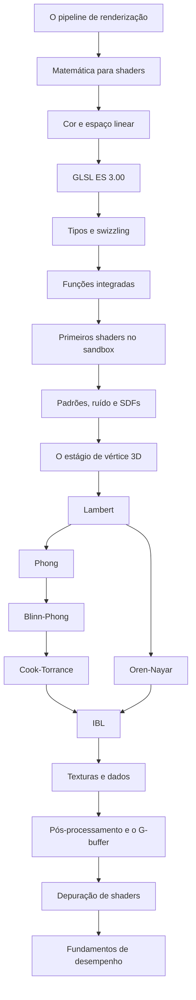

# Trilha de aprendizagem

Esta é a ordem em que as lições foram escritas. Cada lição pressupõe as
anteriores; o frontmatter registra os mesmos links, então a árvore e as páginas
concordam. Você pode pular para um tópico, mas a série de iluminação pressupõe
a lição do estágio de vértice e a lição de pós-processamento pressupõe a série
de iluminação.

## 1. Fundamentos

| Lição | Dificuldade | O que você vai aprender |
| --- | --- | --- |
| [O pipeline de renderização](/docs/the-rendering-pipeline) | Iniciante | Como dados de vértices se tornam pixels. |
| [Matemática para shaders](/docs/math-for-shaders) | Iniciante | Vetores, produto escalar/vetorial, matrizes, espaços. |
| [Cor e espaço linear](/docs/color-and-linear) | Iniciante | sRGB vs linear, HDR, tone mapping. |

## 2. A linguagem

| Lição | Dificuldade | O que você vai aprender |
| --- | --- | --- |
| [GLSL ES 3.00](/docs/gles-3-0-webgl2) | Iniciante | Qualificadores, precisão, fluxo de controle, funções. |
| [Tipos e swizzling](/docs/data-types) | Iniciante | Escalares, vetores, matrizes, construtores, swizzles. |
| [Funções integradas](/docs/built-in-functions) | Iniciante | As funções que você vai usar todo dia. |
| [Referência rápida de GLSL](/docs/cheat-sheet) | Iniciante | Uma referência imprimível para a sintaxe. |

## 3. O sandbox 2D

| Lição | Dificuldade | O que você vai aprender |
| --- | --- | --- |
| [Primeiros shaders no sandbox](/docs/first-shaders) | Iniciante | UVs, gradientes, formas, tempo, tiling. |
| [Padrões, ruído e SDFs](/docs/patterns-noise-sdf) | Iniciante | Hash, ruído de valor, fBm, campos de distância com sinal. |

O sandbox é o lugar mais rápido para iterar. Todo trecho marcado com
**Run this** o abre com o código exato.

## 4. O estágio de vértice 3D

| Lição | Dificuldade | O que você vai aprender |
| --- | --- | --- |
| [O estágio de vértice 3D](/docs/vertex-stage-3d) | Intermediário | MVP, normalMatrix, varyings, deslocamento. |

## 5. Iluminação

| Lição | Dificuldade | O que você vai aprender |
| --- | --- | --- |
| [Iluminação: Lambert](/docs/lighting-lambert) | Iniciante | Difuso pela lei do cosseno. |
| [Iluminação: Phong](/docs/lighting-phong) | Iniciante | Especular com vetor de reflexão. |
| [Iluminação: Blinn-Phong](/docs/lighting-blinn-phong) | Intermediário | Especular com half vector. |
| [Iluminação: Oren-Nayar](/docs/lighting-oren-nayar) | Intermediário | Difuso rugoso. |
| [Iluminação: Cook-Torrance](/docs/lighting-cook-torrance) | Avançado | GGX, Smith, Fresnel. |
| [Iluminação: IBL](/docs/lighting-ibl) | Avançado | Irradiância, pré-filtragem, LUT de BRDF. |

As lições de iluminação correspondem uma a uma aos exemplos incluídos. O
callout **Open in editor** no topo de cada lição carrega o exemplo
correspondente.

## 6. Texturas e dados

| Lição | Dificuldade | O que você vai aprender |
| --- | --- | --- |
| [Texturas e dados](/docs/textures-and-data) | Intermediário | sampler2D, wrapping, mapas de normais, texturas cúbicas, Dados do usuário. |

## 7. Espaço de tela e pós-processamento

| Lição | Dificuldade | O que você vai aprender |
| --- | --- | --- |
| [Pós-processamento e o G-buffer](/docs/post-processing) | Intermediário | A pilha, vinheta, desfoque, contornos, névoa, SSAO. |
| [Editor GLSL de Tela](/docs/screen-space-editor) | Avançado | O editor de cena inteira e seu pipeline HDR. |
| [Referência da ABI](/docs/abi-reference) | Referência | Todo nome que o renderizador vincula. |

## 8. Depuração e desempenho

| Lição | Dificuldade | O que você vai aprender |
| --- | --- | --- |
| [Depuração de shaders](/docs/debugging-shaders) | Intermediário | Cor como printf, isolar termos, o catálogo de erros. |
| [Fundamentos de desempenho](/docs/how-the-gpu-executes-shaders) | Intermediário | Desvios condicionais, leituras, overdraw, resolução adaptativa. |

## Qual editor devo usar?

- **Sandbox GLSL 2D** — um único fragmento, sem geometria, sem iluminação.
  Melhor para gradientes, padrões, ruído, SDFs e matemática pura de espaço de
  tela.
- **Editor GLSL 3D** — uma única malha com um par de shaders de vértices e
  fragmentos. Melhor para modelos de iluminação, mapas de normais, deslocamento
  e reflexões de ambiente.
- **Editor GLSL de Tela** — uma cena HDR inteira com um G-buffer completo.
  Melhor para efeitos de profundidade/normal, contornos, SSAO, vetores de
  movimento e qualquer coisa que precise da cor original da cena.

O mesmo GLSL funciona em todo lugar onde a ABI coincide, mas os dados não. Um
efeito de espaço de tela que lê `depthTexture` como unidades de mundo vai se
comportar mal na aba de pós-efeito de superfície, onde a profundidade é
normalizada.

## Relacionados

- [Glossário](/docs/glossary)
- [Visão geral dos editores](/docs/editors-overview)
- [Limites e solução de problemas](/docs/limits-and-troubleshooting)
