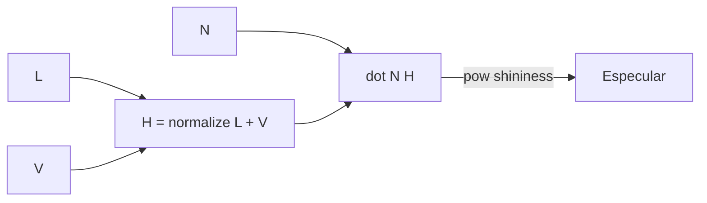

# Iluminação: Blinn-Phong

## Objetivo

Troque o vetor de reflexão de Phong pelo half vector, explique por que o brilho
especular fica estável em ângulos rasantes e compare os dois lobos.

## O half vector

A mudança de Blinn é pequena: em vez de refletir a luz e compará-la com o olho,
compare o *half vector* entre luz e olho com a normal:

```glsl
vec3 H = normalize(L + V);
float specular = pow(max(dot(N, H), 0.0), shininess);
```

`H` é a direção que uma microfaceta precisaria ter para refletir `L` em `V`.
Ele nunca sai do hemisfério em torno de `N` quando `L` e `V` estão ambos acima
da superfície, então o brilho especular não desaparece na silhueta como o vetor
de reflexão de Phong pode.



## O shader

```glsl run=editor example=blinn-phong title="Blinn-Phong"
#version 300 es
precision highp float;

in vec3 vWorldPosition;
in vec3 vWorldNormal;

uniform vec3 cameraPos;
uniform vec3 lightDir;

layout(location = 0) out vec4 fragColor;

void main(void)
{
    vec3 N = normalize(vWorldNormal);
    vec3 L = normalize(lightDir);
    vec3 V = normalize(cameraPos - vWorldPosition);

    float NdotL = max(dot(N, L), 0.0);
    vec3 H = normalize(L + V);
    float specular = pow(max(dot(N, H), 0.0), shininess);

    vec3 diffuse = albedo * NdotL;
    vec3 highlight = specularColor * specular * NdotL;

    fragColor = vec4(diffuse + highlight, 1.0);
}
```

Para igualar a largura visual de Phong, use um `shininess` um pouco maior; os
dois expoentes não são equivalentes. O exemplo mantém `48` para que a comparação
seja direta.

## Resultado esperado


Mova a câmera ao redor do objeto: o brilho especular de Blinn-Phong permanece na
superfície até a silhueta, enquanto o de Phong pode desaparecer antes.

## Exercícios

1. Defina `shininess` como `128` nos dois exemplos, Phong e Blinn-Phong. Qual
   brilho especular fica mais concentrado?
2. Remova o fator `NdotL`. O Blinn-Phong continua plausível na silhueta?
3. Renomeie `H` para `R` e compare a saída com o exemplo de Phong. O que você
   mudou?
4. Normalize `L + V` manualmente com `length` e compare custo e legibilidade.

::: solution Solução 1
O lobo de Blinn-Phong costuma ser mais amplo para o mesmo expoente; para igualar
a largura de Phong você precisa de um expoente maior, mas a conversão exata
depende da direção de visão.
:::

::: solution Solução 2
Ele continua mais plausível que o Phong porque `H` permanece no hemisfério, mas
o brilho especular ainda pode aparecer em superfícies voltadas para longe da
luz. A máscara `NdotL` ainda é a correção certa.
:::

::: solution Solução 3
Você trocou a comparação pelo half vector por uma comparação de reflexão, o que
volta a ser Phong. O termo `pow` agora usa `dot(R, V)`.
:::

::: solution Solução 4
`vec3 H = (L + V) / length(L + V);` é equivalente e um pouco mais explícito.
`normalize` é mais claro e corresponde a uma instrução na maioria das GPUs.
:::

## Erros comuns

- Esquecer de normalizar `L + V`.
- Usar o half vector para iluminação difusa.
- Presumir que o mesmo expoente gera o mesmo brilho especular que o Phong.
- Vetores `L + V` negativos perto do horizonte; o clamp resolve o pow, mas a
  iluminação fica indefinida se o olho estiver abaixo da superfície.

## Próximos passos

- [Iluminação: Oren-Nayar](/docs/lighting-oren-nayar)
- [Iluminação: Cook-Torrance](/docs/lighting-cook-torrance)
