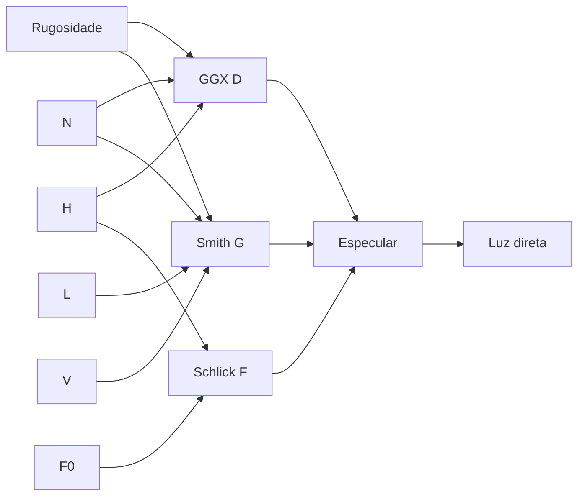

# Iluminação: Cook-Torrance

## Objetivo

Leia e implemente a BRDF de microfaceta Cook-Torrance: a distribuição normal
GGX `D`, o termo de mascaramento-sombreamento de Smith `G` e o termo Fresnel de
Schlick `F`. Entenda por que o termo especular é dividido por
`4 * NdotL * NdotV` e como os metais tingem sua reflexão.

## O modelo de microfaceta

Uma superfície real é uma coleção de espelhos minúsculos. A BRDF faz três
perguntas:

- **D — distribuição:** quantas microfacetas estão orientadas exatamente ao
  longo do half vector `H`?
- **G — geometria:** quanta luz sobrevive ao mascaramento e ao
  auto-sombreamento entre facetas?
- **F — Fresnel:** quanta luz reflete em vez de refratar em cada faceta?

A contribuição especular é `D * G * F / (4 * NdotL * NdotV)`. O denominador
normaliza o mapeamento do half vector e mantém o resultado com conservação de
energia.



## O shader

```glsl run=editor example=cook-torrance title="Cook-Torrance"
#version 300 es
precision highp float;

in vec3 vWorldPosition;
in vec3 vWorldNormal;

uniform vec3 cameraPos;
uniform vec3 lightDir;

layout(location = 0) out vec4 fragColor;

const float PI = 3.14159265359;
const float DIELECTRIC_F0 = 0.04;
const float LIGHT_RADIANCE = 3.0;

vec3 acesFilm(vec3 x)
{
    float a = 2.51;
    float b = 0.03;
    float c = 2.43;
    float d = 0.59;
    float e = 0.14;
    return clamp((x * (a * x + b)) / (x * (c * x + d) + e), 0.0, 1.0);
}

float distributionGGX(float NdotH, float perceptualRoughness)
{
    float alpha = perceptualRoughness * perceptualRoughness;
    float alpha2 = alpha * alpha;
    float denominator = NdotH * NdotH * (alpha2 - 1.0) + 1.0;
    return alpha2 / max(PI * denominator * denominator, 1e-4);
}

float geometrySchlickGGX(float NdotX, float k)
{
    return NdotX / (NdotX * (1.0 - k) + k);
}

float geometrySmith(float NdotV, float NdotL, float perceptualRoughness)
{
    float k = (perceptualRoughness + 1.0) * (perceptualRoughness + 1.0) / 8.0;
    return geometrySchlickGGX(NdotV, k) * geometrySchlickGGX(NdotL, k);
}

vec3 fresnelSchlick(float VdotH, vec3 F0)
{
    float factor = pow(max(1.0 - VdotH, 0.0), 5.0);
    return F0 + (vec3(1.0) - F0) * factor;
}

void main(void)
{
    vec3 N = normalize(vWorldNormal);
    vec3 L = normalize(lightDir);
    vec3 V = normalize(cameraPos - vWorldPosition);
    vec3 H = normalize(L + V);

    float NdotL = max(dot(N, L), 0.0);
    float NdotV = max(dot(N, V), 1e-3);
    float NdotH = max(dot(N, H), 0.0);
    float VdotH = max(dot(V, H), 0.0);

    vec3 F0 = mix(vec3(DIELECTRIC_F0), baseColor, metallic);

    vec3 F = fresnelSchlick(VdotH, F0);
    float D = distributionGGX(NdotH, roughness);
    float G = geometrySmith(NdotV, NdotL, roughness);

    vec3 specular = D * G * F / (4.0 * NdotL * NdotV + 1e-3);

    vec3 kD = (vec3(1.0) - F) * (1.0 - metallic);
    vec3 diffuse = kD * baseColor / PI;

    vec3 finalColor = (diffuse + specular) * LIGHT_RADIANCE * NdotL;
    fragColor = vec4(acesFilm(finalColor), 1.0);
}
```

`LIGHT_RADIANCE` está deliberadamente acima de `1.0` para que o brilho
especular alcance o ombro do ACES. Sem uma curva tonal, o brilho especular
estouraria e perderia a forma.

## Resultado esperado


Defina `roughness` como `0.05` para um quase-espelho e `0.9` para uma reflexão
ampla e fraca. Defina `metallic` como `1` para remover o termo difuso e tingir
`F0` com a cor base.

## Exercícios

1. Defina `roughness` como `0.05` e depois `0.95`. Como o brilho especular
   muda em tamanho e intensidade?
2. Defina `metallic` como `1.0`. Por que o termo difuso desaparece?
3. Substitua `geometrySmith` por `1.0`. O que acontece em ângulos rasantes?
4. Substitua a `D` de GGX por uma constante. A qual modelo o resultado se
   assemelha?
5. Remova `acesFilm` e aplique clamp em `1.0`. O que acontece com o brilho
   especular?
6. Por que `NdotV` recebe clamp em `1e-3` e não em `0.0`?

::: solution Solução 1
Rugosidade baixa concentra a reflexão em um brilho especular pequeno e intenso;
rugosidade alta a espalha e abaixa o pico, que é o significado visual de
rugosidade.
:::

::: solution Solução 2
`kD = (1 - F) * (1 - metallic)` fica zero, deixando apenas o especular. Um metal
não tem albedo difuso neste modelo; em vez disso, a cor base tinge `F0`.
:::

::: solution Solução 3
O termo especular deixa de atenuar em ângulos rasantes, então a borda fica
brilhante demais e o modelo perde a conservação de energia. A silhueta pode
brilhar.
:::

::: solution Solução 4
Uma `D` constante gera um lobo parecido com o de Blinn-Phong. GGX é a
distribuição de microfaceta que produz o brilho especular rugoso
característico, com uma cauda longa.
:::

::: solution Solução 5
Valores acima de `1.0` recebem clamp para branco, então o brilho especular vira
um disco chapado. A curva tonal comprime o pico e preserva a forma.
:::

::: solution Solução 6
O denominador contém `NdotV`; fazer o clamp em zero dividiria por zero (ou
produziria um termo rasante infinitamente brilhante). Um epsilon pequeno mantém
o resultado finito, enquanto o termo `G` leva a contribuição para zero.
:::

## Erros comuns

- Esquecer o denominador `4 * NdotL * NdotV`, o que faz o brilho especular
  explodir.
- Usar a rugosidade diretamente como `alpha` sem elevá-la ao quadrado para GGX.
- Esquecer `kD = 1 - F` e somar difuso e especular sem conservação de energia.
- Aplicar ACES dentro do shader quando o passe de exibição do editor já
  aplica uma transformação de saída. Os exemplos são autocontidos; um efeito de
  tela não deve repetir a curva.
- Usar `NdotL` ou `NdotV` sem clamp antes da divisão.

## Próximos passos

- [Iluminação: IBL](/docs/lighting-ibl)
- [Lições de pós-processamento](/docs/post-processing)
