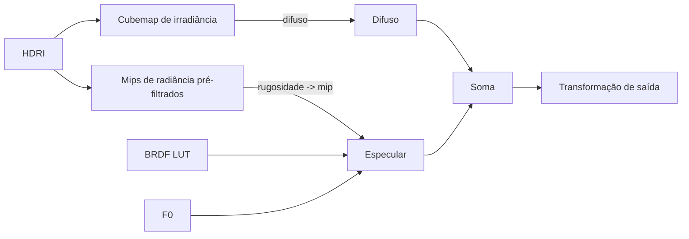

# Iluminação: IBL

## Objetivo

Entenda a aproximação split-sum e use os três recursos de cubemap que a prévia
vincula: `irradianceMap`, `prefilteredEnvironmentMap` e `brdfLUT`. Implemente
tanto o workflow metalness/roughness quanto o especular/glossiness.

## Por que um cubemap não basta

Um shader IBL ingênuo amostra o ambiente ao longo do vetor de reflexão:

```glsl
vec3 colour = texture(environmentMap, reflect(-V, N)).rgb;
```

Isso dá um espelho. Uma superfície rugosa integra o ambiente sobre um lobo
amplo, e fazer isso por pixel custa caro demais. O split-sum pré-calcula a
integral em duas partes:

1. **Radiância pré-filtrada** — o ambiente convoluído com um lobo GGX em vários
   níveis de rugosidade, armazenado nos níveis de mip de um cubemap.
2. **LUT de BRDF** — uma tabela 2D da resposta da BRDF em função de `NdotV` e
   da rugosidade, independente do ambiente.

O especular final é `prefiltered(R, roughness) * (F0 * lut.r + lut.g)`.



A irradiância difusa é um cubemap convoluído por cosseno. Amostrá-lo com `N`
já é a integral sobre o hemisfério, então nenhum fator de cosseno extra é
necessário.

## O workflow metalness / roughness

```glsl run=editor example=ibl-metalness-roughness title="IBL metalness / roughness"
#version 300 es
precision highp float;

in vec3 vWorldPosition;
in vec3 vWorldNormal;

uniform vec3 cameraPos;
uniform samplerCube irradianceMap;
uniform samplerCube prefilteredEnvironmentMap;
uniform sampler2D brdfLUT;

layout(location = 0) out vec4 fragColor;

const float ENV_MAX_LOD = 9.0;
const float DIELECTRIC_F0 = 0.04;

vec3 acesFilm(vec3 x)
{
    float a = 2.51;
    float b = 0.03;
    float c = 2.43;
    float d = 0.59;
    float e = 0.14;
    return clamp((x * (a * x + b)) / (x * (c * x + d) + e), 0.0, 1.0);
}

void main(void)
{
    vec3 N = normalize(vWorldNormal);
    vec3 V = normalize(cameraPos - vWorldPosition);
    vec3 R = reflect(-V, N);

    float NdotV = max(dot(N, V), 1e-3);

    vec3 F0 = mix(vec3(DIELECTRIC_F0), baseColor, metallic);
    vec3 kD = vec3(1.0) - F0;

    vec3 irradiance = texture(irradianceMap, N).rgb;
    vec3 radiance = textureLod(
        prefilteredEnvironmentMap,
        R,
        roughness * ENV_MAX_LOD
    ).rgb;

    vec2 brdf = texture(brdfLUT, vec2(NdotV, roughness)).rg;
    vec3 specular = radiance * mix(vec3(brdf.r), vec3(brdf.g), F0);

    vec3 diffuse = kD * baseColor * irradiance;

    fragColor = vec4(acesFilm(diffuse + specular), 1.0);
}
```

## Metalness/roughness versus especular/glossiness

Os dois workflows descrevem a mesma superfície:

| Conceito | Metalness / roughness | Especular / glossiness |
| --- | --- | --- |
| Cor base | `baseColor` | `diffuseColor` |
| Refletância | `F0 = mix(0.04, baseColor, metallic)` | `specularColor` diretamente |
| Rugosidade | `roughness` | `1 - glossiness` |
| Peso do difuso | `1 - F0` | `1 - specularColor` |
| Detecção de metal | `metallic` | a cor especular é alta e o difuso é quase preto |

O exemplo especular/glossiness usa a segunda coluna. Não misture os dois:
escolher `specularColor` como `F0` e também multiplicar por `metallic` aplicaria
a regra do metal duas vezes.

## Resultado esperado


Arraste o slider `roughness` de `0.05` a `0.9`: a reflexão se alarga e o nível
de mip pré-filtrado sobe. Mude o ambiente no menu do visualizador e a reflexão
muda junto.

## Exercícios

1. Defina `metallic` como `0.0` e `baseColor` como uma cor clara. Por que a
   reflexão escurece?
2. Defina `roughness` como `0.0`. Qual nível de mip é amostrado, e como a
   superfície fica?
3. Defina `roughness` como `1.0`. O que acontece em `ENV_MAX_LOD`?
4. No exemplo especular/glossiness, defina `glossiness` como `1.0`. Como isso se
   compara com `roughness = 0.0` no outro exemplo?
5. Inverta `brdf.r` e `brdf.g` no mix. O que acontece com a intensidade da
   reflexão?

::: solution Solução 1
`F0` é o `0.04` do dielétrico, então apenas 4% do ambiente é refletido na
incidência normal; o resto é difuso. Um metal usaria a cor base como `F0`, que é
bem mais clara.
:::

::: solution Solução 2
`roughness * 9 = 0`, então o mip base é amostrado: uma reflexão de espelho
nítida.
:::

::: solution Solução 3
O mip mais rugoso (`9`) é amostrado. A reflexão é uma média ampla e de baixa
frequência do ambiente.
:::

::: solution Solução 4
`glossiness = 1` significa `roughness = 0`; os dois workflows devem concordar
quando os parâmetros são convertidos corretamente.
:::

::: solution Solução 5
Os dois canais da LUT do split-sum têm significados diferentes; trocá-los dá uma
resposta de Fresnel errada, normalmente uma borda mais clara ou mais escura e um
decaimento rasante incorreto.
:::

## Erros comuns

- Amostrar o ambiente com `N` para o especular; a reflexão precisa de `R`.
- Usar `roughness * 9` quando o cubemap tem menos mips.
- Esquecer de decodificar a LUT de BRDF (`r` e `g` já são lineares).
- Misturar os workflows metalness e especular/glossiness.
- Aplicar a transformação de saída duas vezes; o passe de exibição do editor é
  quem cuida dela.
- Presumir que `environmentMap` e `prefilteredEnvironmentMap` são a mesma
  textura.

## Próximos passos

- [Lições de pós-processamento](/docs/post-processing)
- [O Editor GLSL de Tela](/docs/screen-space-editor)
