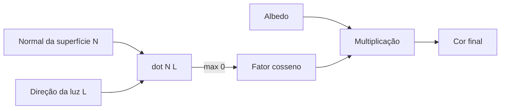

# Iluminação: Lambert

## Objetivo

Implemente a iluminação difusa lambertiana e explique por que `dot(N, L)` é
todo o modelo para uma superfície fosca.

## A lei do cosseno

Uma superfície fosca espalha a luz igualmente em todas as direções, mas recebe
menos energia quando a luz a atinge em um ângulo rasante. A razão é o cosseno
do ângulo entre a normal da superfície `N` e a direção da luz `L`. Para vetores
unitários, esse cosseno é `dot(N, L)`.



`max(..., 0.0)` limita o lado que está de costas para a luz. Sem isso, o lado
escuro receberia um valor negativo e poderia cancelar a luz ambiente.

## O shader

```glsl run=editor example=lambert title="Lambert"
#version 300 es
precision highp float;

in vec3 vWorldNormal;
uniform vec3 lightDir;

layout(location = 0) out vec4 fragColor;

void main(void)
{
    vec3 N = normalize(vWorldNormal);
    vec3 L = normalize(lightDir);

    float NdotL = max(dot(N, L), 0.0);
    vec3 finalColor = albedo * NdotL;

    fragColor = vec4(finalColor, 1.0);
}
```

`albedo` é uma cor de dados do usuário; o exemplo a define como um terracota
quente. A direção da luz é uma direção no espaço de mundo fornecida pela
prévia, não uma posição.

## Resultado esperado


O terminador é suave e o lado não iluminado é completamente preto. Esse preto
chapado é, fisicamente, o que o modelo prevê sem um termo ambiente; os outros
modelos acrescentam luz ambiente ou mais energia.

## Exercícios

1. Some `0.1` a `NdotL` antes de multiplicar pelo albedo. Por que isso deixa de
   ser Lambert, e o que isso aproxima?
2. Inverta a direção da luz (`-lightDir`). O que acontece com o terminador?
3. Substitua `NdotL` por `smoothstep(0.0, 1.0, NdotL)`. Como a superfície muda?
4. Multiplique por um segundo `dot(N, L)` (ou seja, `NdotL * NdotL`). A qual
   material isso se assemelha?

::: solution Solução 1
Adicionar uma constante é um termo ambiente: ele eleva o lado não iluminado de
forma uniforme. Não é Lambert porque o modelo agora emite luz a partir de
superfícies de costas para a fonte.
:::

::: solution Solução 2
O terminador passa para o outro lado: o que antes ficava voltado para a luz
agora está escuro.
:::

::: solution Solução 3
`smoothstep` remodela o decaimento, suavizando a transição perto do terminador e
achatando o lado claro. É uma curva estilizada, não uma curva física.
:::

::: solution Solução 4
Elevar o cosseno ao quadrado concentra a resposta em torno da direção da luz, o
que se assemelha a um lobo especular muito amplo e rugoso, em vez de papel
difuso.
:::

## Erros comuns

- Esquecer de normalizar `N` ou `L`.
- Usar uma posição de luz em vez de uma direção da luz.
- Multiplicar por `NdotL` duas vezes por acidente.
- Esperar luz ambiente; não há nenhuma, a menos que você a adicione.
- Iluminar no espaço de objeto enquanto a direção da luz está no espaço de
  mundo.

## Próximos passos

- [Iluminação: Phong](/docs/lighting-phong)
- [Iluminação: Blinn-Phong](/docs/lighting-blinn-phong)
