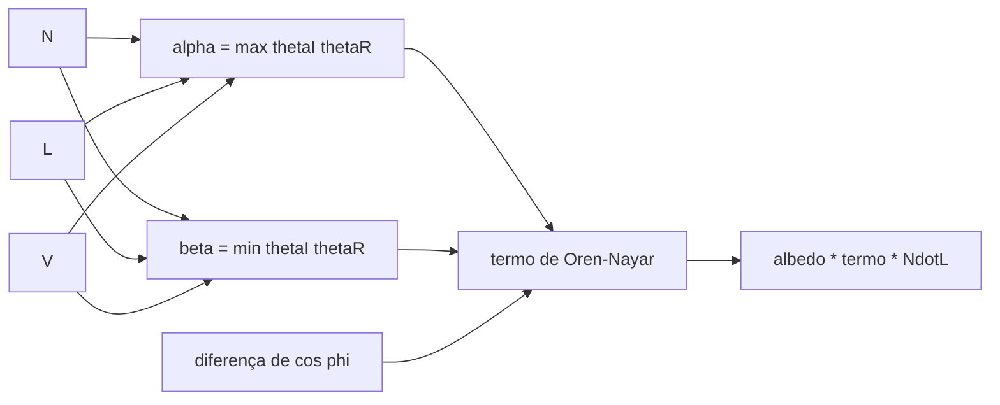

# Iluminação: Oren-Nayar

## Objetivo

Implemente o modelo difuso rugoso de Oren-Nayar, explique o parâmetro `sigma` e
saiba quando vale a pena a matemática extra em relação a Lambert.

## Por que Lambert não basta para superfícies rugosas

Lambert presume uma superfície perfeitamente fosca cujo brilho depende apenas
de `dot(N, L)`. Materiais rugosos reais (giz, argila, feltro) têm microfacetas
em forma de V, então um lado de um sulco pode sombrear o outro e a superfície
retrorreflete mais quando a luz e o olho estão próximos. O resultado é um termo
difuso dependente da visão que achata menos em ângulos rasantes.

Oren-Nayar acrescenta duas peças a Lambert:

- Um parâmetro `sigma` para a inclinação das facetas, em que `0` degenera
  em Lambert.
- Um termo de azimute entre as projeções de `L` e `V` no plano tangente, que
  produz a retrorreflexão.



## O shader

```glsl run=editor example=oren-nayar title="Oren-Nayar"
#version 300 es
precision highp float;

in vec3 vWorldPosition;
in vec3 vWorldNormal;

uniform vec3 cameraPos;
uniform vec3 lightDir;

layout(location = 0) out vec4 fragColor;

void main(void)
{
    vec3 N = normalize(vWorldNormal);
    vec3 L = normalize(lightDir);
    vec3 V = normalize(cameraPos - vWorldPosition);

    float NdotL = max(dot(N, L), 0.0);
    float NdotV = max(dot(N, V), 0.0);

    float sigma2 = sigma * sigma;
    float A = 1.0 - 0.5 * sigma2 / (sigma2 + 0.33);
    float B = 0.45 * sigma2 / (sigma2 + 0.09);

    vec3 tangentL = L - N * NdotL;
    vec3 tangentV = V - N * NdotV;
    float cosPhiDiff = 0.0;
    if (dot(tangentL, tangentL) > 1e-8 && dot(tangentV, tangentV) > 1e-8) {
        cosPhiDiff = max(dot(normalize(tangentL), normalize(tangentV)), 0.0);
    }

    float thetaI = acos(clamp(NdotL, 0.0, 1.0));
    float thetaR = acos(clamp(NdotV, 0.0, 1.0));
    float alpha = max(thetaI, thetaR);
    float beta = min(min(thetaI, thetaR), 1.4);

    float orenNayar = A + B * cosPhiDiff * sin(alpha) * tan(beta);
    vec3 finalColor = albedo * orenNayar * NdotL;

    fragColor = vec4(finalColor, 1.0);
}
```

O clamp de `tan(beta)` importa: `tan` explode quando o menor ângulo se aproxima
de `PI / 2`, e o termo é multiplicado por um `NdotL` que tende a zero, então o
clamp só remove o pico.

## Resultado esperado


Defina `sigma` como `0.0` e a imagem se torna Lambert. Aumente-o em direção a
`1.0` e o terminador suaviza, enquanto a superfície clareia quando a luz está
atrás da câmera.

## Exercícios

1. Defina `sigma` como `0.0` e compare a renderização com o exemplo de Lambert.
2. Remova o clamp de `tan(beta)`. Onde a imagem quebra?
3. Descarte o termo `cosPhiDiff` (defina-o como `1.0`). O que se perde?
4. Substitua `A` e `B` pelas constantes `1.0` e `0.0`. Qual modelo você obtém?
5. Qual termo deixa a superfície mais clara quando a luz e o olho
   estão alinhados?

::: solution Solução 1
Com `sigma = 0`, `A = 1`, `B = 0`, e o resultado é exatamente `albedo * NdotL`,
ou seja, Lambert.
:::

::: solution Solução 2
Perto de ângulos rasantes, `tan(beta)` tende ao infinito e produz fireflies ou
NaN. O clamp remove o pico e mantém o efeito do termo onde ele está definido.
:::

::: solution Solução 3
A retrorreflexão dependente do azimute desaparece; a superfície perde o
clareamento dependente da visão e passa a se comportar como um difuso rugoso
isotrópico.
:::

::: solution Solução 4
`A = 1, B = 0` reduz novamente a Lambert; Oren-Nayar é uma correção sobre a lei
do cosseno.
:::

::: solution Solução 5
O termo `B * cosPhiDiff * sin(alpha) * tan(beta)`. Ele é máximo quando as
direções da luz e de visão estão do mesmo lado da normal.
:::

## Erros comuns

- Esquecer `max(dot(N, V), 0.0)`; o `acos` de um valor negativo é indefinido.
- Calcular o azimute sem proteger contra vetores tangentes degenerados.
- Usar `sigma` em graus; ele é um parâmetro de inclinação, não um ângulo.
- Esperar um brilho especular; Oren-Nayar é apenas difuso.
- Esquecer que a luz tem radiância unitária e que a multiplicação final por
  `NdotL` é o que faz dele um modelo de reflexão.

## Próximos passos

- [Iluminação: Cook-Torrance](/docs/lighting-cook-torrance)
- [Iluminação: IBL](/docs/lighting-ibl)
