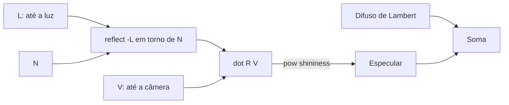

# Iluminação: Phong

## Objetivo

Estenda Lambert com um brilho especular, explique o vetor de reflexão e entenda
o que o expoente de brilho controla.

## O vetor de reflexão

Uma superfície brilhante reflete a luz que chega em torno de sua normal.
Phong compara essa direção refletida `R` com a direção até o olho `V`:

```glsl
vec3 R = reflect(-L, N);
float specular = pow(max(dot(R, V), 0.0), shininess);
```

`reflect` espera o vetor incidente apontando *para* a superfície, então passe
`-L` quando `L` aponta da superfície para a luz. O expoente de `pow` controla a
largura do lobo: valores maiores concentram o brilho especular em um ponto
menor e mais nítido.



## O shader

```glsl run=editor example=phong title="Phong"
#version 300 es
precision highp float;

in vec3 vWorldPosition;
in vec3 vWorldNormal;

uniform vec3 cameraPos;
uniform vec3 lightDir;

layout(location = 0) out vec4 fragColor;

void main(void)
{
    vec3 N = normalize(vWorldNormal);
    vec3 L = normalize(lightDir);
    vec3 V = normalize(cameraPos - vWorldPosition);

    float NdotL = max(dot(N, L), 0.0);
    vec3 R = reflect(-L, N);
    float specular = pow(max(dot(R, V), 0.0), shininess);

    vec3 diffuse = albedo * NdotL;
    vec3 highlight = specularColor * specular * NdotL;

    fragColor = vec4(diffuse + highlight, 1.0);
}
```

Multiplicar o brilho especular por `NdotL` evita que ele apareça em superfícies
de costas para a luz.

## Resultado esperado


O `shininess` padrão é `48`. Aumente para `128` e o brilho especular se
concentra; diminua para `4` e ele se espalha pela superfície.

## Exercícios

1. Defina `shininess` como `1`. Como fica o brilho especular, e por quê?
2. Remova o fator `NdotL` do brilho especular. Qual lado do objeto começa a
   brilhar?
3. Mude a reflexão para `reflect(L, N)`. O brilho especular passa para o
   outro lado?
4. Adicione um segundo lobo especular com um `shininess` bem menor e metade
   da intensidade. A que material isso remete?

::: solution Solução 1
O lobo fica extremamente amplo e fraco, quase indistinguível do difuso; `pow`
com expoente `1` é apenas o cosseno de novo.
:::

::: solution Solução 2
O brilho especular aparece em superfícies voltadas para longe da luz, porque
a máscara `NdotL` se foi. É um bug comum ao portar código de Phong.
:::

::: solution Solução 3
Sim. `reflect(L, N)` espelha a direção para longe da luz, então o brilho
especular termina no lado oposto.
:::

::: solution Solução 4
Dois lobos de largura diferente lembram uma superfície com revestimento: um
brilho especular nítido de clear coat sobre um especular de base mais amplo.
:::

## Erros comuns

- Passar `L` em vez de `-L` para `reflect`.
- Esquecer `max(..., 0.0)` antes de `pow`, o que produz NaN para bases
  negativas.
- Multiplicar o brilho especular por `NdotL` duas vezes.
- Usar uma posição de luz como `lightDir`.
- Esperar conservação de energia; Phong adiciona energia e pode ficar brilhante
  demais.

## Próximos passos

- [Iluminação: Blinn-Phong](/docs/lighting-blinn-phong)
- [Iluminação: Cook-Torrance](/docs/lighting-cook-torrance)
