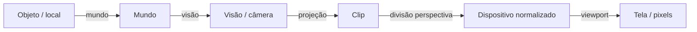

# Matemática para shaders

## Objetivo

Ao final desta página, você deve ser capaz de ler um shader de vértices que
multiplica uma posição por três matrizes, explicar o que cada matriz faz, usar
um produto escalar para responder "o quanto esta superfície está voltada para a
luz?" e usar um produto vetorial para construir um referencial tangente. Você
não precisa de cálculo para as lições que vêm a seguir.

## Vetores

Um `vec3` são três números. Em shaders, ele geralmente significa uma de duas
coisas:

- **Uma posição** — um ponto em algum espaço, como `(0.2, 1.4, -3.0)`.
- **Uma direção** — uma seta, como uma normal de superfície ou a direção da
  luz. As direções normalmente são normalizadas antes.

Normalizar divide um vetor pelo seu comprimento para que o resultado tenha
comprimento `1`:

```glsl
vec3 toLight = normalize(lightPosition - worldPosition);
```

Os mesmos três números podem ser uma coisa ou outra, e misturar as duas é uma
das fontes mais comuns de resultados confusos. Uma normal nunca deve ser
transladada: ela não tem posição. Uma posição deve ser transformada pela matriz
de modelo; uma normal deve usar a matriz de normais.

## Produto escalar

`dot(a, b)` é `|a| * |b| * cos(angle)`. Para dois vetores unitários, é
simplesmente `cos(angle)`:

- `1` significa que os vetores apontam na mesma direção.
- `0` significa que eles são perpendiculares.
- `-1` significa que eles apontam em direções opostas.

É por isso que a iluminação difusa é um único produto escalar:

```glsl
float NdotL = max(dot(normal, lightDirection), 0.0);
```

`max(..., 0.0)` limita o lado de trás à escuridão. Sem isso, o lado não
iluminado receberia uma contribuição negativa e escureceria de forma incorreta.

O produto escalar também é útil fora da iluminação:
`dot(uv, normalize(vec2(1.0, 1.0)))` projeta uma coordenada UV sobre uma rampa
diagonal, e é assim que o exemplo de gradiente funciona.

## Produto vetorial

`cross(a, b)` retorna um vetor perpendicular às duas entradas. Seu comprimento é
a área do paralelogramo que elas definem. Em shaders, ele é usado com mais
frequência para construir um referencial ortonormal:

```glsl
vec3 tangent = normalize(vWorldTangent - normal * dot(normal, vWorldTangent));
vec3 bitangent = cross(normal, tangent);
```

A subtração remove a parte da tangente que aponta ao longo da normal
(Gram–Schmidt), e o produto vetorial produz o terceiro eixo. Sem essa correção,
uma tangente importada de uma malha pode não ser exatamente perpendicular à
normal interpolada, e a superfície com mapa de normais vai parecer distorcida.

## Matrizes

Um `mat4` é uma grade 4×4. Em GLSL, ele multiplica um `vec4` à esquerda:

```glsl
vec4 clipPosition = projection * view * world * vec4(position, 1.0);
```

A multiplicação de matrizes não é comutativa: `A * B` não é `B * A`. A ordem
acima significa "modelo primeiro, depois visão, depois projeção", porque a
matriz mais à direita é aplicada primeiro ao vetor.

### Os espaços de coordenadas



| Espaço | O que os números significam | Matriz típica |
| --- | --- | --- |
| Objeto / local | Relativo à origem da própria malha | — |
| Mundo | Coordenadas compartilhadas da cena | `world` |
| Visão / câmera | Relativo à câmera, útil para iluminação e profundidade | `view` |
| Clip | Coordenadas homogêneas logo antes de a GPU dividir por `w` | `projection * view * world` |
| NDC | `x`/`y` em `[-1, 1]`, `z` em `[-1, 1]` (WebGL) | clip / `w` |
| Tela | Pixels, após a transformação de viewport | `gl_FragCoord`, texturas |

O shader de vértices escreve o clip space em `gl_Position`. Tudo depois disso é
de função fixa. Um shader de fragmentos normalmente recebe valores interpolados
em espaço de mundo ou em espaço de visão, não valores em clip space.

### A matriz de normais

As normais são direções, não posições, e uma escala não uniforme muda a direção
para onde uma superfície aponta. A matriz de normais é a inversa-transposta do
bloco 3×3 superior esquerdo da matriz de mundo:

```glsl
vWorldNormal = normalize(normalMatrix * normal); // mat3, não mat4
```

A prévia vincula essa matriz para você. Reutilizar `mat3(world)` em vez disso
só está correto para escala uniforme e sem cisalhamento.

## Cor

Uma cor são três (ou quatro) números, mas ela pode ser armazenada em duas
codificações diferentes:

- **sRGB** — codificação perceptiva usada por imagens e pelo canvas final. Os
  valores não são proporcionais à luz.
- **Linear** — valores proporcionais à luz. Somar duas cores lineares tem
  significado físico; somar dois valores sRGB não tem.

O renderizador trabalha em espaço linear e codifica para sRGB uma única vez, no
passe de exibição. É por isso que uma textura amostrada com `texture()` é
linearizada pelo Babylon quando necessário, e que um uniform de cor é
convertido antes de chegar ao shader.

Sua regra principal: **faça matemática em espaço linear, codifique uma vez no
final.** A página [Cor e espaço linear](/docs/color-and-linear) cobre os
detalhes, incluindo HDR e tone mapping.

## Exemplo mínimo: um gradiente de produto escalar

O fragmento de sandbox abaixo transforma o produto escalar em uma rampa
diagonal de sombreamento. É a mesma operação de `NdotL`, só com uma coordenada
UV em vez de uma normal.

```glsl run=sandbox title="Gradiente de produto escalar"
#version 300 es
precision highp float;

in vec2 vUv;
uniform vec2 uResolution;
uniform float uTime;

out vec4 fragColor;

void main(void)
{
    vec2 direction = normalize(vec2(1.0, 1.0));
    float ramp = dot(vUv, direction);      // 0 no canto inferior esquerdo, ~1.41 no canto superior direito
    float shade = smoothstep(0.15, 1.0, ramp);

    vec3 color = mix(vec3(0.05, 0.08, 0.2), vec3(0.95, 0.5, 0.2), shade);
    fragColor = vec4(color, 1.0);
}
```

## Exercícios

1. Mude `direction` para `normalize(vec2(1.0, -1.0))`. Preveja qual canto fica
   mais claro antes de executar.
2. Substitua `smoothstep` por `step(0.7, ramp)`. O que muda, e por que a borda
   fica dura?
3. Use `cross(vec3(ramp, 0.0, 0.0), vec3(0.0, ramp, 0.0))` e exiba o
   resultado. Qual é o comprimento da saída em `ramp = 1`?

::: solution Solução 1
O canto superior esquerdo passa a ser a extremidade clara: o produto escalar é
maior onde os dois componentes da direção são positivos da mesma forma.
:::

::: solution Solução 2
`step` retorna `0` ou `1` imediatamente no limite; `smoothstep` interpola em um
intervalo. A borda dura é o ponto de um step, e ela mostra aliasing.
:::

::: solution Solução 3
O produto vetorial desses dois vetores tem comprimento `ramp²`, então a saída
cresce quadraticamente. Em `ramp = 1`, ela vale `1`.
:::

## Erros comuns

- **Usar uma posição onde se espera uma direção.** Uma normal não é um ponto;
  não a translade por `world`.
- **Esquecer de normalizar.** `dot` só é um cosseno quando os dois vetores têm
  comprimento `1`.
- **Multiplicar matrizes na ordem errada.** Leia a cadeia da direita para a
  esquerda.
- **Fazer matemática sRGB em um seletor de cor.** A cor da UI é convertida para
  você; não aplique gamma duas vezes.

## Próximos passos

- [Cor e espaço linear](/docs/color-and-linear)
- [GLSL ES 3.00](/docs/gles-3-0-webgl2)
- [Primeiros shaders no sandbox](/docs/first-shaders)
