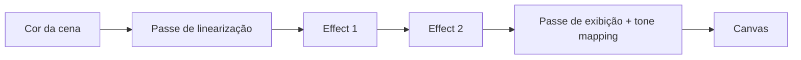

# Efeitos de pós-processamento

Um efeito de pós-processamento é um passe de fragmentos de tela cheia que roda
depois que a cena foi renderizada. Os efeitos são empilhados: cada um recebe a
saída do passe anterior, e um passe de exibição final aplica a transformação de
saída. O Editor GLSL 3D e o Sandbox GLSL 2D compartilham essa pilha de
superfície, a ABI e o editor.
O [Editor GLSL de Tela](/docs/screen-space-editor) tem uma pilha separada, com um
G-buffer de cena mais rico.

## A pilha

Abra o documento **Pós-efeito** para editar o efeito selecionado. O painel acima
do editor contém a pilha:

| Controle                   | O que faz                                                              |
| -------------------------- | ---------------------------------------------------------------------- |
| Nome do efeito             | Seleciona esse efeito para edição.                                     |
| Caixa de seleção           | Ativa ou desativa o efeito. Efeitos desativados são ignorados.         |
| **↑** / **↓**              | Move o efeito para antes ou para depois na cadeia.                     |
| **×**                      | Remove o efeito.                                                       |
| **Adicionar efeito**       | Anexa um novo efeito pass-through.                                     |
| **Carregar exemplo…**      | Substitui o efeito ativo por um exemplo incluído (vignette, blur, outline, depth fog, SSAO). |
| **Transformação de saída** | Escolhe o tone mapping aplicado pelo passe de exibição.                |

Sempre há pelo menos um efeito: remover o último cria um novo efeito com o
fragmento pass-through padrão. O primeiro efeito se chama **Pass through**;
efeitos adicionados se chamam **Effect 2**, **Effect 3** e assim por diante.

A ordem da lista é a ordem de execução. O primeiro efeito lê a cena; cada efeito
seguinte lê a saída do que está acima dele.

## O pipeline



- A cena é renderizada em um render target de cor.
- Um passe interno de **linearização** converte essa cor para o espaço de
  trabalho linear.
- Cada efeito ativado roda em ordem, fazendo ping-pong entre dois render
  targets.
- O passe de **exibição** aplica a transformação de saída e codifica para sRGB.
- No editor 3D, um prepasse de normal/profundidade também roda, para que os
  efeitos possam ler as normais no espaço de visão e a profundidade linear da
  cena.

Seu efeito recebe cor linear. Não aplique uma codificação sRGB você mesmo; o
passe de exibição faz isso uma vez, no final.

## A ABI do pós-efeito

### Entradas

| Nome                | Tipo        | Significado                                                            |
| ------------------- | ----------- | ---------------------------------------------------------------------- |
| `textureSampler`    | `sampler2D` | Saída do passe anterior. O primeiro efeito recebe a cena.              |
| `gbufferTexture`    | `sampler2D` | `rgb`: normal no espaço de visão codificada como `n * 0.5 + 0.5`; `a`: `1` na geometria, `0` no fundo. |
| `depthTexture`      | `sampler2D` | `r`: profundidade de visão linear normalizada para o intervalo de clipping. `0` é o plano próximo, `1` é o plano distante e o fundo. As unidades de mundo são `cameraNear + r * (cameraFar - cameraNear)`. |
| `resolution`        | `vec2`      | Tamanho atual do render target em pixels.                              |
| `texelSize`         | `vec2`      | `1.0 / resolution`, útil para amostragens no espaço de tela.           |
| `time`              | `float`     | Segundos.                                                              |
| `cameraNear`        | `float`     | Plano próximo de clipping, em unidades de mundo.                       |
| `cameraFar`         | `float`     | Plano distante de clipping, em unidades de mundo.                      |
| `cameraPosition`    | `vec3`      | Posição da câmera no espaço de mundo.                                  |
| `projection`        | `mat4`      | Matriz de projeção da câmera.                                          |
| `inverseProjection` | `mat4`      | Projeção inversa, para reconstrução de profundidade.                   |
| `view`              | `mat4`      | Matriz de mundo para visão.                                            |
| `inverseView`       | `mat4`      | Matriz de visão para mundo.                                            |

### Varying e saída

```glsl
in vec2 vUV;
layout(location = 0) out vec4 fragColor;
```

`vUV` é a coordenada de tela normalizada, de `(0, 0)` no canto inferior esquerdo
até `(1, 1)` no canto superior direito. Escreva cor linear em `fragColor`;
mantenha o alpha em `1.0`.

Como acontece com toda entrada da engine, declare os nomes que você usa. Um
efeito que não menciona `depthTexture` não precisa declará-lo.

## Tone mapping

A **Transformação de saída** roda depois do último efeito:

| Opção                          | Comportamento                                              |
| ------------------------------ | ---------------------------------------------------------- |
| **Nenhuma (linear para sRGB)** | Sem curva; a cor linear é limitada e codificada para sRGB. |
| **Reinhard**                   | `color / (1 + color)` por canal.                           |
| **ACES filmic**                | Aproximação ACES com um ombro fílmico.                     |

Mudar a transformação não recompila a cadeia: o passe de exibição lê o modo como
um uniform. Isso muda a aparência da imagem final depois de todos os efeitos,
porque os efeitos trabalham em espaço linear antes da transformação.

## Editor 3D vs Sandbox 2D

Os dois editores usam a mesma pilha e a mesma ABI de shader, mas o sandbox não
tem geometria de onde derivar normais ou profundidade. Ele fornece placeholders
neutros:

| Entrada                           | Editor 3D                              | Sandbox 2D              |
| --------------------------------- | -------------------------------------- | ----------------------- |
| `textureSampler`                  | Passe anterior                         | Passe anterior          |
| `gbufferTexture`                  | Normais reais no espaço de visão       | Normal neutra 1×1       |
| `depthTexture`                    | Profundidade de visão real normalizada | Profundidade neutra 1×1 |
| `cameraNear` / `cameraFar`        | Planos de clipping reais               | `0` / `1`               |
| `projection` e afins              | Matrizes de câmera reais               | Identidade              |
| `resolution`, `texelSize`, `time` | Reais                                  | Reais                   |

Consequência: efeitos que leem `gbufferTexture`, `depthTexture` ou as matrizes
de câmera não têm nada significativo para ler no sandbox e parecem não fazer
nada. Efeitos que usam só `textureSampler`, `resolution`, `texelSize`, `time` e
seus próprios uniforms se comportam igual nos dois editores.

## Dados do usuário em efeitos de pós-processamento

Uma definição de Dados do usuário precisa apontar para **Pós** para aparecer
em todo passe de pós-efeito. No sandbox, **Todos** também alcança os
pós-efeitos. No editor 3D, **Todos** significa apenas vértice e fragmento; ele
**não** alcança os pós-efeitos. Veja [Dados do usuário](/docs/user-data).

## Compilando a cadeia

- Adicionar, remover, mover, ativar ou desativar um efeito recompila a cadeia
  inteira.
- Selecionar um efeito ou mudar a transformação de saída não recompila.
- A cadeia é compilada de forma atômica: se qualquer passe falhar, a cadeia
  anterior continua renderizando. O painel de erros indica o efeito que falhou e
  o estágio dele.
- Editar o fragmento de um efeito não compila automaticamente; pressione
  **Compilar** com o documento Pós-efeito ativo.

## Efeitos de espaço de tela são diferentes

Os efeitos do editor de tela rodam sobre uma cena inteira e expõem a cor HDR
original da cena mais os attachments de profundidade, normal, albedo, material e
velocidade. A ABI de superfície acima tem apenas `textureSampler`,
`gbufferTexture` e uma `depthTexture` normalizada. Um efeito de espaço de tela
que lê `depthTexture` como unidades de mundo vai ficar errado na aba de
superfície, e um efeito de superfície que espera profundidade normalizada vai
ficar errado aqui.

Use o editor de tela para contornos de profundidade/normal, SSAO, vetores de
movimento e qualquer coisa que precise da cor de cena intocada. A lista completa
de nomes dos dois contratos está na [Referência da ABI](/docs/abi-reference)
gerada.

## Um efeito de escala de cinza e vinheta

Este fragmento funciona nos dois editores e usa apenas entradas que fazem
sentido no sandbox:

```glsl run=sandbox title="Escala de cinza + vinheta"
#version 300 es
precision highp float;

in vec2 vUV;

uniform sampler2D textureSampler;

layout(location = 0) out vec4 fragColor;

void main(void)
{
    vec3 color = texture(textureSampler, vUV).rgb;

    float luma = dot(color, vec3(0.2126, 0.7152, 0.0722));

    vec2 p = vUV * 2.0 - 1.0;
    float vignette = 1.0 - 0.35 * dot(p, p);

    fragColor = vec4(vec3(luma) * vignette, 1.0);
}
```

Para um desfoque, amostre `textureSampler` em deslocamentos escalados por
`texelSize`, não por um número fixo de unidades de UV, para que o efeito
mantenha o mesmo raio em qualquer tamanho de painel.

## Armadilhas

- **A cadeia está em espaço linear.** Codificar para sRGB dentro de um efeito
  codifica a imagem duas vezes quando o passe de exibição roda.
- **O alpha deve ficar em `1.0`.** O canvas é opaco; um alpha incomum torna os
  passes seguintes e o passe de exibição imprevisíveis.
- **A ordem importa.** Um desfoque antes de um limiar não é o mesmo efeito que
  um limiar antes de um desfoque.
- **Efeitos desativados são removidos da cadeia compilada**, então seus uniforms
  e texturas não são vinculados enquanto estão desligados.
- **Profundidade e normais estão no espaço de visão.** Não trate
  `gbufferTexture.rgb` como uma normal no espaço de mundo.
- **O sandbox não tem geometria.** Um contorno baseado em profundidade não vai
  funcionar lá.

## Relacionados

- [Editor GLSL 3D](/docs/3d-editor)
- [Sandbox GLSL 2D](/docs/2d-sandbox)
- [Dados do usuário](/docs/user-data)
- [Compilação e erros](/docs/compiling-and-errors)
