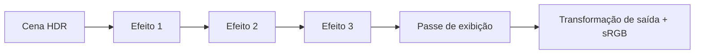

# Pós-processamento e o G-buffer

## Objetivo

Entenda as duas ABIs de pós-efeito, monte uma cadeia ordenada, decodifique os
attachments e implemente os efeitos clássicos: vinheta, desfoque, detecção de
bordas, névoa de profundidade e SSAO. Saiba quando usar a aba Pós-efeito do
editor 3D e quando usar o Editor GLSL de Tela.

## Duas pilhas, dois contratos

| Editor | ABI | Samplers | Melhor para |
| --- | --- | --- | --- |
| Editor GLSL 3D, aba Pós-efeito | ABI de pós-efeito de superfície | `textureSampler`, `gbufferTexture`, `depthTexture` | Efeitos sobre a única malha da prévia |
| Sandbox GLSL 2D, aba Pós-efeito | A mesma ABI de superfície | o mesmo, com geometria neutra | Matemática de espaço de tela que não precisa de dados da cena |
| Editor GLSL de Tela | ABI de G-buffer de espaço de tela | Passe anterior, cena original, profundidade, normal, albedo, material, velocidade | Efeitos sobre a cena inteira e trabalho com G-buffer |

O `depthTexture` da ABI de superfície é profundidade linear *normalizada*: `0`
no plano próximo, `1` no plano distante e no fundo. O `depthTexture` da ABI de
espaço de tela é profundidade linear no espaço de visão em **unidades de
mundo**. Confundir os dois é o bug de portabilidade mais comum entre os
editores.

## A cadeia



Cada efeito lê o passe anterior em `textureSampler`. O primeiro efeito lê a
cena. No Editor GLSL de Tela, `sceneColorTexture` é sempre o original intocado,
que é do que efeitos como SSR ou uma combinação de bloom precisam.

Efeitos são apenas de fragmento. O estágio de vértice de tela cheia é interno,
então um efeito de pós-processamento é exatamente um código-fonte de fragmento
com `vUV` e `fragColor`.

## Transformação de saída

O passe de exibição é responsável pela curva de tom e pela codificação sRGB.
Escolha a transformação na pilha de efeitos:

- **Nenhuma** para visualizações de dados ou efeitos que já fazem tone mapping.
- **Reinhard** para um roll-off fílmico suave.
- **ACES** para trabalho com cenas iluminadas.

Não aplique `pow(color, vec3(1.0 / 2.2))` dentro de um efeito se a transformação
estiver ativa. Veja [Cor e espaço linear](/docs/color-and-linear) para a
explicação completa.

## Vinheta

Uma vinheta escurece as bordas do quadro. Ela só precisa do passe anterior e da
resolução:

```glsl run=editor effect=vignette title="Vinheta"
#version 300 es
precision highp float;

in vec2 vUV;
uniform sampler2D textureSampler;
uniform vec2 resolution;

layout(location = 0) out vec4 fragColor;

void main(void)
{
    vec3 color = texture(textureSampler, vUV).rgb;

    vec2 p = (vUV - 0.5) * 2.0;
    p.x *= resolution.x / resolution.y;
    float distanceFromCentre = length(p);

    float vignette = smoothstep(0.55, 1.25, distanceFromCentre);
    color *= mix(1.0, 0.22, vignette);

    fragColor = vec4(color, 1.0);
}
```


## Desfoque

Um desfoque gaussiano separável é feito em dois passes: horizontal e depois
vertical. Esta é a metade horizontal; os pesos são simétricos em torno do
centro.

```glsl run=editor effect=blur title="Desfoque de nove amostras (horizontal)"
#version 300 es
precision highp float;

in vec2 vUV;
uniform sampler2D textureSampler;
uniform vec2 texelSize;

layout(location = 0) out vec4 fragColor;

void main(void)
{
    const float weights[5] = float[](0.227027, 0.194594, 0.121621, 0.054054, 0.016216);
    vec3 color = texture(textureSampler, vUV).rgb * weights[0];

    for (int tap = 1; tap < 5; tap++)
    {
        vec2 offset = vec2(float(tap) * texelSize.x, 0.0);
        color += texture(textureSampler, vUV + offset).rgb * weights[tap];
        color += texture(textureSampler, vUV - offset).rgb * weights[tap];
    }

    fragColor = vec4(color, 1.0);
}
```

Para uma cadeia de desfoque de verdade, adicione uma cópia vertical com
`texelSize.y`. Dois passes de nove amostras são bem mais baratos que um kernel
2D grande.


## Detecção de bordas e contornos

Um contorno compara a profundidade e a normal de um pixel com as dos vizinhos.
Uma diferença grande significa uma borda. A versão de espaço de tela pode usar
o buffer de profundidade real e as normais no espaço de visão:

```glsl
float depthEdge =
    abs(depthAt(vUV - vec2(texelSize.x, 0.0)) - depthAt(vUV + vec2(texelSize.x, 0.0))) +
    abs(depthAt(vUV - vec2(0.0, texelSize.y)) - depthAt(vUV + vec2(0.0, texelSize.y)));

vec3 normalCenter = normalAt(vUV);
float normalEdge = 1.0 - clamp(dot(normalCenter, averageNeighbourNormal), 0.0, 1.0);

float edge = smoothstep(0.03, 0.12, depthEdge) + smoothstep(0.25, 0.6, normalEdge);
```

A ABI de espaço de tela tem um exemplo completo de contorno e um de SSAO no menu
de efeitos. A versão da ABI de superfície é parecida, mas usa a profundidade
normalizada, então os limiares de profundidade são menores.


## Névoa de profundidade

A névoa é uma mistura por distância. Converta a profundidade para unidades de
mundo primeiro:

```glsl
float normalisedDepth = texture(depthTexture, vUV).r;
float worldDepth = cameraNear + normalisedDepth * (cameraFar - cameraNear);

float density = 0.035;
float fog = 1.0 - exp(-worldDepth * worldDepth * density * density);

vec3 color = mix(scene, fogColor, clamp(fog, 0.0, 1.0));
```

No Editor GLSL de Tela, `depthTexture.r` já está em unidades de mundo, então o
remapeamento de `cameraNear`/`cameraFar` não é necessário. Essa diferença é
exatamente o motivo pelo qual as versões de superfície e de espaço de tela são
documentos separados.


## SSAO

A oclusão ambiente escurece dobras. A AO de espaço de tela amostra o buffer de
profundidade em um disco ao redor de cada pixel e conta quantos vizinhos estão
mais perto da câmera que o plano tangente:

```glsl
vec3 position = viewPosition(vUV);
vec3 normal = decodeNormal(vUV);

float occlusion = 0.0;
for (int i = 0; i < 12; i++)
{
    vec2 offset = discOffset(i) * radius * texelSize * 256.0;
    vec3 neighbour = viewPosition(vUV + offset);
    vec3 delta = neighbour - position;

    float inRadius = step(length(delta), radius);
    float inFront = step(bias, dot(-delta, normal) / max(length(delta), 1e-4));
    occlusion += inRadius * inFront;
}

occlusion = 1.0 - occlusion / 12.0;
fragColor = vec4(scene * mix(0.45, 1.0, occlusion), 1.0);
```

O exemplo de espaço de tela reconstrói as posições no espaço de visão a partir
da projeção inversa e da profundidade real. A versão de superfície não tem uma
reconstrução confiável no espaço de visão, então usa as diferenças de
profundidade normalizada diretamente e é aproximada na mesma medida.


## Resultado esperado


A primeira coisa a fazer em um efeito de espaço de tela novo é mudar para a aba
**G-Buffer** e confirmar o attachment que você pretende amostrar. Se a
visualização estiver preta, o pipeline não está solicitando esse attachment, ou
você está olhando para o fundo.

## Exercícios

1. Adicione um uniform `radius` à vinheta e anime-o com `time`. O que muda?
2. Torne o desfoque vertical trocando `texelSize.x` por `texelSize.y`.
3. Aumente o limiar de profundidade do contorno até as dobras internas
   desaparecerem. Qual limiar controla a silhueta?
4. Na névoa de profundidade de espaço de tela, remova o remapeamento de
   `cameraNear` (se você copiou a versão de superfície). O que muda, e por quê?
5. Inverta a mistura do SSAO (`mix(1.0, 0.45, occlusion)`). Como fica a
   imagem?
6. Por que o SSAO precisa do buffer de normais, e não só da profundidade?

::: solution Solução 1
As bordas interna e externa da vinheta se expandem e se contraem; a região
escurecida vira um quadro pulsante. Use `time` (segundos) e um fator de
velocidade.
:::

::: solution Solução 2
O mesmo loop agora desfoca ao longo do eixo vertical. Aplicar as duas versões
em sequência aproxima um gaussiano 2D.
:::

::: solution Solução 3
O limiar baixo de `smoothstep(0.03, 0.12, depthEdge)` controla quais diferenças
pequenas contam; aumentá-lo remove dobras, mas também pode remover silhuetas
finas. O termo da normal é o que mantém a silhueta.
:::

::: solution Solução 4
Os valores já estão em unidades de mundo no buffer de espaço de tela, então
tratá-los como normalizados e remapeá-los comprime ou expande a faixa da névoa.
A névoa começa perto demais ou nunca aparece.
:::

::: solution Solução 5
As áreas ocluídas ficam claras e as áreas abertas ficam escuras: as dobras
brilham. É o inverso da oclusão ambiente, útil apenas como visualização de
depuração.
:::

::: solution Solução 6
Só a profundidade não diz se um vizinho mais próximo pertence à mesma superfície
(uma inclinação) ou a outra (uma dobra). A normal fornece o plano tangente que
dá sentido ao teste.
:::

## Erros comuns

- Tratar a profundidade de espaço de tela como normalizada; ela está em unidades
  de mundo.
- Amostrar `normalTexture` sem decodificar `* 2.0 - 1.0`.
- Esquecer a máscara de geometria, fazendo o fundo contribuir para o efeito.
- Fazer tone mapping dentro de um efeito enquanto a transformação de exibição
  está ativa.
- Usar os mesmos limiares para profundidade de superfície e de espaço de tela.
- Esquecer que a geometria neutra do sandbox transforma efeitos de
  profundidade/normal em no-ops.

## Próximos passos

- [Depuração de shaders](/docs/debugging-shaders)
- [Fundamentos de desempenho](/docs/how-the-gpu-executes-shaders)
- [A referência do Editor GLSL de Tela](/docs/screen-space-editor)
