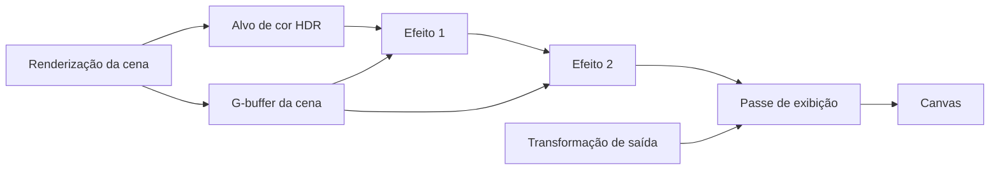
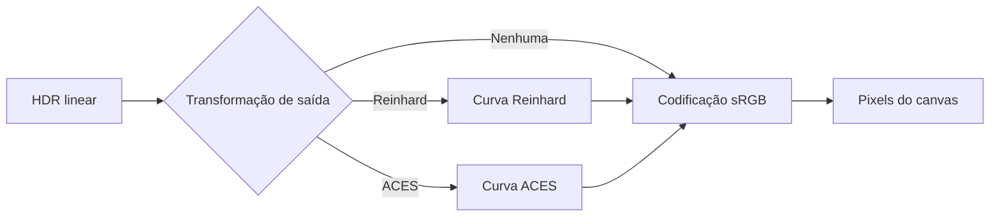

# Editor GLSL de Tela

O Editor GLSL de Tela é a bancada de trabalho da cena inteira. Em vez de
sombrear uma única malha, você escreve o estágio de fragmento de um ou mais
passes de tela cheia que rodam depois de uma cena PBR completa ser renderizada.
Isso faz dele o editor certo para efeitos que precisam da imagem inteira ou dos
dados de geometria da cena: contornos, SSAO, névoa de profundidade, cadeias de
desfoque estilo bloom, visualizadores de G-buffer e qualquer coisa que reprojete
entre quadros.

A aba **Pós-efeito** do Editor GLSL 3D também ocupa a tela, mas ela só vê uma
malha e uma imagem de cor LDR. Este editor enxerga a cena HDR original, um
G-buffer separado e o histórico de visão/projeção de que os efeitos temporais
precisam.

## O que está na tela

| Região | O que faz |
| --- | --- |
| Aba **Pós-efeito** | A pilha de efeitos e o editor do fragmento do efeito selecionado. |
| Aba **Dados do usuário** | Declara uniforms e texturas para o estágio `post`. O bloco gerado é injetado em cada passe de efeito. |
| Aba **G-Buffer** | Muda a viewport para um attachment bruto e lista o contrato exato dos attachments. |
| Menus **Cena** e **Ambiente** | Carregam uma cena GLB inteira e um HDRI. Ambos são catálogos fixos. |
| **Compilar** | Compila a pilha inteira de forma atômica. Uma falha mantém a cadeia anterior na tela. |
| **Pausar** | Interrompe o loop de renderização. `time`, `frameIndex` e `deltaTime` param de avançar enquanto pausado. |
| **Sobreposição de iluminação** | Sliders de intensidade do Sol e do HDRI. Eles mudam a renderização, não o código do seu efeito. |
| **Sobreposição de estatísticas** | FPS, tempo de quadro versus o orçamento de 16,7 ms, tamanho do buffer de desenho, draw calls e a escala de renderização adaptativa. |

## O pipeline



A cena é renderizada uma vez. A cor opaca vai para um alvo HDR, e os attachments
solicitados vão para o G-buffer em um único passe MRT. Cada passe de efeito lê o
passe anterior em `textureSampler` (o primeiro efeito lê a cena HDR), e ele
também pode ler `sceneColorTexture` para o original intocado. O passe de
exibição aplica a transformação de saída e depois a codificação sRGB exatamente
uma vez.

Os attachments só são solicitados quando um efeito compilado realmente os lê,
mais o que a visão de debug ativa precisar. Um efeito pass-through, portanto,
custa um alvo de cor simples, não um G-buffer completo.

## Os attachments do G-buffer

Todo attachment é um `sampler2D` e chega em espaço linear. As codificações fazem
parte do contrato; decodifique-as antes de fazer contas.

| Sampler | Codificação | Decodificação |
| --- | --- | --- |
| `textureSampler` | Saída do passe anterior. Para o primeiro efeito, a cor da cena HDR. | já linear |
| `sceneColorTexture` | A cor da cena HDR original, independente da pilha. | já linear |
| `depthTexture` | Profundidade linear no espaço de visão, em unidades de mundo, em `r`. O fundo é o plano distante. | `worldZ = depth` |
| `normalTexture` | Normal no espaço de visão `n * 0.5 + 0.5` em `rgb`; `a` é a máscara de geometria. | `n = normalize(rgb * 2.0 - 1.0)` |
| `albedoTexture` | Cor base linear codificada com `sqrt` em `rgb`; `a` é a máscara de geometria. | `albedo = rgb * rgb` |
| `materialTexture` | Refletividade PBR: `rgb` = F0 especular, `a` = glossiness (`1 - roughness`). | `roughness = 1 - a`; metálico a partir de F0 vs albedo |
| `velocityTexture` | Vetores de movimento lineares no espaço UV em `rg`; os valores podem ser negativos. | movimento em unidades de UV |

A máscara de geometria é o que separa "o fundo" de "uma superfície cuja normal
por acaso aponta para o outro lado". Sempre multiplique uma visão de debug
visual por `normalTexture.a` se você não quiser que o fundo acenda.

### Decodificando normais

```glsl run=screen-space
#version 300 es
precision highp float;

in vec2 vUV;

uniform sampler2D normalTexture;
uniform sampler2D depthTexture;
uniform vec2 resolution;

layout(location = 0) out vec4 fragColor;

void main(void)
{
    vec4 sampleValue = texture(normalTexture, vUV);
    vec3 normal = normalize(sampleValue.rgb * 2.0 - 1.0);

    // Mostra a normal no espaço de mundo/visão como cor e mascara o fundo.
    fragColor = vec4((normal * 0.5 + 0.5) * sampleValue.a, 1.0);
}
```

### Reconstruindo metálico e rugosidade

O Babylon armazena o workflow especular da PBR, não o metallic/roughness. O
efeito padrão e o painel do G-buffer trazem as duas funções auxiliares de que
você precisa:

```glsl
float gbufferRoughness(vec2 uv)
{
    return clamp(1.0 - texture(materialTexture, uv).a, 0.0, 1.0);
}

float gbufferMetallic(vec2 uv)
{
    vec3 f0 = texture(materialTexture, uv).rgb;
    vec3 albedo = texture(albedoTexture, uv).rgb;
    albedo *= albedo;

    float dielectric = 0.04;
    float maxF0 = max(max(f0.r, f0.g), f0.b);
    float maxAlbedo = max(max(albedo.r, albedo.g), albedo.b);
    return clamp((maxF0 - dielectric) / max(maxAlbedo - dielectric, 1e-3), 0.0, 1.0);
}
```

Elas não são variáveis da engine; são funções comuns no código-fonte do efeito
padrão. Copie-as para o seu próprio efeito se precisar delas depois de
substituir o documento inicial.

## A pilha de efeitos

A pilha é ordenada. Cada efeito ativado é um passe de fragmentos em tela cheia,
e cada passe recebe a saída do passe anterior. Use as caixas de seleção para
pular um efeito sem excluí-lo, as setas para reordenar e o menu de transformação
de saída para escolher como o passe de exibição mapeia a cor linear HDR para a
tela.

- **Nenhuma (linear para sRGB)** — sem curva de tom; útil para visualizações de
  dados.
- **Reinhard** — curva fílmica simples, boa para uma verificação rápida de
  sanidade.
- **ACES filmic** — o padrão sensato para uma cena iluminada.

Efeitos desativados não são compilados e seus uniforms não são vinculados. Uma
cadeia só é instalada quando todos os passes compilam; uma falha mantém a cadeia
anterior.

## As visões de debug

A aba **G-Buffer** e a sobreposição da viewport mudam o passe de exibição para um
attachment bruto. As visões de debug pulam a saída da pilha de efeitos, então
você pode inspecionar o que o seu shader consegue ler antes de escrevê-lo.

| Visão | O que mostra |
| --- | --- |
| Imagem final | A saída da pilha depois da transformação de saída. |
| Cor da cena | A cor opaca HDR intocada. |
| Profundidade | Profundidade linear no espaço de visão, moldada por gamma para facilitar a leitura. |
| Normal | Normal no espaço de visão como RGB, mascarada pela geometria. |
| Albedo | Cor base linear, mascarada pela geometria. |
| Rugosidade / metálico | Rugosidade em vermelho, metálico em verde, F0 médio em azul. |
| Vetores de movimento | O buffer de velocidade, ampliado para a direção ficar visível. |
| Sobreposição transparente | O alvo transparente separado, quando o pipeline o habilita. |

A entrada **Sobreposição transparente** fica oculta enquanto as superfícies
transparentes são renderizadas no passe principal; esse é o padrão atual.

## Dados do usuário no editor de tela

A tabela de Dados do usuário aqui é só de pós-efeito: cada definição é injetada
em todo passe de efeito e vinculada a cada quadro. Samplers cúbicos não são
oferecidos; use o G-buffer da cena e os cubemaps integrados se precisar de dados
de ambiente.

```glsl
// Declarado em Dados do usuário como um float de pós-efeito chamado `radius`.
uniform float radius;

void main(void)
{
    float d = texture(depthTexture, vUV).r;
    fragColor = vec4(vec3(step(d, radius)), 1.0);
}
```

Edições de valor são vinculadas na hora, sem recompilar. Adicionar, renomear ou
mudar o alvo de uma linha reconstrói o shader.

## Iluminação e a câmera

O painel **Iluminação** tem dois sliders:

- **Sol** — intensidade da luz direcional direta, de `0` a `5`.
- **HDRI** — intensidade do ambiente, de `0` a `3`.

Eles são úteis para verificar se um efeito lê a iluminação da cena ou apenas o
G-buffer. Eles não afetam os valores que o seu efeito amostra do G-buffer além
da própria renderização da cena.

A viewport é uma câmera em primeira pessoa:

- Clique na viewport para capturar o ponteiro.
- `W A S D` move, `Q`/`E` desce/sobe.
- `Shift` acelera a velocidade de movimento.
- `Esc` libera o ponteiro.

**Pausar** interrompe o loop de renderização. Use enquanto lê um quadro ou compara
duas visões de debug; a sobreposição de estatísticas congela também.

## HDR, espaço linear e a transformação de saída

Toda a renderização da cena e todos os passes de efeito são lineares. O HDRI, o
Sol e o material PBR podem produzir valores bem acima de `1.0`; é justamente
esse o ponto do HDR. O passe de exibição é o único lugar onde uma transformação
de saída e a codificação sRGB acontecem.



Consequências para o seu código:

- Não aplique `pow(color, vec3(2.2))` nem uma curva ACES dentro de um efeito, a
  menos que também defina a transformação de saída como **Nenhuma**; caso
  contrário, a imagem é transformada duas vezes.
- Mantenha os valores intermediários lineares. Um brilho especular forte pode
  ser `10.0` ou mais; escrevê-lo em um alvo LDR o limitaria antes de o passe de
  exibição vê-lo.
- As visões de debug pulam a pilha de efeitos de propósito, mas ainda passam
  pelo passe de exibição, então são codificadas do mesmo jeito que a imagem
  final.

## Resolução adaptativa

A prévia é limitada pela taxa de preenchimento: cada passe de efeito e o G-buffer
escalam com a contagem de pixels. Quando o tempo de quadro suavizado passa do
orçamento de 60 fps, o renderizador reduz a resolução interna (até 50%) e deixa o
navegador ampliar o canvas. A recuperação é lenta, só com folga de verdade. O
`%` na sobreposição de estatísticas é o fator de escala atual.

É por isso que um shader rápido a 100% pode continuar fluido enquanto você
adiciona passes: você está trocando detalhe por interatividade, não mudando o
shader. Isso também significa que comparações de tempo de quadro em escalas
diferentes não são de igual para igual.

## Limites

- Uma pilha de efeitos, um catálogo de cenas (atualmente Bistro) e um catálogo
  de HDRIs. Não há upload nem caminho para assets personalizados.
- Efeitos são só de fragmento. O estágio de vértice de tela cheia é interno.
- A pilha é linear; não há grafo de passes com ramificações ou condicionais.
- O editor não tem salvar, exportar nem compartilhar além de
  **Copiar código do shader**.
- Nada persiste entre recarregamentos: a pilha, os dados do usuário, a cena e a
  câmera são todos redefinidos.
- O alvo da sobreposição transparente fica desativado por padrão; sua visão de
  debug fica oculta enquanto isso for verdade.

## Relacionados

- [Referência da ABI](/docs/abi-reference) — todo uniform e sampler, gerados a
  partir das declarações.
- [Efeitos de pós-processamento](/docs/post-effects) — a ABI menor de
  pós-efeito de superfície.
- [Lições de pós-processamento](/docs/post-processing)
- [Depuração de shaders](/docs/debugging-shaders)
- [Limites e solução de problemas](/docs/limits-and-troubleshooting)
