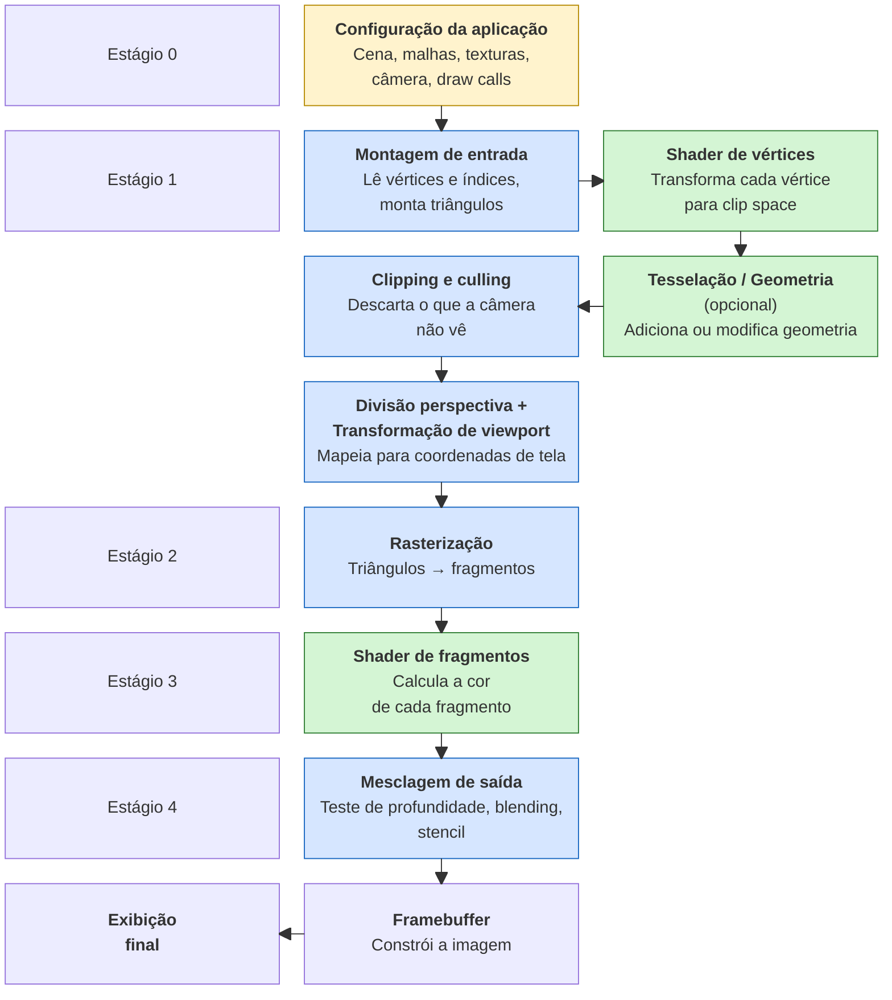
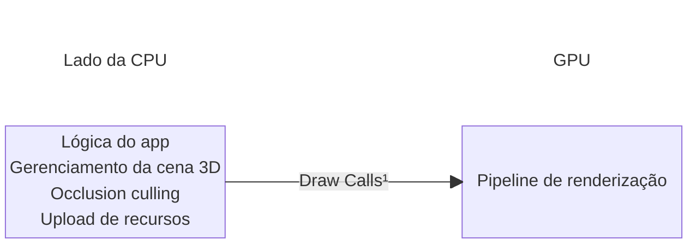
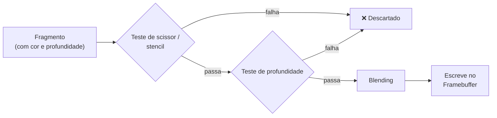
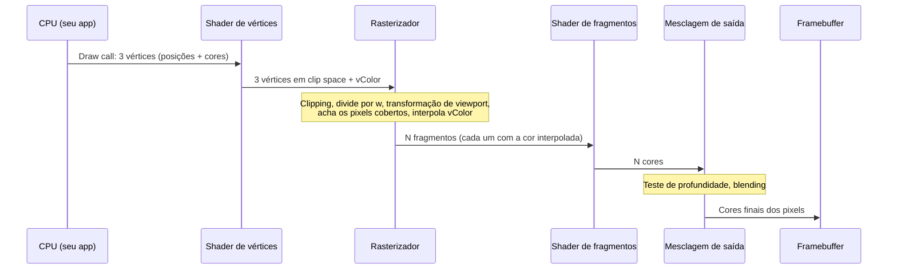

# O pipeline de renderização: dos dados 3D aos pixels da sua tela

> **Público:** estudantes do primeiro ano de computação gráfica.
> **Pré-requisitos:** programação básica, uma lembrança vaga de vetores e
> matrizes. Nada além disso.
> **Tempo de leitura:** cerca de 25 minutos.

---

## Sumário

1. [O que é um pipeline de renderização?](#1-o-que-é-um-pipeline-de-renderização)
2. [O panorama geral](#2-o-panorama-geral)
3. [Estágio 0: a aplicação (lado da CPU)](#3-estágio-0-a-configuração-da-aplicação)
4. [Estágio 1: processamento de geometria](#4-estágio-1-processamento-de-geometria)
5. [Espaços de coordenadas: a jornada de um vértice](#5-espaços-de-coordenadas-a-jornada-de-um-vértice)
6. [Estágio 2: rasterização](#6-estágio-2-rasterização)
7. [Estágio 3: processamento de fragmentos (pixels)](#7-estágio-3-processamento-de-fragmentos-pixels)
8. [Estágio 4: mesclagem de saída](#8-estágio-4-mesclagem-de-saída)
9. [Estágios programáveis vs. de função fixa](#9-estágios-programáveis-vs-de-função-fixa)
10. [Por que um pipeline? Paralelismo na GPU](#10-por-que-um-pipeline-paralelismo-na-gpu)
11. [Um exemplo mínimo: shaders](#11-um-exemplo-mínimo-shaders)
12. [Além do básico: forward, deferred e ray tracing](#12-além-do-básico-forward-deferred-e-ray-tracing)
13. [Erros comuns de iniciantes](#13-erros-comuns-de-iniciantes)
14. [Glossário](#14-glossário)
15. [Exercícios](#15-exercícios)
16. [Leitura complementar](#16-leitura-complementar)

---

## 1. O que é um pipeline de renderização?

Uma tela de computador é apenas uma grade de pontos coloridos chamados **pixels**.
Um jogo ou aplicativo 3D, por outro lado, descreve um mundo feito de **números**:
posições de pontos no espaço, triângulos que os conectam, materiais, luzes e uma
câmera.

**Renderização** é o processo de transformar essa descrição 3D em uma imagem 2D.
O **pipeline de renderização** (também chamado de *pipeline gráfico*) é a
sequência de etapas pelas quais os dados passam para que essa conversão aconteça,
dezenas ou centenas de vezes por segundo.

### A analogia da fábrica

Pense em uma fábrica de carros com uma linha de montagem:
- A estação 1 solda o chassi.
- A estação 2 pinta.
- A estação 3 instala o interior.
- A estação 4 faz a inspeção final.


Cada estação faz **um trabalho específico**, recebe a saída da estação anterior e
passa o resultado para a próxima. Enquanto o carro #1 ainda está sendo soldado, o
carro #2 já está sendo pintado, e assim por diante. Tudo funciona **em paralelo**,
e esse é o segredo do throughput.

O pipeline de renderização funciona de forma muito parecida, só que suas
"matérias-primas" são dados 3D, como **vértices** e **triângulos**, e seu produto
final são os **pixels** exibidos na tela.

```text
  Matéria-prima                                              Produto final
    (dados 3D)  ───►  [Estágio 1] ──► [ ... ] ──► [Estágio N] ───►  (uma imagem)
```

> **Ideia-chave:** um pipeline de renderização é uma *sequência de estágios*. Cada
> estágio recebe dados, transforma-os e entrega-os ao estágio seguinte.

---

## 2. O panorama geral

Aqui está o pipeline inteiro de relance. Não se preocupe com as palavras
desconhecidas ainda; vamos visitar cada caixa.


>**Legenda:**
>- 🟨 **Lado da CPU**;
>- 🟩 **Programável** — por você (shaders);
>- 🟦 **Função fixa** — (configurável, mas não programável).
---

## 3. Estágio 0: a configuração da aplicação

Antes de a GPU fazer qualquer coisa, **seu programa** (executando na **CPU**)
prepara o trabalho:

1. **Carrega os dados**: malhas (posições de vértices, normais, coordenadas UV),
   texturas, shaders.
2. **Atualiza a cena**: move objetos 3D, reproduz animações, executa a física.
3. **Decide o que desenhar**: por exemplo, pula objetos que estão claramente atrás
   da câmera (por exemplo, *frustum culling* no nível do objeto).
4. **Envia comandos para a GPU**: esses comandos são chamados de **draw calls**.

Um draw call é basicamente a frase: *"Desenhe esta malha, com este shader, estas
texturas e estas configurações."*


> **¹ Draw Calls** são funções chamadas via API (OpenGL, Vulkan, DirectX, Metal,
> WebGPU); draw calls demais podem fazer da CPU o gargalo, porque a GPU pode ficar
> ociosa esperando instruções. Esse é um dos primeiros problemas de desempenho
> que você vai encontrar.

### Como é uma malha?

Uma malha costuma ser armazenada como dois arrays:

```text
Buffer de vértices (uma entrada por vértice):
  index   position (x,y,z)      normal (nx,ny,nz)    uv (u,v)
    0     (-1.0, -1.0, 0.0)     (0,0,1)              (0,0)
    1     ( 1.0, -1.0, 0.0)     (0,0,1)              (1,0)
    2     ( 1.0,  1.0, 0.0)     (0,0,1)              (1,1)
    3     (-1.0,  1.0, 0.0)     (0,0,1)              (0,1)

Buffer de índices (grupos de 3 = um triângulo):
    0, 1, 2,    0, 2, 3        ← dois triângulos formam um quadrado (quad)
```

```text
   3 ●───────────● 2
     │ ╲         │
     │   ╲  T2   │         T1 = (0, 1, 2)
     │     ╲     │         T2 = (0, 2, 3)
     │  T1   ╲   │
     │         ╲ │
   0 ●───────────● 1
```

> **Por que triângulos?** Um triângulo é o polígono mais simples: seus três pontos
> são sempre **coplanares** (estão em um único plano), ele é sempre **convexo** e
> é fácil de rasterizar. GPUs são feitas para devorar triângulos.

---

## 4. Estágio 1: processamento de geometria

Esta fase responde: **"Onde cada vértice acaba na tela?"**

### 4.1 Montagem de entrada

A GPU lê os buffers de vértices e de índices e monta **primitivas** (normalmente
triângulos, mas também linhas ou pontos).

### 4.2 O shader de vértices (programável)

O **shader de vértices** é um pequeno programa que roda **uma vez por vértice**.
Sua missão principal é emitir a posição do vértice em **clip space**. Ele faz isso
multiplicando a posição por matrizes:

```text
clipPosition = Projection × View × Model × localPosition
               └───────── "matriz MVP" ─────────┘
```

Ele também pode fazer outras coisas: animar vértices (grama ondulando, animação
esquelética), passar dados (cores, UVs, normais) para os próximos estágios, e
assim por diante.

### 4.3 Shaders de tesselação e de geometria (opcional)

Estágios opcionais que podem **criar ou modificar geometria na GPU**: por exemplo,
subdividir uma malha grosseira em uma mais suave. Iniciantes podem ignorá-los
tranquilamente no começo.

### 4.4 Clipping e culling (função fixa)

Nem tudo o que a CPU envia ficará visível. A GPU faz isso automaticamente:

- **Faz clipping** dos triângulos contra o volume de visão da câmera (o
  *frustum*). Triângulos parcialmente fora são cortados, e novos vértices são
  criados na borda.
- **Faz culling de faces traseiras**: triângulos que apontam para longe da câmera
  (o interior de um objeto fechado) costumam ser descartados, já que você não os
  veria de qualquer forma.

```text
        Vista de topo do frustum da câmera

                     plano distante
                  ┌───────────────┐
                 ╱                 ╲
                ╱    ▲ visível      ╲
               ╱    ▲▲▲             ╲
              ╱                      ╲        ● ← fora: descartado
             ╱       ▲▲               ╲
            ╱   ▲                      ╲
           └──────────────────────────────┘ plano próximo
                     ╲          ╱
                      ╲        ╱
                       ╲      ╱
                        ╲    ╱
                         ◉ câmera
```

### 4.5 Divisão perspectiva e transformação de viewport

Duas últimas conversões transformam coordenadas de clip space em coordenadas de
pixel:

1. **Divisão perspectiva**: divida `x, y, z` por `w`. É isso que faz **objetos
   distantes parecerem menores**. O resultado se chama **NDC** (*Normalized
   Device Coordinates*), em que os pontos visíveis ficam dentro de um cubo de -1 a
   +1 (no OpenGL; Direct3D e Vulkan usam 0 a 1 para profundidade).
2. **Transformação de viewport**: escala e desloca o quadrado NDC para a janela
   real, por exemplo 1920×1080 pixels.

```text
   NDC (independente de resolução)       Tela (pixels)

      y                                   (0,0) ───────────► x
      ▲  (+1,+1)                           │
 (-1,+1)┌─────────┐                        │   1920 × 1080
      │ │    ●    │      viewport          │   ┌──────────────┐
 ─────┼─┼────┼────┼──►x   ───────►         │   │      ●       │
      │ │         │      transformação     ▼   │              │
 (-1,-1)└─────────┘ (+1,-1)                y   └──────────────┘
```

---

## 5. Espaços de coordenadas: a jornada de um vértice

Este é o conceito mais importante de todos para dominar como iniciante. Um vértice
**não** é descrito em um único sistema de coordenadas ao longo do pipeline. Ele
percorre vários **espaços**, cada um útil para um propósito diferente.

```mermaid
flowchart LR
    A["<b>Espaço local / de modelo</b><br/>Coordenadas relativas à<br/>origem do próprio objeto"]
    B["<b>Espaço de mundo</b><br/>Coordenadas na<br/>cena compartilhada"]
    C["<b>Espaço de visão / câmera</b><br/>Câmera na origem,<br/>olhando para -Z"]
    D["<b>Clip space</b><br/>Depois da projeção;<br/>homogêneo 4D"]
    E["<b>NDC</b><br/>x,y,z em [-1, 1]"]
    F["<b>Espaço de tela</b><br/>Coordenadas de pixel"]

    A -- "Matriz de modelo" --> B
    B -- "Matriz de visão" --> C
    C -- "Matriz de projeção" --> D
    D -- "÷ w" --> E
    E -- "Transformação de viewport" --> F
```




| Espaço | O que muda? | Analogia |
| ---------- | --------------------------------------------------------------------- | ------------------------------------------- |
| **Local** | O artista modelou uma cadeira com a origem no centro do assento. | Um desenho técnico da cadeira. |
| **Mundo** | Onde a cadeira fica na sala (posição, rotação, escala). | Colocar a cadeira na sala. |
| **Visão** | Tudo é reexpresso em relação à câmera. | Descrever a sala pelos olhos da câmera. |
| **Clip** | A perspectiva é aplicada (uma caixa 3D vira um *frustum*). | Como uma lente curva a visão. |
| **NDC** | Divide por `w`; tudo o que é visível cabe em um cubo padrão. | Um "quadro de foto" padronizado. |
| **Tela** | Escala para a resolução de pixels da janela. | Imprimir a foto em um tamanho dado. |


### Por que matrizes?

Mover, rotacionar e escalar podem todos ser escritos como **matrizes 4×4**.
Multiplicar matrizes combina várias transformações em uma. É por isso que os
vértices carregam **4 componentes** `(x, y, z, w)` (as chamadas *coordenadas
homogêneas*): isso permite expressar *translação* e *perspectiva* também como
multiplicações de matrizes.

```text
              ┌ m00 m01 m02 m03 ┐   ┌ x ┐
 clipPos  =   │ m10 m11 m12 m13 │ × │ y │
              │ m20 m21 m22 m23 │   │ z │
              └ m30 m31 m32 m33 ┘   └ 1 ┘
```

> **Dica:** a ordem importa! `Projection × View × Model × v` aplica Model
> **primeiro** (é o mais à direita), depois View e por fim Projection, quando se
> usam vetores coluna (a convenção do OpenGL).

---

## 6. Estágio 2: rasterização

Depois do processamento de geometria, temos triângulos descritos por três pontos em
**espaço de tela**. Mas uma tela é feita de pixels. A **rasterização** é o processo
que responde:

> *"Quais pixels este triângulo cobre?"*

Ela é executada por uma unidade de hardware de **função fixa** (o *rasterizador*).

### 6.1 Como funciona (conceitualmente)

Para cada triângulo, o rasterizador testa o **centro** de cada pixel na bounding box
do triângulo. Se o centro estiver dentro do triângulo, aquele pixel se torna um
**fragmento**: um pixel candidato a ser colorido.

Abaixo, um triângulo com vértices **A**, **B** e **C** é colocado sobre uma grade
de pixels. `#` marca os pixels cujos centros são cobertos:

```text
        0 1 2 3 4 5 6 7 8 9 10 11
     0  . A . . . . . . . . .  .
     1  . # # # . . . . . . .  .
     2  . # # # # # # . . . .  .
     3  . # # # # # # # # B .  .
     4  . # # # # # # # . . .  .
     5  . . # # # # . . . . .  .
     6  . . # # . . . . . . .  .
     7  . . C . . . . . . . .  .

     (ilustrativo: o hardware real usa funções de borda exatas)
```

Repare nas bordas em **escada** (serrilhadas). Isso é **aliasing**, uma
consequência natural de amostrar uma forma contínua com uma grade discreta.
Técnicas como **MSAA** (multisample anti-aliasing) ou **TAA** existem para
suavizá-las.

### 6.2 Como ele sabe que um pixel está dentro?

O método clássico usa **funções de borda**. Para cada uma das três arestas do
triângulo, calculamos de que lado da aresta está o centro do pixel. Se estiver no
lado "interno" das três arestas, o pixel é coberto.

```text
          C
         ╱ ╲
        ╱   ╲        P está dentro se estiver do
       ╱  P  ╲       lado esquerdo de AB, BC e CA
      ╱   ●   ╲      (para triângulos em sentido anti-horário)
     A─────────B
```

### 6.3 Interpolação: o bônus mágico

A saída do shader de vértices (cor, UV, normal...) existe apenas **nos três
vértices**. Para cada fragmento, o rasterizador calcula **coordenadas
baricêntricas** `(α, β, γ)` (três pesos que somam 1) e **interpola** esses valores:

```text
 value(P) = α · value(A) + β · value(B) + γ · value(C)
```

```text
                      C (azul)
                      ╱╲
                     ╱  ╲
                    ╱    ╲        Um pixel perto de A é quase todo vermelho,
                   ╱  ●   ╲       perto de B, quase todo verde,
                  ╱  P     ╲      perto de C, quase todo azul,
                 ╱          ╲     e, no meio, uma mistura suave.
   A (vermelho) ●────────────● B (verde)
```

Isso explica por que um triângulo com 3 vértices coloridos mostra um gradiente
suave. É também assim que **coordenadas de textura**, **normais** e todo o resto
se espalham suavemente por uma superfície.

> **Importante:** o rasterizador emite **fragmentos**, não pixels. Um *fragmento*
> é um pixel *potencial*; ele ainda pode ser descartado (por exemplo, pelo teste de
> profundidade), ou vários fragmentos podem competir pelo mesmo pixel.

---

## 7. Estágio 3: processamento de fragmentos (pixels)

### O shader de fragmentos (programável)

O **shader de fragmentos** (chamado **pixel shader** no DirectX) roda **uma vez por
fragmento**. Seu trabalho é responder: **"Qual é a cor deste fragmento?"**

É aqui que se decide a maior parte da *aparência visual* da sua cena:

- **Amostragem de textura**: ler uma cor de uma imagem usando as coordenadas UV
  interpoladas.
- **Iluminação**: combinar a normal da superfície, a direção da luz e o material
  para obter sombreamento difuso e especular.
- **Efeitos**: normal mapping, sombras, névoa, reflexões, e assim por diante.

Um cálculo de iluminação bem simples (Lambert difuso):

```text
 brightness = max(0, dot(normal, directionToLight))
 finalColor = textureColor × lightColor × brightness
```

```text
         direção da luz
              ╲  │ normal
               ╲ │
                ╲│  θ
     ─────────────●─────────── superfície

     brightness = cos(θ)   →  1 quando de frente para a luz, 0 a 90° ou mais
```

O shader de fragmentos também pode **descartar** o fragmento (útil para recortes
transparentes, como folhas) e emitir **várias cores** de uma vez (para deferred
rendering, veja a seção 12).

> **Nota de desempenho:** shaders de fragmentos rodam para *cada pixel coberto*,
> então em uma tela 4K há mais de 8 milhões deles por quadro, por camada de
> geometria! Shaders de fragmentos caros são uma causa clássica de taxa de quadros
> baixa.

---

## 8. Estágio 4: mesclagem de saída

O shader de fragmentos nos dá uma cor, mas ainda não terminamos: esse fragmento
precisa ser **mesclado** à imagem final. Este estágio é de função fixa (mas
configurável) e faz vários testes, em ordem:



### 8.1 Teste de profundidade (Z-buffer)

Como garantir que uma parede próxima esconda a montanha atrás dela,
independentemente da **ordem** em que são desenhadas? Com um **buffer de
profundidade** (Z-buffer): um array do tamanho da imagem que guarda, para cada
pixel, a **profundidade do fragmento mais próximo visto até agora**.

```text
 Para cada fragmento que chega no pixel (x, y):
     if fragment.depth < depthBuffer[x][y]:     ← está mais perto?
         depthBuffer[x][y] = fragment.depth      ← guarda a nova profundidade
         colorBuffer[x][y] = fragment.color      ← e escreve sua cor
     else:
         discard o fragmento                     ← está escondido
```

Um exemplo passo a passo para **um pixel**, com três triângulos desenhados em
ordem arbitrária:

```text
 Triângulo desenhado    Profundidade do fragmento    Buffer de profundidade antes   Resultado       Buffer de profundidade depois
 ────────────────────   ──────────────────────────   ────────────────────────────   ─────────────   ─────────────────────────────
 1. Vermelho            0.60                         1.00 (limpo)                   0.60 < 1.00 ✔   0.60   cor = vermelho
 2. Azul                0.80                         0.60                           0.80 < 0.60 ✘   0.60   cor = vermelho
 3. Verde               0.30                         0.60                           0.30 < 0.60 ✔   0.30   cor = verde
```

Cor final do pixel: **verde** (o mais próximo), independentemente da ordem de
desenho.

```text
     câmera ◉ ──────►  verde (0.30)   vermelho (0.60)   azul (0.80)
                           ▓▓▓              ▒▒▒             ░░░
                       mais próximo                    mais distante
```

### 8.2 Blending (transparência)

Para objetos translúcidos (vidro, água, partículas), a nova cor é **misturada** ao
que já está no framebuffer:

```text
 result = source.rgb × source.alpha  +  destination.rgb × (1 − source.alpha)
```

> **Atenção:** o blending depende da **ordem**. Objetos transparentes costumam ser
> desenhados *depois* dos opacos, ordenados do mais distante para o mais próximo.

### 8.3 Teste de stencil

O **stencil buffer** é uma pequena máscara de inteiros por pixel. Você pode usá-lo
para restringir o desenho a alguma região: portais, espelhos, contornos, volumes de
sombra, etc.

### 8.4 O framebuffer e o double buffering

Por fim, a cor é escrita no **framebuffer**. Para evitar mostrar uma imagem pela
metade (cintilação ou *tearing*), as GPUs usam **double buffering**:

```text
   ┌────────────┐                 ┌────────────┐
   │ Buffer     │ ──► Monitor     │ Buffer     │ ◄── a GPU desenha aqui
   │ frontal    │                 │ traseiro   │
   └────────────┘                 └────────────┘
          ▲                              │
          └────── troca quando termina ──┘
```

Enquanto o monitor exibe o buffer frontal, a GPU desenha o próximo quadro no buffer
traseiro. Quando termina, eles trocam.

---

## 9. Estágios programáveis vs. de função fixa

As primeiras GPUs (anos 1990) tinham um **pipeline de função fixa**: você só podia
alternar opções (iluminação ligada/desligada, névoa ligada/desligada). As GPUs
modernas têm **estágios programáveis** movidos por pequenos programas chamados
**shaders**.


| Estágio | Tipo | Quem controla? |
| ---------------------------- | ----------------------- | ---------------------------------- |
| Montagem de entrada | Fixo | Configurado pelo estado da API |
| **Shader de vértices** | **Programável** | **Você** (código do shader) |
| Tesselação / Geometria | Programável (opcional) | Você |
| Clipping, culling | Fixo | Configurado (por exemplo, modo de culling) |
| Divisão perspectiva, viewport | Fixo | Configurado (tamanho do viewport) |
| Rasterização | Fixo | Configurado (modo de preenchimento, MSAA) |
| **Shader de fragmentos** | **Programável** | **Você** |
| Profundidade/stencil/blend | Fixo (configurável) | Configurado (operações, funções) |


Uma regra prática para iniciantes: **você escreve o shader de vértices e o shader
de fragmentos; o hardware faz o resto.**

---

## 10. Por que um pipeline? Paralelismo na GPU

Há dois tipos de paralelismo em jogo:

1. **Paralelismo de pipeline (de tarefas)**: assim como na fábrica, estágios
   diferentes trabalham sobre dados diferentes *ao mesmo tempo*.
2. **Paralelismo de dados**: cada estágio processa *milhares de itens de uma vez*
   (vértices ou fragmentos são independentes entre si).

```text
 Tempo ─────────────────────────────────────────────────►

 Estágio:     Vértice     Raster      Fragmento    Mescla
 Lote 1:      ██████
 Lote 2:                  ██████
 Lote 1:                              ██████
 ...          (lotes diferentes estão em estágios diferentes ao mesmo tempo)

 Dentro do estágio de fragmento, milhares de núcleos executam o mesmo shader em pixels diferentes:

 núcleo 0: pixel (0,0) ─┐
 núcleo 1: pixel (1,0)  │  mesmo programa,
 núcleo 2: pixel (2,0)  ├─ dados diferentes  ("SIMT / SIMD")
 ...                    │
 núcleo N: pixel (x,y) ─┘
```

É por isso que as GPUs têm **milhares de núcleos simples**, enquanto uma CPU tem
alguns poucos muito complexos. O pipeline é projetado para que cada vértice e cada
pixel possam ser processados **independentemente**: ninguém precisa esperar por
ninguém.

> **Consequência para a programação de shaders:** uma invocação de shader não
> consegue (facilmente) olhar os resultados das vizinhas. Pense em cada invocação
> como um trabalhador isolado com seu próprio caderno particular.

---

## 11. Um exemplo mínimo: shaders

Aqui está o clássico "triângulo colorido" em **GLSL** (a linguagem de shaders do
OpenGL). Leia como uma história do que aprendemos.

### Shader de vértices (roda uma vez por vértice)

```glsl
#version 330 core

layout(location = 0) in vec3 aPosition;   // do buffer de vértices
layout(location = 1) in vec3 aColor;      // do buffer de vértices

uniform mat4 uModel;        // igual para todos os vértices deste draw call
uniform mat4 uView;
uniform mat4 uProjection;

out vec3 vColor;            // passado ao rasterizador → interpolado

void main()
{
    vColor = aColor;
    // Local → Mundo → Visão → Clip
    gl_Position = uProjection * uView * uModel * vec4(aPosition, 1.0);
}
```

### Shader de fragmentos (roda uma vez por fragmento)

```glsl
#version 330 core

in vec3 vColor;             // interpolado pelo rasterizador
out vec4 FragColor;         // vai para a mesclagem de saída

void main()
{
    FragColor = vec4(vColor, 1.0);   // RGB + alfa
}
```

### O que acontece quando você emite `glDrawArrays(GL_TRIANGLES, 0, 3)`?



Entram três vértices (vermelho, verde, azul), e sai um triângulo com um gradiente
suave de arco-íris. **O shader de vértices rodou 3 vezes. O shader de fragmentos
rodou talvez milhares de vezes.**

---

## 12. Além do básico: forward, deferred e ray tracing

Depois que o pipeline básico estiver claro, você vai encontrar estas variações
importantes:

### Forward rendering

O que descrevemos: cada objeto passa pelo pipeline inteiro e é iluminado no shader
de fragmentos. Simples e rápido com poucas luzes, mas custoso com *muitas* luzes.

### Deferred rendering

O pipeline é dividido em dois passes:


A iluminação é calculada **uma vez por pixel visível**, em vez de uma vez por
fragmento (inclusive os escondidos). Ótimo para centenas de luzes, mas mais difícil
com transparência e antialiasing.

### Ray tracing

Uma abordagem diferente: em vez de "para cada triângulo, encontre os pixels"
(*object-order*), ela pergunta "para cada pixel, dispare um raio e encontre o
triângulo que ele atinge" (*image-order*).

```text
     Rasterização                         Ray tracing
  "triângulos → pixels"                "pixels → triângulos"

   para cada triângulo:                  para cada pixel:
       para cada pixel que ele cobre:        para cada objeto:
           sombreie-o                             o raio o atinge?
```

As GPUs modernas têm hardware dedicado a ray tracing, e muitas engines usam
**hybrid rendering**: rasterizam a imagem principal e usam ray tracing para
reflexões, sombras ou iluminação global.

### Compute shaders

Os pipelines modernos também incluem **compute shaders**: programas de uso geral na
GPU, usados para sistemas de partículas, pós-processamento, culling e mais,
executando fora do pipeline gráfico propriamente dito.

---

## 13. Erros comuns de iniciantes


| Sintoma | Causa provável |
| -------------------------------------------------- | ------------------------------------------------------------------------------------------------------------------------------------------------------------------ |
| **Não aparece nada na tela** | O objeto está fora do frustum, atrás da câmera, ou tem uma matriz MVP errada; o shader não compilou; a ordem dos vértices do triângulo está invertida e ele foi descartado pelo culling. |
| **O objeto parece "do avesso"** | A ordem dos vértices está errada (horário vs. anti-horário), então as faces frontais estão sendo descartadas pelo culling. |
| **Objetos distantes se sobrepõem aos próximos** | O teste de profundidade está desativado, ou o buffer de profundidade não foi limpo no início do quadro. |
| **Superfícies cintilantes ("z-fighting")** | Duas superfícies com profundidades quase iguais; ou o plano próximo está perto demais e o plano distante longe demais (precisão de profundidade ruim). |
| **Objetos aparecem achatados** | A proporção (aspect ratio) na matriz de projeção não corresponde à da janela. |
| **A transformação faz o oposto do que você espera** | A ordem de multiplicação das matrizes está errada (matrizes *não* são comutativas). |
| **FPS baixo** | Draw calls demais (limitado pela CPU), ou shaders de fragmentos pesados / overdraw (limitado pela GPU). |


---

## 14. Glossário


| Termo | Significado |
| --------------------------- | ------------------------------------------------------------------------- |
| **Vértice** | Um ponto no espaço com atributos (posição, normal, UV, cor...). |
| **Primitiva** | A forma básica que a GPU desenha: ponto, linha ou triângulo. |
| **Malha** | Um conjunto de vértices e índices que formam um objeto. |
| **Shader** | Um pequeno programa que roda na GPU. |
| **Draw call** | Um comando da CPU pedindo que a GPU desenhe algo. |
| **Frustum** | A pirâmide truncada que representa o volume visível da câmera. |
| **Clip space** | Espaço de coordenadas depois da projeção, antes de dividir por `w`. |
| **NDC** | Normalized Device Coordinates: a área visível é um cubo padrão. |
| **Rasterização** | Converter triângulos nos fragmentos (pixels) que eles cobrem. |
| **Fragmento** | Um pixel candidato gerado pelo rasterizador. |
| **Coordenadas baricêntricas** | Três pesos que descrevem a posição de um ponto dentro de um triângulo. |
| **Z-buffer / Buffer de profundidade** | Registro por pixel da profundidade mais próxima, usado para resolver a visibilidade. |
| **Framebuffer** | A memória que guarda a imagem final (cor, profundidade, stencil). |
| **Aliasing** | Bordas serrilhadas causadas pela amostragem em uma resolução finita. |
| **Overdraw** | Sombrear o mesmo pixel várias vezes por causa de geometria sobreposta. |
| **API** | Interface de programação para a GPU: OpenGL, Vulkan, DirectX, Metal, WebGPU. |


---

## 15. Exercícios

1. **Desenhe você mesmo.** Sem olhar este artigo, esboce o pipeline de memória
   (pelo menos 6 caixas). Marque quais são programáveis.
2. **Espaços.** Um cubo é modelado com o centro em `(0,0,0)`. Você o translada
   para `(5,0,0)` na cena. Em qual espaço estão as coordenadas `(0.5, 0.5, 0.5)` e
   `(5.5, 0.5, 0.5)`, respectivamente?
3. **Contagem.** Um triângulo cobre 1.000 pixels na tela. Quantas vezes o shader de
   vértices roda? Quantas vezes (no mínimo) o shader de fragmentos roda?
4. **Buffer de profundidade.** Três fragmentos com profundidades `0.7`, `0.2`,
   `0.5` chegam nesta ordem para o mesmo pixel. Escreva o valor do buffer de
   profundidade depois de cada fragmento (valor inicial `1.0`). Qual cor vence?
5. **Interpolação.** Um triângulo tem cores de vértice vermelho `(1,0,0)`, verde
   `(0,1,0)` e azul `(0,0,1)`. Qual é a cor no centro exato do triângulo (pesos
   baricêntricos `1/3, 1/3, 1/3`)?
6. **Mão na massa.** Usando qualquer API (WebGL, OpenGL, WebGPU), renderize um
   único triângulo com uma cor por vértice. Depois mude o shader de vértices para
   que o triângulo gire com o tempo.

Respostas (clique para expandir)

2. Espaço local → `(0.5, 0.5, 0.5)`; espaço de mundo → `(5.5, 0.5, 0.5)`.
3. O shader de vértices roda 3 vezes (uma por vértice). O shader de fragmentos roda
   cerca de 1.000 vezes (uma por pixel coberto, mais se outra geometria se
   sobrepuser).
4. Depois do primeiro: `0.7`; depois do segundo: `0.2`; o terceiro (`0.5`) falha no
   teste, então o buffer fica em `0.2`. A cor do **segundo** fragmento vence.
5. `(1/3, 1/3, 1/3)`, um cinza médio.


---

## 16. Leitura complementar

- **LearnOpenGL**: uma série de tutoriais passo a passo muito amigável
  (learnopengl.com).
- **Scratchapixel**: explica a matemática por trás da rasterização e do ray tracing
  do zero.
- **Real-Time Rendering** (Akenine-Möller, Haines, Hoffman): o livro de referência
  da área.
- **Fundamentals of Computer Graphics** (Marschner & Shirley): excelente para
  primeiros cursos.
- **A trip through the Graphics Pipeline** (Fabian "ryg" Giesen): um olhar profundo
  sobre como GPUs reais implementam os estágios.
- **Khronos / Microsoft / Apple docs**: especificações oficiais de Vulkan/OpenGL,
  Direct3D e Metal.

---

## Resumo

```text
  ┌──────────────────────────────────────────────────────────────────┐
  │ 1. A CPU envia vértices, triângulos e draw calls para a GPU.     │
  │ 2. O SHADER DE VÉRTICES leva cada vértice ao clip space (MVP).   │
  │ 3. Clipping, culling, ÷w e viewport põem triângulos na tela.     │
  │ 4. A RASTERIZAÇÃO descobre quais pixels cada triângulo cobre e   │
  │    interpola os dados de vértice por ele.                        │
  │ 5. O SHADER DE FRAGMENTOS calcula a cor de cada fragmento.       │
  │ 6. A MESCLAGEM DE SAÍDA (profundidade, stencil, blending)        │
  │    decide o que é escrito no framebuffer.                        │
  │ 7. O framebuffer é exibido na tela. Repita 60+ vezes             │
  │    por segundo.                                                  │
  └──────────────────────────────────────────────────────────────────┘
```

> **Se você lembrar de apenas uma frase:** *o pipeline de renderização é uma linha
> de montagem que transforma triângulos descritos por números em pixels coloridos,
> e sua força vem de fazer isso para milhões de vértices e pixels independentes em
> paralelo.*

Bons renders! 🎨
