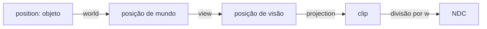

# O estágio de vértice 3D

## Objetivo

Escreva um estágio de vértice que transforme posições e normais corretamente,
encaminhe valores interpolados para o shader de fragmentos e desloque a
geometria ao longo da normal sem quebrar a iluminação.

## A cadeia MVP

Todo shader de vértices 3D termina com uma posição em clip space:

```glsl
gl_Position = projection * view * world * vec4(position, 1.0);
```

Leia da direita para a esquerda:

1. `world` move a malha do espaço de objeto para o espaço de mundo.
2. `view` leva o mundo para o espaço de visão, relativo à câmera.
3. `projection` produz o clip space.

A GPU divide por `w` e rasteriza. Você nunca faz essa divisão por conta própria.



## Normais precisam da matriz de normais

Uma normal é uma direção. Se a malha for escalada de forma não uniforme,
multiplicá-la por `mat3(world)` fornece a direção errada. A matriz de normais é
a inversa-transposta da matriz de mundo:

```glsl
vWorldNormal = normalize(normalMatrix * normal);
```

A prévia vincula `normalMatrix` como uma `mat3`. Se você apenas rotaciona e
escala uniformemente, `mat3(world)` acaba funcionando, e é por isso que o erro
costuma passar despercebido até aparecer uma malha esticada.

## Varyings

Um `out` no estágio de vértice vira um `in` no estágio de fragmento com o mesmo
nome e o mesmo tipo:

```glsl
// vértice
out vec3 vWorldPosition;
out vec3 vWorldNormal;

// fragmento
in vec3 vWorldPosition;
in vec3 vWorldNormal;
```

Os varyings são interpolados ao longo do triângulo com correção de perspectiva.
É por isso que eles costumam ser posições e normais no espaço de mundo, e não
valores em clip space.

## Deslocamento

Deslocar um vértice significa alterar `position` antes da transformação MVP.
Mova-o ao longo da normal, e não ao longo de um eixo arbitrário, para que a
superfície se expanda para fora:

```glsl
float wave = sin(position.x * 4.0 + time * 2.0) * cos(position.z * 4.0);
vec3 displaced = position + normal * wave * amplitude;

vec4 worldPosition = world * vec4(displaced, 1.0);
gl_Position = projection * view * worldPosition;
```

No exemplo, `amplitude` é um uniform de Dados do usuário no estágio de vértice.
`time` é fornecido pela ABI.

A parte difícil é a normal. A normal deslocada verdadeira depende de como a onda
varia entre vértices vizinhos. O exemplo mantém a normal original e anota a
aproximação; um shader de produção ou recalcularia essa normal a partir de
derivadas parciais (`dFdx`/`dFdy` da posição de mundo no estágio de fragmento),
ou usaria um deslocamento de frequência mais baixa, que não precisa de uma
normal exata.

## Um par completo

```glsl example=displacement title="Deslocamento de vértices (abra o exemplo para ver o par completo)"
#version 300 es
precision highp float;

// Estágio de vértice
in vec3 position;
in vec3 normal;

uniform mat4 world;
uniform mat4 view;
uniform mat4 projection;
uniform mat3 normalMatrix;
uniform float time;
uniform float amplitude;

out vec3 vWorldPosition;
out vec3 vWorldNormal;
out float vHeight;

void main(void)
{
    float wave = sin(position.x * 4.0 + time * 2.0) * cos(position.z * 4.0);
    vec3 displaced = position + normal * wave * amplitude;

    vec4 worldPosition = world * vec4(displaced, 1.0);
    vWorldPosition = worldPosition.xyz;
    vWorldNormal = normalize(normalMatrix * normal);
    vHeight = wave;

    gl_Position = projection * view * worldPosition;
}

// Estágio de fragmento
// in vec3 vWorldPosition;
// in vec3 vWorldNormal;
// in float vHeight;
// uniform vec3 lightDir;
// void main(void) { ... }
```

## Resultado esperado


As cristas ficam mais claras e os vales mais escuros porque o estágio de
fragmento mistura duas tonalidades de albedo usando `vHeight`.

## Exercícios

1. Altere a onda para depender apenas de `position.y` e descreva a direção em
   que a superfície se move.
2. Defina `amplitude` como `0.0` na aba Dados do usuário. Qual estágio ainda é
   executado, e como fica a malha?
3. Encaminhe `vHeight` para o shader de fragmentos e use-o para tingir as
   cristas. O exemplo já faz isso; altere as cores da tonalidade.
4. Substitua `normalMatrix * normal` por `mat3(world) * normal` e escale a malha
   de forma não uniforme. O que acontece com a iluminação?
5. Adicione `vUv` às saídas de vértice e repasse-o para o fragmento.

::: solution Solução 1
A onda passa a ser função da altura, então a superfície se comprime e se expande
na vertical. O deslocamento ainda é aplicado ao longo da normal de cada vértice,
e não ao longo da vertical do mundo, então o resultado segue a orientação da
superfície.
:::

::: solution Solução 2
O estágio de fragmento ainda executa; as posições dos vértices não mudam, então
a malha fica com a aparência da esfera/macaco original e a iluminação é a da
geometria não deslocada.
:::

::: solution Solução 3
`vec3 base = mix(albedo * 0.35, albedo, smoothstep(-1.0, 1.0, vHeight));`
— troque as duas cores ou adicione um terceiro `mix` com uma cor de brilho
especular.
:::

::: solution Solução 4
As normais são transformadas pela matriz errada, então uma malha esticada é
iluminada como se não estivesse esticada. Em uma escala uniforme o erro é apenas
um fator de escala, que `normalize` esconde; por isso o bug passa despercebido
com facilidade.
:::

::: solution Solução 5
Adicione `in vec2 uv;`, `out vec2 vUv;`, depois `vUv = uv;` no estágio de
vértice. No fragmento, `in vec2 vUv;` e use-o.
:::

## Erros comuns

- Esquecer `vec4(position, 1.0)`; o componente `w` precisa ser `1` para uma
  posição.
- Transformar uma normal com `world` em vez de `normalMatrix`.
- Nomes ou tipos de varying incompatíveis entre os estágios.
- Esquecer de normalizar a normal interpolada no shader de fragmentos.
- Escrever um deslocamento diretamente em `gl_Position`, ignorando a câmera.

## Próximos passos

- [Iluminação: Lambert](/docs/lighting-lambert)
- [Texturas e dados](/docs/textures-and-data)
- [A referência do Editor GLSL 3D](/docs/3d-editor)
